# Mister Download Manager

<p align="center">
  
</p>

<h3 align="center">Downloads faster than IDM. Free, forever.</h3>

<p align="center">
  <a href="https://github.com/anefzaoui/misterdownloadmanager/releases/latest"></a>
  <a href="https://github.com/anefzaoui/misterdownloadmanager/releases/latest"></a>
  <a href="https://github.com/anefzaoui/misterdownloadmanager/releases/latest"></a>
</p>

<p align="center">
  Windows 10 and 11 · macOS (Apple Silicon and Intel) · Linux (Ubuntu, Debian, Mint, Fedora, openSUSE, Arch and more)<br>
  86 languages · no ads, no trial, no sign-up
</p>

<table align="center">
  <tr>
    <td align="center" width="210"><h1>5×</h1><b>Faster</b><br><sub>a 1 GB file: 1 s instead of 5.5 s</sub></td>
    <td align="center" width="210"><h1>+46</h1><b>More languages</b><br><sub>86 instead of IDM's 40</sub></td>
    <td align="center" width="210"><h1>100%</h1><b>Cheaper (free!)</b><br><sub>no licence, no trial, ever</sub></td>
    <td align="center" width="210"><h1>Torrent</h1><b>Supported fully</b><br><sub>magnet links, .torrent files, seeding</sub></td>
  </tr>
</table>

<p align="center">
  <picture>
    <source media="(prefers-color-scheme: dark)" srcset="docs/images/main-dark.png">
    
  </picture>
</p>

<p align="center">
  <a href="https://github.com/anefzaoui/misterdownloadmanager/releases/latest"></a>
  <a href="https://github.com/anefzaoui/misterdownloadmanager/releases"></a>
  <a href="https://github.com/anefzaoui/misterdownloadmanager/actions/workflows/ci.yml"></a>
  
  <a href="LICENSE"></a>
</p>

| 🚀 [Download](#download) | ⚡ [Why switch](#why-switch-from-idm) | 🖼️ [Screenshots](#screenshots) | ✨ [Getting started](docs/getting-started.md) | 📜 [Help and tutorials](docs/README.md) |
| --- | --- | --- | --- | --- |

## Why switch from IDM?

**Same window you know. Your downloads finish sooner. And it costs nothing.**

<p align="center">
  <picture>
    <source media="(prefers-color-scheme: dark)" srcset="docs/images/races-dark.svg">
    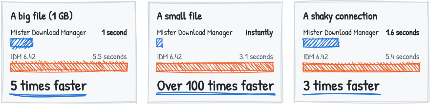
  </picture>
</p>

<!-- compare:start -->
| | Mister Download Manager | IDM 6.42 |
| --- | --- | --- |
| Download a big file (1 GB) | **1 second** | 5.5 seconds |
| Download a small file | **instantly** | 3.1 seconds |
| Download over a shaky connection | **1.6 seconds** | 5.4 seconds |
| Wait before a download starts | **instantly** | 3.1 seconds |
| Price | **Free, forever** | Paid, after a 30-day trial |
| Ads, nag screens, sign-up | **None** | Registration needed |
| Open source | **Yes** (GPL) | No |
<!-- compare:end -->

Nothing new to learn: the toolbar, the categories, the list of downloads, the progress window and
the browser button are where you expect them. Measured on the same computer, same files, both
programs at their default settings ([how we measured](#the-benchmark-in-detail)).

## Download

<p align="center">
  <a href="https://github.com/anefzaoui/misterdownloadmanager/releases/latest"></a>
  <a href="https://github.com/anefzaoui/misterdownloadmanager/releases/latest"></a>
  <a href="https://github.com/anefzaoui/misterdownloadmanager/releases/latest"></a>
</p>

On the [download page](https://github.com/anefzaoui/misterdownloadmanager/releases/latest), pick
one:

| File | Choose it when |
| --- | --- |
| **`...-setup.exe`** | **Not sure? Take this one.** It installs MDM, connects it to your browser and asks your language. |
| `...-portable.zip` | You want MDM on a USB stick or without installing: unzip and run. Everything stays in its folder. |
| `...-x64.zip` | You want the plain programs without an installer. |
| `...-extension-chromium.zip`, `...-extension-firefox.xpi` | You want only the browser extension (the setup already includes it): Chrome, Edge, Brave, Opera, Vivaldi, or Firefox. |

> [!NOTE]
> Windows may say *"Windows protected your PC"* the first time, because this early version isn't
> code-signed yet. Click **More info**, then **Run anyway**.

### On a Mac or Linux? Be the first to try it

Fresh builds for **macOS** (Apple Silicon and Intel) and **Linux** are on the same download page,
marked `-experimental`: they're brand new and we haven't tried them ourselves yet. Give them a go
and [tell us how it went](https://github.com/anefzaoui/misterdownloadmanager/issues/new); you'll
help make them as solid as the Windows version.

| File | For |
| --- | --- |
| `...-macos-universal-experimental.dmg` | Mac. Open it and drag MDM to Applications. The first time, right-click the app and choose **Open**. |
| `...-linux-x86_64-experimental.AppImage` | Any Linux. Make it executable and run it. |
| `...-linux-x86_64-experimental.deb` | Ubuntu, Debian, Mint, Pop!_OS. |
| `...-linux-x86_64-experimental.rpm` | Fedora, openSUSE, RHEL. |
| `...-linux-x86_64-experimental.tar.gz` | The plain programs, for any distro. |

## 🌍 In your language

Every language Windows 11 offers, **86 in all**. MDM asks on its first start, and you can change
it any time in **View → Language**. Arabic, Hebrew, Persian, Urdu and Uyghur get a fully mirrored,
right-to-left window.

<!-- languages:start -->
<p align="center">


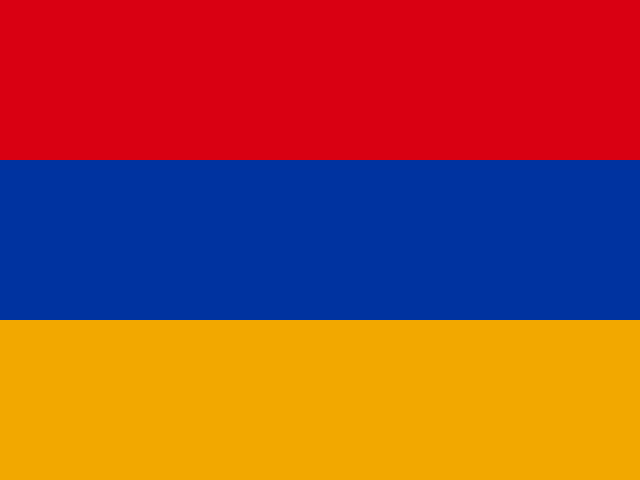


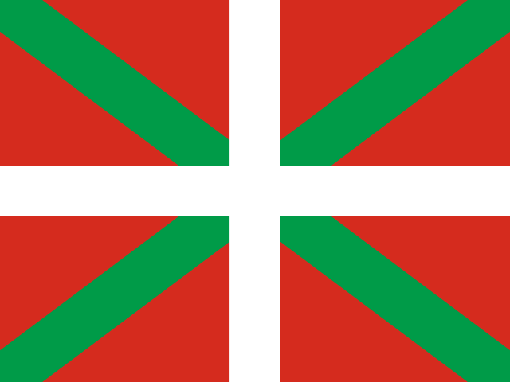


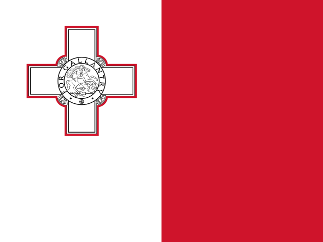


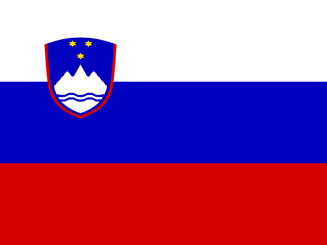


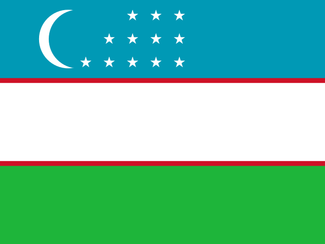


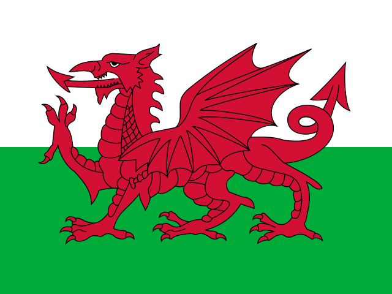
</p>
<!-- languages:end -->

## Screenshots

<table>
  <tr>
    <td width="50%">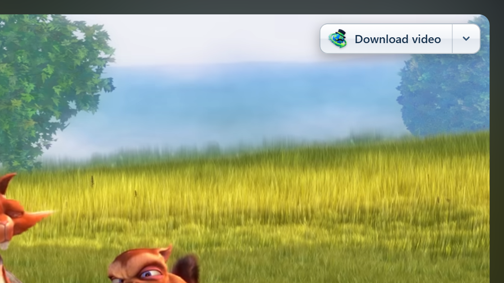<br><sub><b>One click on YouTube</b>: the Download video button appears over the video.</sub></td>
    <td width="50%">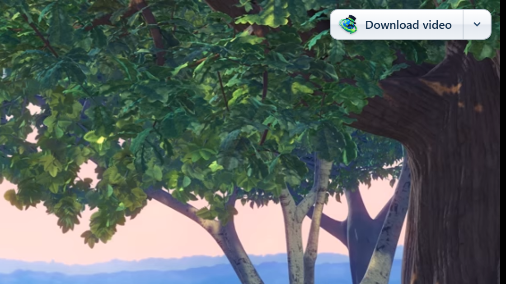<br><sub><b>Any video on any page</b>: drag the button where you like, it stays there.</sub></td>
  </tr>
  <tr>
    <td width="50%"><br><sub><b>Watch it fly</b>: every connection's share of the file, live speed and time left.</sub></td>
    <td width="50%"><br><sub><b>Dark mode</b> that follows Windows.</sub></td>
  </tr>
  <tr>
    <td><br><sub><b>Add a download</b>: paste a link, or let MDM catch it from your browser.</sub></td>
    <td>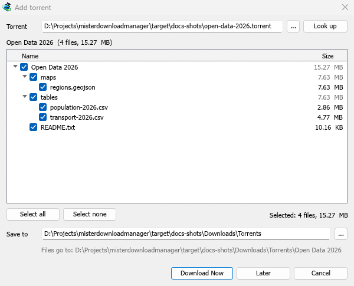<br><sub><b>Torrents and magnet links</b>: pick the files you want, skip the rest.</sub></td>
  </tr>
  <tr>
    <td>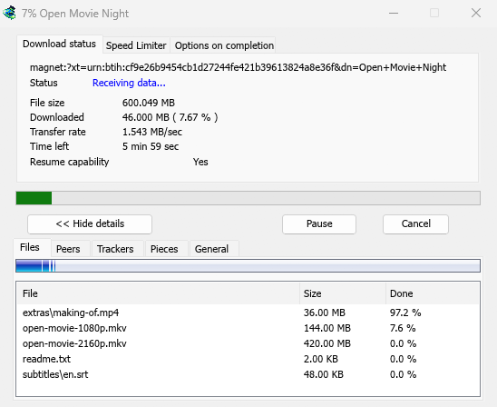<br><sub><b>A torrent's progress</b>: its files, peers, trackers and pieces, in tabs.</sub></td>
    <td><br><sub><b>A video's progress</b>: speed and time left while yt-dlp brings it in.</sub></td>
  </tr>
  <tr>
    <td><br><sub><b>86 languages</b>, chosen by flag on the first start.</sub></td>
    <td><br><sub><b>Right to left</b> for Arabic, Hebrew, Persian, Urdu and Uyghur.</sub></td>
  </tr>
  <tr>
    <td>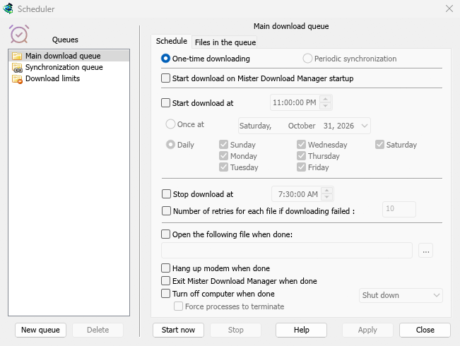<br><sub><b>Download overnight</b>: queues that start and stop on their own.</sub></td>
    <td><br><sub><b>Options</b> where you expect them, every control working.</sub></td>
  </tr>
</table>

## What it does

- **Speeds up every download** by fetching parts of the file at the same time, and keeps
  re-balancing until the last byte.
- **Resumes** after a crash, a restart or a dropped connection, without starting over.
- **Catches downloads from Chrome, Edge and Brave** (Firefox in testing), and gives them back to
  the browser when MDM isn't running.
- **Downloads videos** from web pages (a button appears over the video), and **torrents and magnet links**.
- **Downloads overnight** with queues and a scheduler, then shuts the computer down if you like.
- **Works from scripts too**: IDM's command-line switches, a command-line tool, and a local API for other programs ([how](docs/command-line.md)).
- **Works with your AI assistant**: an MCP server lets Claude, Cursor or VS Code list, add, pause and remove your downloads ([set it up](docs/ai-assistants.md)).
- **Leaves you some speed**: limit one download or all of them, only while you're at the computer.
- **Day and dark mode**, 86 languages, and a portable version for USB sticks.
- **No ads, no trial, no account**. Free and open source.

Step by step: [your first download](docs/guide-first-download.md) ·
[catch every browser download](docs/guide-catch-browser-downloads.md) ·
[download overnight](docs/guide-download-overnight.md) ·
[download a video](docs/guide-video-from-page.md) · [all help pages](docs/README.md)

---

## The benchmark in detail

Both programs downloaded the same files from the same local test server
([labserver](crates/labserver)), with the network trouble each scenario names: seven runs each,
both at their default settings. MDM finished first in **all seven scenarios**; every difference is
statistically significant (Mann-Whitney p < 0.001), and MDM used less CPU in every one.

<p align="center">
  <picture>
    <source media="(prefers-color-scheme: dark)" srcset="docs/images/bench-time-dark.svg">
    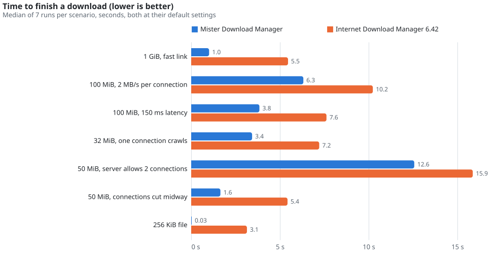
  </picture>
</p>

On a server that allows only two connections, MDM used 2 and still finished first; IDM opened 480.
The full table, the machine and the raw data: [docs/bench/run5/REPORT.md](docs/bench/run5/REPORT.md).
The harness is in [tools/bench](tools/bench), so anyone can run it again.

## Not a reverse-engineering project

MDM is an independent, clean-room program. It is a new implementation of a familiar way of
working, not a copy of anyone's software.

- **No one else's code or assets.** It contains no code, binaries, artwork, icons, sounds or
  text from Internet Download Manager, nor code from any other download manager. The app icon
  was made for MDM with ChatGPT (OpenAI's image generation); the other icons come from openly
  licensed sets ([ATTRIBUTION.md](ATTRIBUTION.md)).
- **Nothing taken apart.** No IDM file was ever disassembled, decompiled, debugged, patched or
  inspected below its user interface, and its licensing, trial and registration were never
  touched or bypassed.
- **Learned as a user learns.** What MDM does was learned from IDM's public documentation and
  help pages, its public screenshots, and by using a licensed copy as a black box: downloading
  test files from our own test server ([labserver](crates/labserver)) and watching what reached
  the network and the screen.
- **Built on public standards.** The download engine follows the HTTP specifications (RFC 9110,
  RFC 9112) and was designed, tested and measured independently. Its speed comes from its own
  design, which the benchmark shows.
- **Not affiliated.** MDM isn't affiliated with, endorsed by or connected to Tonec Inc.
  "Internet Download Manager" and "IDM" are trademarks of their owner, named here only to
  describe the layout people already know and to compare the two programs.

## For developers

<details>
<summary><b>Build from source</b></summary>

Requires Rust stable 1.95 or later (the MSVC toolchain on Windows).

```
cargo build --release
cargo test
```

This makes `misterdownloadmanager.exe` (the app), `misterdownloadmanager-cli.exe` (headless
command line), `misterdownloadmanager-mcp.exe` (the MCP server for AI assistants) and
`misterdownloadmanager-nmhost.exe` (the browser host) in `target\release\`.
`tools\installer\build.ps1` builds the installer and both zips into `target\dist\` (needs
[Inno Setup 6](https://jrsoftware.org/isinfo.php)); a `vX.Y.Z` tag does the same on GitHub
Actions and publishes the release.

Browser integration from a build: register the native messaging host with
`target\release\misterdownloadmanager-nmhost.exe --register` (undo with `--unregister`), then in
`chrome://extensions` or `edge://extensions` turn on Developer mode, **Load unpacked** and pick
the `extension/` folder (its ID is always `oogbclbbninliongijffeeggalppliok`).

</details>

<details>
<summary><b>Layout and tools</b></summary>

A Cargo workspace (edition 2024); [docs/ARCHITECTURE.md](docs/ARCHITECTURE.md) explains how the
pieces fit.

| Crate | What it is |
|---|---|
| [`mdm-engine`](crates/engine) | The download engine: segmentation, connections, resume, limits |
| [`mdm-app`](crates/app) | The Windows app (egui) |
| [`mdm-cli`](crates/cli) | Headless downloads from the command line |
| [`mdm-mcp`](crates/mcp) | The MCP server, for AI assistants |
| [`mdm-nmhost`](crates/nmhost) | The browser's native messaging host |
| [`mdm-ipc`](crates/ipc) | Talking to a running app; shared capture rules |
| [`mdm-tools`](crates/tools) | yt-dlp and ffmpeg for video pages |
| [`mdm-torrent`](crates/torrent) | BitTorrent through librqbit |
| [`mdm-labserver`](crates/labserver) | An HTTP test server with fault injection, for tests and benchmarks |

| Tool | What it does |
|---|---|
| `tools\dev\check-cross.ps1` | Checks the code for Linux and macOS from Windows (with [Zig](https://ziglang.org) as the C compiler) |
| `node tools/extension/e2e.mjs` | The browser extension in real Chrome, Brave, Edge and Firefox, headless: a link's download must reach MDM |
| `python tools/i18n/extract.py` | Lists every interface text in `i18n/en.tsv` (CI checks it matches the code) |
| `python tools/i18n/translate.py` | Translates what the catalogs lack (checks every row in code) |
| `python tools/installer/languages.py` | The installer's messages in every language |
| `node tools/readme/build.mjs` | This page's pictures, comparison table and flags, from the benchmark data |
| `tools\lab\docs-shots.ps1` | The screenshots, from a separate test instance (`/show <window>` opens each window), off the screen |
| `tools\lab\progress-shots.ps1` | The progress window of a video (yt-dlp) and of a torrent, from a swarm on this computer (`cargo run -p mdm-torrent --example swarm`) |
| `python tools/website/build.py --serve` | misterdownloadmanager.com into `target/site` (help pages from `docs/`, news from the CHANGELOG, FAQ and legal pages from `website/content/`), served on http://127.0.0.1:8765; GitHub Pages publishes it (`pages.yml`) |
| `python tools/readme/social.py` | The repository's social preview card (`docs/images/social-preview.png`) |
| `MDM_FIT_AUDIT=<file>` | Lists every text that doesn't fit its window or runs over another, for checking a translation |
| `MDM_OFFSCREEN=1` | Opens every window off the screen, without focus, tray icon or sound (screenshots and checks) |

</details>

## Status and helping out

MDM is an early preview: the engine and the main window are solid, some corners are
"good enough for now".

- **Translations are machine-made.** Rows marked `#, machine` in [`i18n/`](i18n) wait for a
  native speaker; fixing one is a one-line pull request ([how](docs/languages.md)).
- Not yet: code signing, Firefox out of testing. The macOS and Linux builds are untested.

Bug reports and ideas are welcome in
[Issues](https://github.com/anefzaoui/misterdownloadmanager/issues): **Help → Report a problem**
in the app fills in your version and Windows. Pull requests are accepted under the same licence: start with [CONTRIBUTING.md](CONTRIBUTING.md).

## Licence and credits

Copyright (c) 2026 Ahmed Nefzaoui. Mister Download Manager is free software under the
[GNU General Public License, version 3](LICENSE) or (at your option) any later version.

Built on [egui](https://github.com/emilk/egui) through
[storytold's forks](https://github.com/storytold/egui) and
[storytold/craft-libs](https://github.com/storytold/craft-libs) (MIT OR Apache-2.0),
[librqbit](https://github.com/ikatson/rqbit) (Apache-2.0) and
[yt-dlp](https://github.com/yt-dlp/yt-dlp) (Unlicense, run as a separate program). Flags from
[flag-icons](https://github.com/lipis/flag-icons) (MIT); pictures drawn with
[rough.js](https://roughjs.com/) (MIT) in [Patrick Hand](https://fonts.google.com/specimen/Patrick+Hand)
(SIL OFL) and [Vega-Lite](https://vega.github.io/vega-lite/) (BSD-3). Bundled icons and artwork
keep their own licences, listed in [ATTRIBUTION.md](ATTRIBUTION.md).
