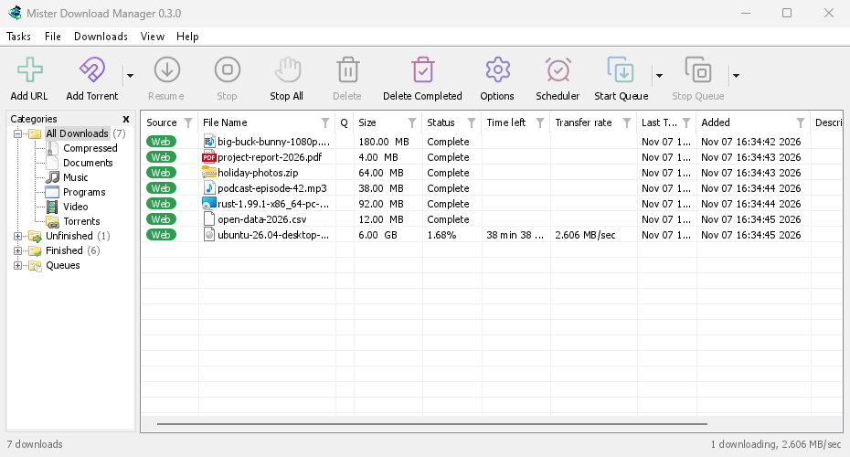

# Mister Download Manager — documentation

Mister Download Manager (MDM) is a free download manager for Windows and Linux (and, still experimental, macOS). It is laid out the way Internet Download Manager users expect: a toolbar, categories on the left, one list of downloads and a browser extension that hands downloads to it.

These pages explain each part of the program. The tutorials walk through the things people do most, one task each.

## Start here

- **[Getting started](getting-started.md)** — install MDM (setup, portable or zip on Windows; the packages on Linux; the .dmg on a Mac), choose a language and find your way around the main window.
- **[Your first download](guide-first-download.md)** — a two-minute walk-through from copied link to opened file.

## Downloading

- **[Adding downloads](adding-downloads.md)** — Add URL, the clipboard, the drop target, batch downloads and lists of links, and Start Download versus Download Later.
- **[Link grabber and archives](link-grabber.md)** — many links at once, in packages; zip, 7z and rar archives extracted when they are downloaded.
- **[Browser integration](browser-integration.md)** — the extension for Firefox (from addons.mozilla.org), Chrome, Edge, Brave, Opera, Vivaldi and Helium (from the Chrome Web Store), which downloads it takes, and what happens when MDM isn't running.
- **[Run MDM on a server](server.md)** — MDM without a window on a home server or NAS (Docker, Unraid), downloading into its folders; send it downloads from your phone or browser.
- **[Control MDM from your phone](remote-control.md)** — add links, magnets and torrents from a phone or another computer at home, and watch and control the list.

## Organising

- **[The download list](download-list.md)** — columns, filters, the categories tree, selecting many downloads, finding one, and deleting downloads with or without their files.
- **[Queues and the Scheduler](queues-and-scheduler.md)** — run downloads a few at a time, start and stop them by the clock, and turn the computer off when they are done.

## Speed and connections

- **[Connections and speed](connections-and-speed.md)** — the progress window, how MDM splits a file over several connections, resuming, and the Speed Limiter.

## Video and torrents

- **[Video downloads](video.md)** — download a video from its page (YouTube, Vimeo and many more) with yt-dlp.
- **[Image galleries](galleries.md)** — download a gallery's pictures (Wikimedia Commons, Flickr, DeviantArt and many more) with gallery-dl.
- **[Torrents](torrents.md)** — magnet links and .torrent files, choosing files, and sharing.
- **[Torrents and your security](torrent-security.md)** — what others can see, the network switches, blocklists, proxies.
- **[Debrid service accounts](debrid.md)** — Real-Debrid, AllDebrid, Premiumize and TorBox: file-host links through your own account.

## Settings

- **[Options](options.md)** — every page of the Options window.
- **[Themes](themes.md)** — the built-in looks (Classic, Native, High contrast, Metro, Adwaita, Breeze, Luna, Aero, Aqua, Emerald), and how to make your own in a text file.
- **[Languages](languages.md)** — the 86 interface languages, numbers and dates, right-to-left layouts, and how to help translate.
- **[Portable mode](portable.md)** — run MDM from a folder or a USB stick without installing it.
- **[Keyboard shortcuts](keyboard-shortcuts.md)** — every key the main window answers, and screen readers.
- **[Command line and automation](command-line.md)** — IDM's command-line switches, the `misterdownloadmanager-cli` tool, and the automation API other programs can use.
- **[AI assistants (MCP)](ai-assistants.md)** — let Claude, Cursor, VS Code or another MCP assistant list, add, pause and remove your downloads.

## Tutorials

- **[Download a file](guide-first-download.md)** — copy a link, add it, open the file.
- **[Catch downloads from your browser](guide-catch-browser-downloads.md)** — set up the extension so clicked downloads go to MDM.
- **[Download overnight](guide-download-overnight.md)** — queue files and let the Scheduler start them at night.
- **[Resume a broken download](guide-resume-broken-download.md)** — continue after a cut connection, a crash or an expired link.
- **[Keep some speed for everything else](guide-keep-speed-for-everything-else.md)** — cap MDM so browsing and calls stay smooth.
- **[Download a video from a page](guide-video-from-page.md)** — pick a quality and save a video.
- **[Carry MDM on a USB stick](guide-usb-stick.md)** — the portable copy, with downloads saved to the stick.
- **[Find a download in a long list](guide-find-in-long-list.md)** — Find, Find Next and column filters.

## Help

- **[Crash reports](crash-reports.md)** — what the crash report window shows when MDM closes unexpectedly or stops responding, what a report contains, and how to send it.
- **[Troubleshooting](troubleshooting.md)** — what to check when a download fails, the browser doesn't hand over a download, or a schedule doesn't start.
- **[The browser and MDM aren't connected](browser-help.md)** — what the extension's red **!** means, reason by reason, and how to fix each.
- **[Releases](https://github.com/anefzaoui/misterdownloadmanager/releases)** — download the latest version.
- **[Report a problem](https://github.com/anefzaoui/misterdownloadmanager/issues/new/choose)** — or use **Help → Report a problem** in MDM, which fills in your version, system and how MDM was installed for you.

---

> Screenshots in these docs show Windows and the light theme unless noted; on the website each has its dark version beside it. MDM follows the system's dark mode: when Windows (or your desktop) is set to dark, MDM is dark too.
