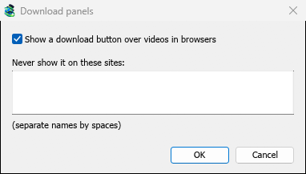

# Browser integration

[← Back to docs index](README.md)

With the MDM extension, clicking a download link in your browser hands the download to MDM. MDM gets the address together with the page it came from (the referrer), your cookies for the site and the browser's User-Agent, so downloads that need you to be signed in still work.

The extension works in **Google Chrome**, **Microsoft Edge** and **Brave**. **Firefox** support is still being tested.

## Set it up

Browser integration has two parts: a small helper program that the browser talks to, and the extension itself.

1. Install MDM with the setup and keep **Set up browser integration (Chrome, Edge, Brave, Firefox)** ticked. This registers the helper. (The portable copy can't do this; see [Portable mode](portable.md).)
2. Load the extension in each browser you use, as below. The extension's files are in the `extension` folder where MDM is installed: `%LOCALAPPDATA%\Programs\Mister Download Manager\extension` if you installed it for yourself, or `Program Files\Mister Download Manager\extension` if you installed it for everyone. Every release also has them as their own downloads: `...-extension-chromium.zip` (Chrome, Edge, Brave, Opera, Vivaldi; unzip it first) and `...-extension-firefox.xpi`.

### Chrome, Edge and Brave

1. Open the extensions page: `chrome://extensions`, `edge://extensions` or `brave://extensions`.
2. Turn on **Developer mode**.
3. Click **Load unpacked** and choose the `extension\chromium` folder.

**Mister Download Manager Integration Module** appears in the list. Leave it turned on.

### Firefox

Firefox 128 or later is needed.

1. Open `about:debugging` and click **This Firefox**.
2. Click **Load Temporary Add-on** and choose `extension\mdm-firefox.xpi`.

Firefox removes a temporary add-on when it closes, so you have to load it again after each restart.

### From the plain zip

The `-x64.zip` copy has no installer, but you can register the helper yourself. Open a command prompt in MDM's folder and run:

```
misterdownloadmanager-nmhost.exe --register
```

This is for your Windows account only. `--unregister` undoes it. Then load the extension as above, from the zip's `extension` folder.

## What it takes

When you click a download, the extension checks MDM's Options:

- **Options → General → Use advanced browser integration** must be on. Turn it off to send nothing to MDM.
- **Options → General → Capture downloads from the following browsers** must have your browser ticked.
- **Options → File types → Automatically start downloading the following file types** must list the file's type. The list starts with the usual ones: ZIP, RAR, 7Z, EXE, MSI, ISO, MP3, MP4, MKV, PDF and many more.
- **Options → File types → Don't start downloading automatically from the following sites** must not list the site. Names are separated by spaces, and `*` matches any part, as in `*.update.microsoft.com`.

Everything else stays with the browser. Changes in Options reach the browser within a minute; you don't need to restart it.

When MDM takes a download, the browser's own copy is cancelled and removed from the browser's download list. **Download File Info** opens in MDM (unless you turned it off in **Options → Downloads**). Cancelling there doesn't hand the download back to the browser.

Downloads from a private window use that window's cookies, never the normal ones.

## Right-click: Download with Mister Download Manager

Right-click a link, a video, a sound or a picture and choose **Download with Mister Download Manager**. MDM downloads it whatever its type: you asked for it, so the file types list and the excluded sites don't apply here (they only decide which downloads MDM takes over by itself).

## The download button over videos


Point at a video on a web page and a small **Download video** button appears at its edge. Click it and MDM's **Download video from a page** window opens for that page and looks up the qualities it can download (the same as pasting the page's address there). It works for embedded players too: a video from another site in a page is downloaded from that site.

It stays out of the way: it shows only while you point at a video (or the video has the keyboard's focus), fades when the pointer rests, and leaves out small videos and muted looping clips (animated pictures, backgrounds). In fullscreen it follows the video when the player allows it.

- **Move it**: drag it anywhere along the video's edge; it snaps to the nearest edge and stays there on that site.
- **Its menu** (the arrow next to it): **Hide on this video**, **Never on** the site (MDM remembers the site), and **Button settings...**, which opens MDM's Options.
- **Turn it off, or see the sites it stays off**: **Options → General → Customize MDM Download panels in browsers → Edit...**.



The button follows the rest of the integration: it doesn't show when **Use advanced browser integration** is off or the browser is unticked.

## Keys to force or prevent capture

MDM doesn't have keys yet that force a download to MDM or keep it in the browser while you click. The **Keys...** button in **Options → General** is greyed for that reason.

To keep a site's downloads in the browser, add the site to **Don't start downloading automatically from the following sites**. To keep a file type in the browser, take it off the file types list.

## When MDM isn't running

You don't need to start MDM first. When the browser hands over a download and MDM isn't running, the helper starts it and passes the download on.

If MDM can't be reached at all (it was uninstalled, or the helper isn't registered), the extension resumes the download in the browser. Nothing is lost.


## Next steps

- [Tutorial: catch downloads from your browser →](guide-catch-browser-downloads.md)
- [Change which file types MDM takes →](options.md)
- [If the browser doesn't hand downloads over →](troubleshooting.md)
