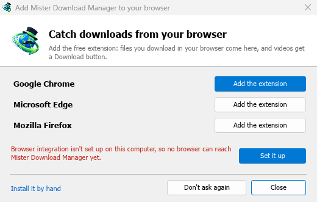
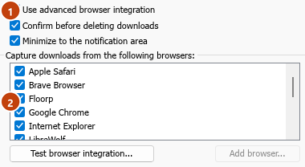
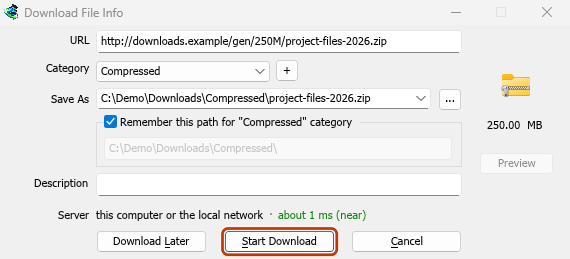
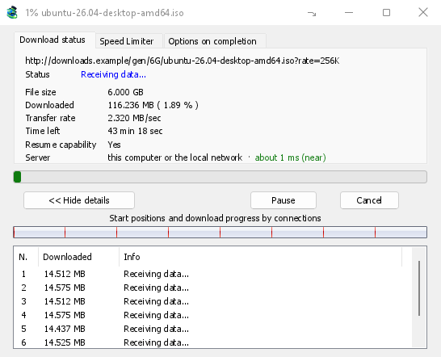
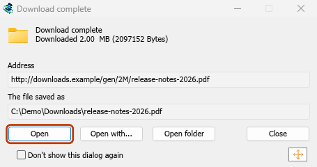
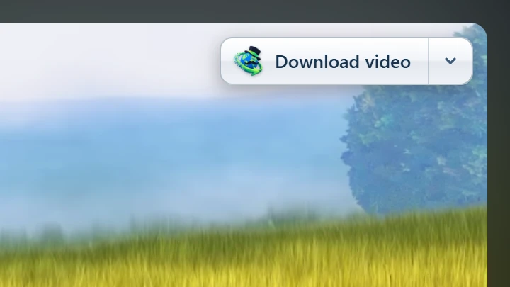
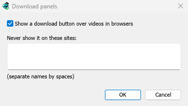
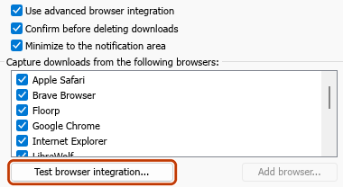

# Browser integration

[← Back to docs index](README.md)

With the MDM extension, clicking a download link in your browser hands the download to MDM. MDM gets the address together with the page it came from (the referrer), your cookies for the site and the browser's User-Agent, so downloads that need you to be signed in still work. It also gets the address the browser's own download had reached: when a site refuses MDM the link itself (a one-time link the browser has already used, or a site that lets only browsers ask for its links), MDM goes on from there once, without your cookies if it is another site. When a site's bot check (Cloudflare's, for one) or its refusal of programs (FileHippo's *412 Precondition Failed*) turns MDM's own connection away, MDM asks once more connecting the way your browser does (the same handshake, settings and order of headers), with your browser's User-Agent and its cookies for that site only, and downloads on that one connection; your proxy, network adapter and speed limits apply as usual. It solves no challenge: a site that still wants one answered refuses again, and MDM says *this site lets only browsers through*; Alt+click the link to leave the download to the browser.

The extension works in **Google Chrome**, **Microsoft Edge**, **Brave**, **Opera** and **Vivaldi**, in **Firefox** 140 or later, and in **Safari** 17 or later on a Mac (see [Safari](#safari-macos)).

Browsers built on them work too: Chromium and Helium take the extension as Chrome does, Brave Origin as Brave does, Zen and LibreWolf as Firefox does. On Windows, Zen has a bug of its own (see [The browser and MDM aren't connected](browser-help.md#not-installed)).

## Set it up

Browser integration has two parts: a small helper program that the browser talks to, and the extension itself.

1. Install MDM with the setup and keep **Set up browser integration (Chrome, Edge, Brave, Firefox)** ticked. This registers the helper. (The portable copy can't do this; see [Portable mode](portable.md).) On Linux and macOS MDM registers it itself, each time it starts, for the browsers installed then.
2. Add the extension to each browser you use, as below: Firefox from its add-ons store, the others from the Chrome Web Store. Until a browser's extension has reached MDM, MDM's **Add Mister Download Manager to your browser** window opens at each start: it lists the browsers it found, and **Add the extension** opens the store's page in that browser. **Install it by hand** opens the steps for loading it without the store; **Don't ask again** stops the window.


*MDM's own window opens each browser's store page for you.*

### Firefox

Firefox 140 or later is needed. Install the add-on from its page on addons.mozilla.org, [Mister Download Manager](https://addons.mozilla.org/firefox/addon/mister-download-manager/): click **Add to Firefox**. Firefox keeps it updated. Zen and LibreWolf install it from the same page. (MDM's **Add Mister Download Manager to your browser** window opens that page for you.)

### Chrome, Edge, Brave, Opera and Vivaldi

Install the extension from its page in the Chrome Web Store, [Mister Download Manager](https://chromewebstore.google.com/detail/mister-download-manager/ejoleppdfgjdndddcjoehopknmlglojp): click **Add to Chrome**. In Edge the button is **Get**: Edge first asks to **Allow extensions from other stores** (click **Allow**), then **Add extension**. The browser keeps it updated. MDM's **Add Mister Download Manager to your browser** window opens that page in each browser for you, and Chrome may offer it by itself at its next start once MDM is installed.

To load it by hand instead (a browser that can't use the store, or a build of your own): its files are in the `extension` folder where MDM is installed: `%LOCALAPPDATA%\Programs\Mister Download Manager\extension` if you installed it for yourself, or `Program Files\Mister Download Manager\extension` if you installed it for everyone. Every release also has them as their own download, `...-extension-chromium.zip` (unzip it first).

1. Open the extensions page: `chrome://extensions`, `edge://extensions` or `brave://extensions`.
2. Turn on **Developer mode**.
3. Click **Load unpacked** and choose the `extension\chromium` folder.

**Mister Download Manager** appears in the list. Leave it turned on. Pin its button to the toolbar to see at a glance whether the browser reaches MDM.

### Helium

[Helium](https://helium.computer/) installs the extension from the same page in the Chrome Web Store: click **Add to Chrome**. Helium fetches extensions through its own services, so this works only while they're allowed. If Helium says **Extension downloads are disabled**, open `helium://settings/privacy/services` (**Settings → Privacy and security → Helium services**), turn on **Allow connecting to Helium services** and **Proxy extension downloads and updates**, and click **Add to Chrome** again. With those off, load the extension by hand instead, as above (`chrome://extensions` works in Helium too).

MDM's setup registers the helper where Helium looks for it, on Windows, Linux and macOS. On Linux and macOS MDM also offers the extension to Helium, through Helium's own services, so with them allowed it arrives by itself at Helium's next start (on macOS Helium asks first: **New extension added** in its menu, where you turn it on). The Linux packages (.deb, .rpm) leave that to the window below, writing nothing in your home folder. On Windows Helium can't be offered the extension this way: MDM's **Add Mister Download Manager to your browser** window opens the store's page in Helium when Helium was installed with its setup; Helium from its zip isn't found there, so open the store's page in it yourself. Helium presents itself as Google Chrome, on purpose, so in **Options → General → Capture downloads from the following browsers** it is **Google Chrome**.

### Safari (macOS)

The Mac app carries the Safari extension: there is nothing to download. Safari 17 or later and macOS 14 or later are needed.

1. Drag MDM to Applications and start it once. MDM's **Add Mister Download Manager to your browser** window lists Safari: **How to Add** shows the steps below.
2. In Safari open **Settings → Extensions** and tick **Mister Download Manager**. Click **Always Allow on Every Website**: the extension needs to read the site to pass your sign-in on.
3. While the app is not notarized by Apple (the experimental builds are not), Safari lists the extension only with unsigned extensions allowed: **Settings → Advanced** → **Show features for web developers**, then **Settings → Developer** → **Allow unsigned extensions**. Safari forgets that setting each time it quits.

Safari lets an extension neither see nor stop the browser's downloads, so what works differs from the other browsers:

- **Works as in the other browsers:** the right-click items, the button over videos, **Media on this page**, the toolbar button, **Alt**-click, MDM starting by itself, and every rule in Options.
- **A click on a link to a file type MDM takes** goes to MDM. A download the page starts by itself (a script, or a link with no file name in its address that the server answers with a file) stays with Safari: use right-click → **Download with Mister Download Manager** for those.
- **Not available:** sharing the browser's proxy or VPN, and a download from a form.

### From the plain zip

The `-x64.zip` copy has no installer, but you can register the helper yourself. Open a command prompt in MDM's folder and run:

```
misterdownloadmanager-nmhost.exe --register
```

This is for your Windows account only. `--unregister` undoes it. Then load the extension as above, from the zip's `extension` folder.

## What it takes

When you click a download, the extension checks MDM's Options:

- **Options → General → Use advanced browser integration** must be on. Turn it off to send nothing to MDM.
- **Options → General → Capture downloads from the following browsers** must have your browser ticked.
- **Options → File types → Automatically start downloading the following file types** must list the file's type. The list starts with the usual ones: ZIP, RAR, 7Z, EXE, MSI, ISO, DMG, DEB, RPM, APPIMAGE, MP3, MP4, MKV, WEBM, PDF, AI models such as GGUF and SAFETENSORS, 3D files such as GLB and STL, and many more. Anything else can be added to the list.
- **Options → File types → Don't start downloading automatically from the following sites** must not list the site. Names are separated by spaces, and `*` matches any part, as in `*.update.microsoft.com`. **Edit list ...** below it lists whole addresses to leave alone, one per line (`https://example.com/private/*`).
- **Options → File types → Don't take files smaller than** leaves small files (a receipt, an icon) to the browser. 0 takes any size.
- The extension must be allowed to read the site. When you limit it to some sites (or **On click**), it can't pass your sign-in on, so it leaves those sites' downloads to the browser.


*1 must be on, and 2 your browser ticked.*

When the browser keeps a download, the extension's button says which of these left it there, with the file's name, and MDM's log has a line for each one (`logs\mdm.log` in [MDM's data folder](crash-reports.md#where-reports-are-kept)).

Both the address you clicked and the one its redirects led to are checked, so a site you excluded stays excluded even when it sends you to another server. Everything else stays with the browser. Changes in Options reach the browser within a minute; you don't need to restart it.

When MDM takes a download, it gets the browser's file name, size and type with it, so **Download File Info** shows them at once without asking the server again. A download from a form (a button that posts and gets a file back) is posted again by MDM with the form's data; a form that sends a file stays with the browser.

When MDM takes a download, the browser's own copy is cancelled and removed from the browser's download list. In Firefox and the browsers built on it (Waterfox, Zen, LibreWolf), MDM takes it as soon as the server answers, before the browser asks *What should … do with this file?*: for a file MDM takes, that question never shows (Waterfox asks it for every new type of file). Files MDM doesn't take get the question as before. **Download File Info** opens in MDM (unless you turned it off in **Options → Downloads**). Cancelling there doesn't hand the download back to the browser.

<!-- steps -->

1. 
   *Click a download link in the browser: Download File Info opens in MDM.*
2. 
   *Start Download: the progress window shows it coming in.*
3. 
   *Download complete: Open the file, or Open folder.*

Downloads from a private window use that window's cookies, never the normal ones, and aren't kept in MDM's list after it closes.

Files MDM downloads from the browser are marked as coming from the internet, as the browser marks its own: Windows checks a program with SmartScreen before it runs and Office opens a document in Protected View.

## Files the browser would open

A PDF, a song or a video that the browser would show or play itself goes to MDM too, when its type is in **Options → File types** (not on the excluded sites). To turn this off, untick **Also take files the browser would open** in **Options → General → Keys...**. This needs a Chromium browser (Chrome, Edge, Brave, Opera, Vivaldi) version 128 or later, or Firefox.

## The toolbar button

The extension's button shows whether the browser reaches MDM. A red **!** means it doesn't; click the button to see why, and **How to fix it** opens the matching section of [The browser and MDM aren't connected](browser-help.md). The button also:

- **Take downloads from this browser**: untick it to pause, and every download stays with the browser until you tick it again.
- **Never take downloads from** the current site: adds it to MDM's excluded sites.
- **Open Mister Download Manager** and **Options...**.
- **Media on this page**: what the page has loaded that MDM can download (see below).

## A VPN or proxy extension

A VPN or proxy extension is a proxy for the browser only. Switch on **Send downloads through this
browser's proxy or VPN extension** in the extension's toolbar popup (it's off as installed), and
MDM downloads what it takes from the browser through the same proxy (with **Options → Proxy /
Socks → Use proxy/socks from a browser's request**, on by default; see
[Options](options.md#proxy--socks)). Switched off, the extension reads nothing of the browser's
proxy.

- **Firefox** asks you once, at the switch, to allow the extension to read the browser's proxy;
  switching it off takes that permission back. MDM gets the proxy the browser's own request for
  the file took, including the ones a VPN extension picks for each request.
- **Chrome, Edge, Brave, Opera and Vivaldi** can't ask for that permission at the switch, so the
  extension has it from the install (Chrome counts it under the access to every site the extension
  already asks for, so it adds no line to the install prompt and the update asks for nothing new).
  The switch asks nothing. MDM gets the browser's effective proxy, whoever set it (a VPN or proxy
  extension, a policy, the command line): a fixed server for the download's scheme (`http`,
  `https`, `socks4`, `socks5`), unless the address is on its bypass list, or its proxy auto-config
  script (by its address or inline). With no proxy, or the system's, nothing is sent and MDM goes
  by its own Options. A QUIC proxy can't be shared.

In both, the proxy's login is never read: a proxy that asks for the VPN extension's own login
can't be shared, and the download says so rather than going without it.

## Media on this page

Some pages play a video without a link to it, and some players hide it from the download button
too. The toolbar button lists what the page has loaded, so you can still save it:

- **Streams**: HLS (`.m3u8`) and DASH (`.mpd`), the way most sites play long videos. Each stream
  is listed once, however many qualities its player switched between, with its qualities (`1080p ·
  720p`) and its length when the extension can read them. A stream whose address doesn't end in
  `.m3u8` or `.mpd`, served as plain text, is found too: when you open the list (or press the
  download button over its player) and the player plays a stream, the extension reads the first
  few kilobytes of what that player fetched to recognise it. Nothing is read until you ask.
- **Video and sound files** the page played (MP4, WebM, MP3 and the like), with their size and,
  for a video, its picture size.

Start the video first: the list fills as the page loads things, and it's emptied when the tab goes
to another page. With **Prefix media file names with the page title** on, a file from the list is
named after the page, then its own name (`The page - clip.mp4`). Click **Download** beside one: a stream opens MDM's **Download video from a page**
window, which reads its qualities (yt-dlp does the work); a file goes to MDM's list like any other
download. Your cookies for its server, the page as the referrer and your browser's User-Agent go
with it, as they do for a link you click.

Pieces of a stream (its segments) are never listed. A copy-protected stream (DRM: Widevine,
PlayReady, FairPlay, as most paid streaming services use) is listed as **Protected**, with no
**Download** button: no tool may break that protection, and MDM doesn't try.

This needs nothing more from you: the extension already sees what the browser downloads in order
to hand downloads over. What it notes stays in the browser's memory and is forgotten when the
browser closes.

## Right-click: Download with Mister Download Manager

Right-click a link, a video, a sound or a picture and choose **Download with Mister Download Manager**. MDM downloads it whatever its type: you asked for it, so the file types list and the excluded sites don't apply here (they only decide which downloads MDM takes over by itself). A video that plays as a stream goes to the **Download video** window with the stream its player loaded (HLS or DASH), as the [button over videos](#the-download-button-over-videos) sends it, with your cookies for the stream's server and the page as the referrer.

Select part of a page and right-click it for **Download selected links with Mister Download Manager**, or right-click the page for **Download all links with Mister Download Manager**: the links open in **[Link grabber](link-grabber.md)**, sorted into packages, where you tick the ones you want.

If MDM can't be reached when you choose one of these, the help page opens at the section that explains why.

## The download button over videos


*The button over a video. Drag it where you like; it stays there.*

Point at a video on a web page and a small **Download video** button appears at its edge. Click it and MDM's **Download video from a page** window opens and looks up the qualities it can download. It takes the video you clicked: its own file when it plays one, or the stream the player loaded (HLS or DASH), else the page. When the button can't tell which one you mean, the toolbar button's [Media on this page](#media-on-this-page) lists them all. Embedded players work too, and your sign-in for the site, the page that embeds the player and your browser's User-Agent go with it, so videos for members, or that play only on the site that embeds them, can be downloaded. Sound players get the button too.

It stays out of the way: it shows only while you point at a video (or the player has the keyboard's focus; **Tab** then moves to the button), fades when the pointer rests, and leaves out small videos and short muted loops (animated pictures, backgrounds). In fullscreen it follows the video when the player allows it. On a copy-protected video (DRM) it says that the video can't be saved.

- **Move it**: drag it anywhere along the video's edge; it snaps to the nearest edge and stays there on that site.
- **Its menu** (the arrow next to it): **Hide on this video**, **Never on** the site (MDM remembers the site), and **Button settings...**, which opens MDM's Options.
- **Turn it off, or see the sites it stays off**: **Options → General → Customize MDM Download panels in browsers → Edit...**.


*Options → General → Edit...: turn the button off, or list sites it never shows on.*

The button follows the rest of the integration: it doesn't show when **Use advanced browser integration** is off or the browser is unticked.

## Keys to force or prevent capture

Hold **Alt** while clicking a link to let the browser download it instead of MDM. In Firefox, Alt+click saves a link only when its `browser.altClickSave` setting is on (in `about:config`); otherwise right-click the link and choose **Save Link As...**, which the browser keeps. **Options → General → Keys...** says so, and holds **Also take files the browser would open**.

To keep a site's downloads in the browser for good, use the toolbar button's **Never take downloads from**, or add the site to **Don't start downloading automatically from the following sites**. To keep a file type in the browser, take it off the file types list.

## When MDM isn't running

You don't need to start MDM first. When the browser hands over a download and MDM isn't running, the helper starts it and passes the download on.

If MDM can't be reached at all (it was uninstalled, or the helper isn't registered), the download stays with the browser, so nothing is lost, and the toolbar button shows a red **!**. See [The browser and MDM aren't connected](browser-help.md), or run **Options → General → Test browser integration...**.


*Test browser integration... says whether the browser reaches MDM.*

## Next steps

- [Tutorial: catch downloads from your browser →](guide-catch-browser-downloads.md)
- [Change which file types MDM takes →](options.md)
- [If the browser doesn't hand downloads over →](troubleshooting.md)
