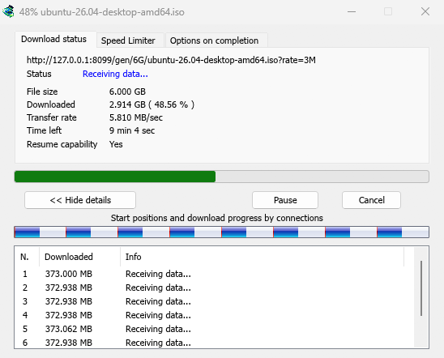
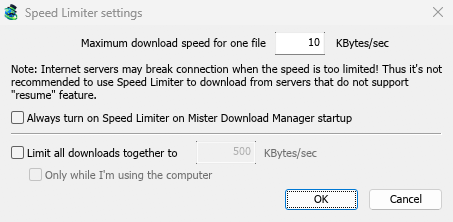

# Connections and speed

[← Back to docs index](README.md)

## The progress window

Each running download has its own progress window. It opens when the download starts; to open it again, double-click the download in the list.

The **Download status** tab shows:

- **Status** — **Connecting...**, **Receiving data...**, **Paused**, **Complete** or the error.
- **File size**, **Downloaded** and **Transfer rate**.
- **Time left**.
- **Resume capability** — **Yes** if the server lets MDM continue the download later, **No** if it doesn't.

**Show details >>** (open by default) adds the connection view:

- A bar of the whole file, showing where each connection started and how far it has got (**Start positions and download progress by connections**).
- A table with one row per connection: its number, how much it has downloaded, and what it is doing right now.

The buttons:

- **Pause** stops the download and keeps what it has; **Resume** continues it.
- **Cancel** stops the download and closes the window. The download stays in the list and can be resumed.
- Closing the window with its close box keeps the download running.

Two more tabs:

- **Speed Limiter** — a limit for this download only. See below.
- **Options on completion** — shows where the file will be saved. Untick **Show download complete dialog** to skip the **Download complete** box for this file only.

**Hide tab** goes back to **Download status**.

## When a download finishes

**Download complete** shows the file's size, its address and where it was saved. Choose **Open**, **Open with...**, **Open folder** or **Close**. You can also drag the small box at the bottom right into Explorer, an email or a chat to drop the file there.

Tick **Don't show this dialog again** to stop seeing it. It can be turned back on in **Options → Downloads → Show download complete dialog**.

## How MDM uses connections

MDM splits a file into parts and downloads them over several connections at once:

- It uses **8 connections** by default. You can set 1 to 32 in **Options → Connection → Default max. conn. number**, or up to 128 after ticking **Allow more than 32 connections** there. More connections help only when the server sends each one at a limited speed and allows that many from one address; most servers allow far fewer.
- When a connection finishes its part, it takes over half of the largest part still left, so no connection sits idle while another one is still working.
- A connection that is far slower than the others is dropped and opened again.
- Some servers allow only a few connections. MDM notices this and stops asking that server for more. What it has learned shows in **Options → Connection** under **Exceptions**, marked **(auto)**.
- You can set a number for a server yourself: **Options → Connection → New**, then type the server's name and the number of connections.

Each connection writes straight into the file's place on disk, in a part file named `<name>.mdm.part` next to the final file. When every part is done, MDM checks the size and renames it. There is no temporary folder and no joining step at the end.

## Resuming

A download resumes where it stopped: after you stop it, after the connection drops, or after Windows or MDM crashes. MDM saves how far each part has got as it goes.

- A connection that fails is retried on its own. The progress window's table shows **Retrying** and the reason.
- To continue a stopped download, select it and click **Resume** on the toolbar (or **File → Download Now**).
- Before continuing, MDM checks that the file on the server is still the same. If it changed, the download stops with **the file changed on the server**. Use **Redownload** to start again from the beginning.
- If **Resume capability** is **No**, the server can't send a file in parts. MDM then downloads it over one connection, and a download that stops has to start over.

[Resume a broken download](guide-resume-broken-download.md) covers expired links too.

## Speed Limiter

The Speed Limiter keeps MDM from using all of your connection.

### For every download

1. Choose **Downloads → Speed Limiter → Settings...**.
2. Set **Maximum download speed for one file** in KBytes/sec. It starts at 10, so set it before you turn the limiter on.
3. Click **OK**.
4. Choose **Downloads → Speed Limiter → Turn on**. **Turn off** gives full speed again.

**Always turn on Speed Limiter on Mister Download Manager startup** turns it on each time MDM starts.

### For all downloads together

In the same window, tick **Limit all downloads together to** and set the speed. This caps MDM as a whole, however many files are downloading. It applies whenever it is ticked, whether the per-file limiter is on or off.

Tick **Only while I'm using the computer** to apply it only while you use the mouse or keyboard. After a minute without input, MDM goes back to full speed.

### For one download

In the download's progress window, open the **Speed Limiter** tab:

1. Tick **Use Speed Limiter**.
2. Set **Maximum download speed** in KBytes/sec. The new limit applies at once.
3. Tick **Remember Speed Limiter settings for this file on download stop/resume** to keep this limit for the file: it applies again when you resume it later, even after restarting MDM.

> Some servers drop the connection when the speed is very low. Avoid a tight limit for servers that can't resume (**Resume capability: No**).

## Next steps

- [Keep some speed for everything else →](guide-keep-speed-for-everything-else.md)
- [Resume a broken download →](guide-resume-broken-download.md)
- [Connection settings in Options →](options.md)
