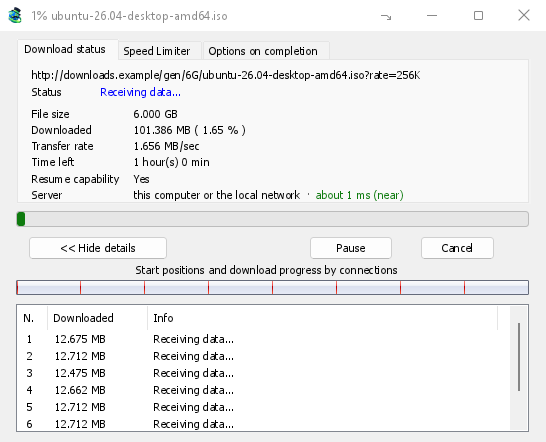
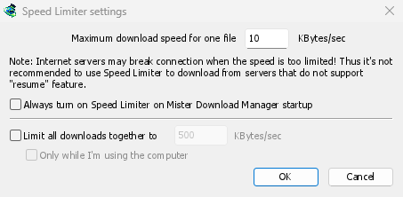

# Connections and speed

[← Back to docs index](README.md)

## The progress window

Each running download has its own progress window. It opens when the download starts; to open it again, double-click the download in the list.

The **Download status** tab shows:

- **Status** — **Connecting...**, **Receiving data...**, **Paused**, **Complete** or the error.
- **File size**, **Downloaded** and **Transfer rate**.
- **Time left**.
- **Resume capability** — **Yes** if the server lets MDM continue the download later, **No** if it doesn't.
- **Server** — where the server is, and how near. See [Where the server is](#where-the-server-is).

**Show details >>** (open by default) adds the connection view:

- A bar of the whole file, showing where each connection started and how far it has got (**Start positions and download progress by connections**).
- A table with one row per connection: its number, how much it has downloaded, and what it is doing right now.

The buttons:

- **Pause** stops the download and keeps what it has; **Resume** continues it.
- **Cancel** stops the download and closes the window. The download stays in the list and can be resumed.
- Closing the window with its close box keeps the download running.
- **Hide to the notification area** (a short dash with an arrow down to the corner; on Windows in
  the title bar, left of Minimize) puts the window in the notification area; **Downloads in
  progress** in the tray icon's menu brings it back. See [The tray icon](getting-started.md#the-tray-icon).

## Where the server is

**Download File Info**, the progress window and **Properties** show where a download's server is: its country's flag and name, then the time a round trip to it takes, such as **about 24 ms (near)**.

- **Near** (green): under 60 ms, usually the same country or the next one.
- **Medium** (amber): 60 to 150 ms, usually the same continent.
- **Far** (red): over 150 ms, usually another continent. A far server is often slower, and more connections help it most.

Hover over the line for the server's address and how the time was measured.

How MDM knows:

- **The country** comes from a table of address ranges that comes with MDM ([IP to Country Lite by DB-IP](https://db-ip.com), CC BY 4.0), looked up on your computer. MDM never sends the address anywhere to ask where it is. The table is updated with each release; an address that has moved since may show its old country.
- **The time** is measured from the download's own connections, as each one opens: MDM sends nothing extra to the server. It is an estimate (the time to open a connection, divided by its round trips: one for http, two for https), so it says **about**. The quickest connection counts.
- **A server on your computer or your local network** shows as such, with no flag.
- **Through a proxy**, MDM only sees the proxy, so it says **through a proxy** (with the proxy's country when it knows it) instead of guessing the server's. A VPN that works at the system level can't be seen: the country is then the server's, but the time includes the VPN's detour.
- **A content delivery network** (Cloudflare, Amazon CloudFront, Fastly, Akamai and others) serves a file from a server near you, not from the site owner's. The tooltip says so: the place is the network's server, not where the site is.
- Torrents and galleries have no single server of MDM's own (peers, or the many a gallery's pictures come from), so their windows don't show one. A video in one file shows the server it comes from.

**Properties** keeps what the last run saw, so a finished download still shows where it came from.

Two more tabs:

- **Speed Limiter** — a limit for this download only. See below.
- **Options on completion** — shows where the file will be saved. Untick **Show download complete dialog** to skip the **Download complete** box for this file only.

**Hide tab** takes a tab off this download's window and goes back to **Download status**. To bring the tabs back, right-click the tab row and choose **Show hidden tabs**; closing the window and opening it again brings them back too.

## When a download finishes

**Download complete** shows the file's size, its address and where it was saved. Choose **Open**, **Open with...**, **Open folder** or **Close**. On Windows you can also drag the small box at the bottom right into Explorer, an email or a chat to drop the file there. The window shows above your other programs until you click it, without taking the keyboard from the one you're typing in.

Tick **Don't show this dialog again** to stop seeing it. It can be turned back on in **Options → Downloads → Show download complete dialog**.

## How MDM uses connections

MDM splits a file into parts and downloads them over several connections at once:

- It uses **8 connections** by default. You can set 1 to 32 in **Options → Connection → Default max. conn. number**, or up to 128 after ticking **Allow more than 32 connections** there. More connections help only when the server sends each one at a limited speed and allows that many from one address; most servers allow far fewer.
- When a connection finishes its part, it takes over half of the largest part still left, so no connection sits idle while another one is still working.
- A connection that is far slower than the others is dropped and opened again.
- Some servers allow only a few connections. MDM notices this and stops asking that server for more. What it has learned shows in **Options → Connection** under **Exceptions**, marked **(auto)**.
- You can set a number for a server yourself: **Options → Connection → New**, then type the server's name and the number of connections.

Each connection writes straight into the file's place on disk, in a part file named `<name>.mdm.part` next to the final file. When every part is done, MDM checks the size and renames it. There is no temporary folder and no joining step at the end.

## Resuming

A download resumes where it stopped: after you stop it, after the connection drops, or after Windows or MDM crashes. MDM saves how far each part has got as it goes.

- A connection that fails is retried on its own. The progress window's table shows **Retrying** and the reason.
- To continue a stopped download, select it and click **Resume** on the toolbar (or **File → Download Now**).
- Before continuing, MDM checks that the file on the server is still the same. If it changed, the download stops with **the file changed on the server**. Use **Redownload** to start again from the beginning.
- If **Resume capability** is **No**, the server can't send a file in parts. MDM then downloads it over one connection, and a download that stops has to start over.

[Resume a broken download](guide-resume-broken-download.md) covers expired links too.

## Through your VPN only: the network adapter and its kill switch

**Options → Proxy / Socks → Network adapter** holds every connection MDM opens to one network
adapter, usually your VPN's: downloads, FTP, torrents, video pages and galleries, MDM's own
downloads and the update check. It works as a kill switch: when the adapter disconnects, or the
VPN is switched off, nothing goes out through your normal connection. Running downloads stop with
**… is not connected**, and start again by themselves when the adapter is back. The line under
the list shows the adapter's address, or that it isn't connected. Details in
[Options → Proxy / Socks](options.md#proxy--socks) and, for torrents, in
[Torrents and your security](torrent-security.md).

## The DNS

**Options → Connection → DNS** chooses who turns the servers' names into addresses: the system's
DNS (the default), or an encrypted one (DNS over HTTPS or TLS) such as Cloudflare, Google, Quad9,
AdGuard, NextDNS or your own. With a network adapter chosen, MDM asks it through the adapter, so
the names stay inside your VPN too. See [Options → Connection](options.md#connection).

## Speed Limiter

The Speed Limiter keeps MDM from using all of your connection.

### For every download

1. Choose **Downloads → Speed Limiter → Settings...**.
2. Set **Maximum download speed for one file** in KBytes/sec. It starts at 10, so set it before you turn the limiter on.
3. Click **OK**.
4. Choose **Downloads → Speed Limiter → Turn on**. **Turn off** gives full speed again.

**Always turn on Speed Limiter on Mister Download Manager startup** turns it on each time MDM starts.

A torrent counts as one file here: each torrent gets the limit of its own. So do a video and an image gallery ([Videos](video.md#speed-limits)). A download with a limit of its own (see [For one download](#for-one-download)) keeps that one.

### For all downloads together

In the same window, tick **Limit all downloads together to** and set the speed. This caps MDM as a whole, however many files are downloading, torrents included. When torrents and other downloads run at the same time, each side gets at least half of the speed, and more when the other side needs less: a torrent going slowly leaves the rest to the other downloads, and the other way round. It applies whenever it is ticked, whether the per-file limiter is on or off.

Tick **Only while I'm using the computer** to apply it only while you use the mouse or keyboard. After a minute without input, MDM goes back to full speed.

### For one download

In the download's progress window, open the **Speed Limiter** tab:

1. Tick **Use Speed Limiter**.
2. Set **Maximum download speed** in KBytes/sec. The new limit applies at once.
3. Tick **Remember Speed Limiter settings for this file on download stop/resume** to keep this limit for the file: it applies again when you resume it later, even after restarting MDM.

A video or a gallery takes a limit of its own the same way. For a torrent, the limit is that torrent's alone; the others keep theirs. A torrent can't be held under 16 KBytes/sec: a lower limit gives it 16.

> Some servers drop the connection when the speed is very low. Avoid a tight limit for servers that can't resume (**Resume capability: No**).

## Next steps

- [Keep some speed for everything else →](guide-keep-speed-for-everything-else.md)
- [Resume a broken download →](guide-resume-broken-download.md)
- [Connection settings in Options →](options.md)
