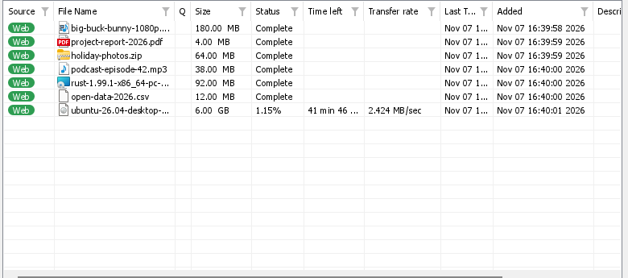
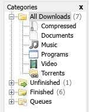
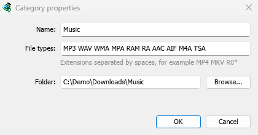
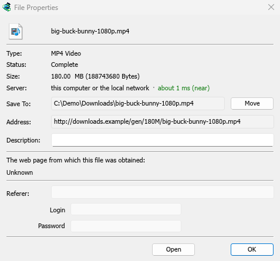
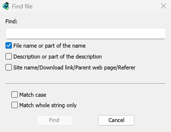
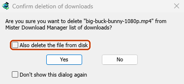

# The download list

[← Back to docs index](README.md)

Every download, finished or not, has a row in the list. The categories on the left choose which rows you see.

The strip under the list says how many downloads it shows and how many are selected, and while
downloads run, how many and how fast in all (the tray icon's tip says the same). When the list
is empty it says why: nothing in this category or queue, or the column filters hide everything
(with **Clear all filters**).

MDM opens where you left it: the window's place and size, the Categories pane, its open
branches and the category or queue you were looking at.

## Columns

*Click a column title to sort; its funnel filters.*

| Column | What it shows |
|---|---|
| **Source** | **Web** (a web server) or **Torrent**. |
| **File Name** | The file's name, after its type's icon: your system's own (Windows Explorer's, macOS Finder's, your Linux desktop's icon theme), or MDM's where the system has none. |
| **Q** | A queue icon when the download is in a queue. |
| **Size** | The file's size, when the server told it. |
| **Status** | How far it is, or **Complete**, **Error** and so on. |
| **Time left** | While it downloads. |
| **Transfer rate** | The current speed. |
| **Upload speed** | A torrent: what it sends to peers, while it runs. |
| **Peers** | A torrent's connected peers while it runs, seeders and leechers alike. |
| **Share ratio** | A torrent: what it has sent to peers against what it took. |
| **Last Try Date** | When it last ran. |
| **Added** | When you added it. |
| **Description** | Your note from **Download File Info** or **Properties**. |

- **Sort:** click a column title. Click again to reverse the order, and a third time to go back to the order of addition. **View → Arrange files** does the same from the menu.
- **Move a column:** drag its title sideways.
- **Resize a column:** drag the line between two titles; double-click it to fit the column to
  its contents.
- **Choose columns:** right-click any column title and tick the ones you want. **Reset columns**
  in the same menu puts them back as they first were.

MDM remembers the columns, their widths and the sort order.

## Filters

Each column title has a faint funnel. Click it to filter the list by that column:

- **Source**, **Q** and **Status** offer a few values to tick, such as only **Error** under **Status**, or only **Not in a queue** under **Q**.
- The other columns take text: type a word, and only rows whose cell contains it stay.

A filtered column's funnel turns blue. To remove every filter, right-click a column title and choose **Clear all filters**. Filters last until you close MDM.

## Categories

The pane on the left has four branches:

*All Downloads, Unfinished, Finished and Queues, each by category.*

- **All Downloads** — everything, with a node per category below it.
- **Unfinished** — downloads that aren't complete yet, by category.
- **Finished** — complete downloads, by category.
- **Queues** — each queue; select one to see only its downloads.

Each download falls into a category by its file type: **General**, **Compressed**, **Documents**, **Music**, **Programs** or **Video**. Torrents have their own **Torrents** category. Each category has its own folder, by default inside your Downloads folder (`Downloads\Compressed`, `Downloads\Video` and so on; General uses `Downloads` itself).

Right-click a category for:

- **Browse** — open its folder in Explorer.
- **Properties** — change its name, its file types and its folder. General and Torrents only change their folder. A renamed category keeps its folder; a built-in one keeps its name in your language until you rename it.
- **Add category** — make your own, for example **Books** for `EPUB MOBI`. Give it a name, the file types (separated by spaces, `*` allowed) and a folder.
- **Delete** — remove a category, your own or a built-in one (not General or Torrents). MDM asks what happens to its downloads: **Move its downloads to General**, or **Remove its downloads from the list** (a download that is running moves to General instead). Their files stay where they are either way. From then on, files of its types go to another category that has them, or to General.

*Right-click a category → Properties: its name, file types and folder.*

To bring the built-in categories back as they came, with their names, file types and folders, use **Options → Save to → Restore the built-in categories**. Your own categories, General and Torrents stay as they are.

The top branches show how many downloads they hold. **View → Hide categories** gives the list
the whole window.

## Dropping links and files

Drag a link from a browser (or a page's text with links in it) onto the list to add it: one
link opens **Download File Info**, several open **Link grabber** to choose which to add. Drop a
`.torrent` file to add the torrent, or a list of addresses (`.txt`, `.ef2`) to import it. The
list is outlined while something you can drop is over it. On macOS and Linux, files can be
dropped (links from a browser only on Windows).

Right-click the list's blank space for **Add new download**, **Select all**, **Arrange files**,
**Clear all filters** and **Delete All Completed**.

## Opening a download

- **Double-click** or press **Enter** on an unfinished download to see its progress window.
- On a finished download, double-click shows its **Properties**. To open the file instead, right-click any download and choose **On Double click → Open**.
- **Alt+Enter** always opens **Properties**.

The right-click menu has everything you can do with a download: **Open**, **Open with...**, **Open folder**, **Move/Rename**, **Redownload**, **Resume Download**, **Stop Download**, **Refresh download address**, **Verify checksum...**, **Remove**, **Add to queue** and **Properties**.

## Properties

**File Properties** shows a download's type, status, size and folder, its address, your description, the page it came from (**Referer**), where its server is ([country and round trip](connections-and-speed.md#where-the-server-is), as its last run saw them) and a login for the site. **Last try** and **Result** tell you how its last attempt went.

- **Move** — move a finished file to another folder, or choose another folder for a download that hasn't started.
- **Address** — for an unfinished download, you can paste a new address here. See [Resume a broken download](guide-resume-broken-download.md).
- **Open** — open the file.

*File Properties: change the address or the folder of a download.*

**Move/Rename** (**Ctrl+M**) moves or renames the file of a finished download, or of one that hasn't started yet. With several downloads selected it asks for a folder and moves them all there, each under its own name.

## Verify checksum

Many sites publish a checksum next to the download. Right-click the download, choose **Verify checksum...** and paste it. MDM reads MD5, SHA-1, SHA-256, SHA-512 and CRC32. A finished file is checked at once; an unfinished one is checked when its download ends. MDM then says **The file matches** or **The file does NOT match**.

## Selecting several downloads

- **Ctrl+click** adds or removes one download.
- **Shift+click** selects every download up to the one you click.
- **Drag on blank space** to draw a box around downloads.
- **Ctrl+A** selects all.
- **Shift+Up / Shift+Down** makes the selection longer or shorter.

**Resume**, **Stop**, **Remove** and the queue commands then act on all the selected downloads. The other commands need one download. The full list of keys is in [Keyboard shortcuts](keyboard-shortcuts.md).

## Finding a download

Press **Ctrl+F** (or **Downloads → Find**), type part of the name and click **Find**. **F3** jumps to the next match. You can also search descriptions and addresses. Step by step in [Find a download in a long list](guide-find-in-long-list.md).

Typing the start of a name while the list has the focus jumps to the first download whose name starts with it.

*Downloads → Find (Ctrl+F).*

## Deleting downloads

Select one or more downloads and press **Delete**, click **Delete** on the toolbar, or choose **File → Remove**. MDM asks first:

- **Also delete the file from disk** — tick it to delete the files too. For an unfinished download, this deletes the part downloaded so far. Leave it unticked to take the downloads off the list and keep the files.
- **Don't show this dialog again** — MDM stops asking and does what you answered this time. To be asked again, tick **Options → General → Confirm before deleting downloads**.

Click **Yes** to delete, or **No** to keep everything.

**Shift+Delete** opens the same question with **Also delete the file from disk** already ticked, for that time only. After a plain **Delete**, MDM remembers your answer and ticks the box the same way next time.

After deleting, the next download in the list is selected, so you can press **Delete** again.

A download that is running isn't deleted. Stop it first.

**Delete Completed** on the toolbar (or **Downloads → Delete All Completed**) removes every finished download from the list, with the same question.

*Tick Also delete the file from disk only if you want the file gone too.*

## Next steps

- [Watch a download's connections →](connections-and-speed.md)
- [Put downloads in a queue →](queues-and-scheduler.md)
- [Find a download in a long list →](guide-find-in-long-list.md)
