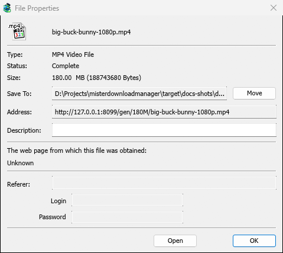
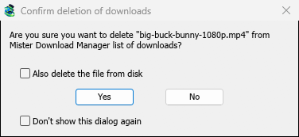

# The download list

[← Back to docs index](README.md)

Every download, finished or not, has a row in the list. The categories on the left choose which rows you see.

## Columns

| Column | What it shows |
|---|---|
| **Source** | **Web** (a web server) or **Torrent**. |
| **File Name** | The file's name, with its icon. |
| **Q** | A queue icon when the download is in a queue. |
| **Size** | The file's size, when the server told it. |
| **Status** | How far it is, or **Complete**, **Error** and so on. |
| **Time left** | While it downloads. |
| **Transfer rate** | The current speed. |
| **Last Try Date** | When it last ran. |
| **Added** | When you added it. |
| **Description** | Your note from **Download File Info** or **Properties**. |

- **Sort:** click a column title. Click again to reverse the order, and a third time to go back to the order of addition. **View → Arrange files** does the same from the menu.
- **Move a column:** drag its title sideways.
- **Resize a column:** drag the line between two titles.
- **Choose columns:** right-click any column title and tick the ones you want.

MDM remembers the columns, their widths and the sort order.

## Filters

Each column title has a faint funnel. Click it to filter the list by that column:

- **Source**, **Q** and **Status** offer a few values to tick, such as only **Error** under **Status**, or only **Not in a queue** under **Q**.
- The other columns take text: type a word, and only rows whose cell contains it stay.

A filtered column's funnel turns blue. To remove every filter, right-click a column title and choose **Clear all filters**. Filters last until you close MDM.

## Categories

The pane on the left has four branches:

- **All Downloads** — everything, with a node per category below it.
- **Unfinished** — downloads that aren't complete yet, by category.
- **Finished** — complete downloads, by category.
- **Queues** — each queue; select one to see only its downloads.

Each download falls into a category by its file type: **General**, **Compressed**, **Documents**, **Music**, **Programs** or **Video**. Torrents have their own **Torrents** category. Each category has its own folder, by default inside your Downloads folder (`Downloads\Compressed`, `Downloads\Video` and so on; General uses `Downloads` itself).

Right-click a category for:

- **Browse** — open its folder in Explorer.
- **Properties** — change its folder (and, for your own categories, its name and file types).
- **Add category** — make your own, for example **Books** for `EPUB MOBI`. Give it a name, the file types (separated by spaces, `*` allowed) and a folder.
- **Delete** — remove one of your own categories. Its downloads become General; their files stay where they are.

**View → Hide categories** gives the list the whole window.

## Opening a download

- **Double-click** or press **Enter** on an unfinished download to see its progress window.
- On a finished download, double-click shows its **Properties**. To open the file instead, right-click any download and choose **On Double click → Open**.
- **Alt+Enter** always opens **Properties**.

The right-click menu has everything you can do with a download: **Open**, **Open with...**, **Open folder**, **Move/Rename**, **Redownload**, **Resume Download**, **Stop Download**, **Refresh download address**, **Verify checksum...**, **Remove**, **Add to queue** and **Properties**.

## Properties

**File Properties** shows a download's type, status, size and folder, its address, your description, the page it came from (**Referer**) and a login for the site. **Last try** and **Result** tell you how its last attempt went.

- **Move** — move a finished file to another folder, or choose another folder for a download that hasn't started.
- **Address** — for an unfinished download, you can paste a new address here. See [Resume a broken download](guide-resume-broken-download.md).
- **Open** — open the file.

**Move/Rename** (**Ctrl+M**) moves or renames the file of a finished download, or of one that hasn't started yet.

## Verify checksum

Many sites publish a checksum next to the download. Right-click the download, choose **Verify checksum...** and paste it. MDM reads MD5, SHA-1, SHA-256, SHA-512 and CRC32. A finished file is checked at once; an unfinished one is checked when its download ends. MDM then says **The file matches** or **The file does NOT match**.

## Selecting several downloads

- **Ctrl+click** adds or removes one download.
- **Shift+click** selects every download up to the one you click.
- **Drag on blank space** to draw a box around downloads.
- **Ctrl+A** selects all.
- **Shift+Up / Shift+Down** makes the selection longer or shorter.

**Resume**, **Stop**, **Remove** and the queue commands then act on all the selected downloads. The other commands need one download. The full list of keys is in [Keyboard shortcuts](keyboard-shortcuts.md).

## Finding a download

Press **Ctrl+F** (or **Downloads → Find**), type part of the name and click **Find**. **F3** jumps to the next match. You can also search descriptions and addresses. Step by step in [Find a download in a long list](guide-find-in-long-list.md).

Typing the start of a name while the list has the focus jumps to the first download whose name starts with it.

## Deleting downloads

Select one or more downloads and press **Delete**, click **Delete** on the toolbar, or choose **File → Remove**. MDM asks first:

- **Also delete the file from disk** — tick it to delete the files too. For an unfinished download, this deletes the part downloaded so far. Leave it unticked to take the downloads off the list and keep the files.
- **Don't show this dialog again** — MDM stops asking and does what you answered this time. To be asked again, tick **Options → General → Confirm before deleting downloads**.

Click **Yes** to delete, or **No** to keep everything.

**Shift+Delete** opens the same question with **Also delete the file from disk** already ticked. MDM remembers your last answer and ticks the box the same way next time.

A download that is running isn't deleted. Stop it first.

**Delete Completed** on the toolbar (or **Downloads → Delete All Completed**) removes every finished download from the list, with the same question.

## Next steps

- [Watch a download's connections →](connections-and-speed.md)
- [Put downloads in a queue →](queues-and-scheduler.md)
- [Find a download in a long list →](guide-find-in-long-list.md)
