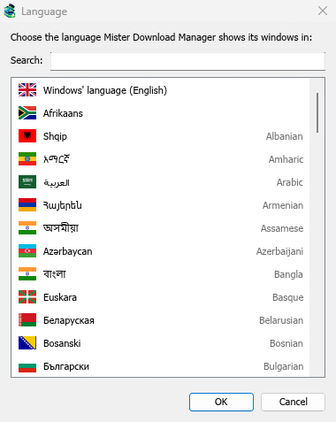
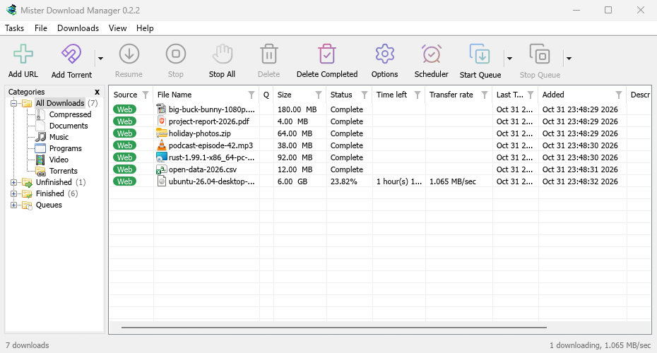
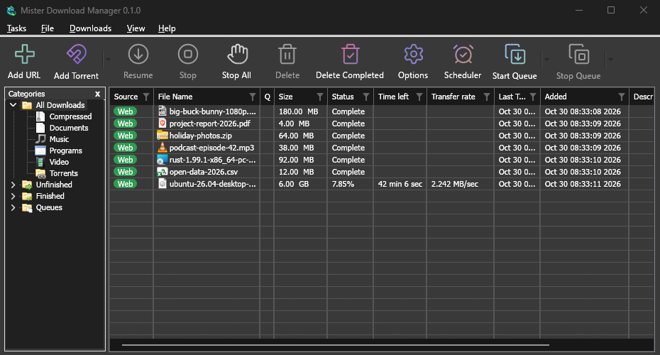

# Getting started

[← Back to docs index](README.md)

MDM runs on 64-bit Windows 10 and Windows 11. Builds for macOS and Linux are new: see
[On a Mac or Linux](#on-a-mac-or-linux).

## Choose a download

Every version is on the [Releases](https://github.com/anefzaoui/misterdownloadmanager/releases) page. For Windows there are three files:

| File | What it is |
|---|---|
| `MisterDownloadManager-<version>-setup.exe` | The installer. Pick this one unless you have a reason not to. It can set up browser integration and open `.torrent` files and magnet links with MDM. |
| `MisterDownloadManager-<version>-portable.zip` | A portable copy. The download list and settings stay in a `data` folder next to the program, and nothing is written to the registry. Browser integration needs the installer. See [Portable mode](portable.md). |
| `MisterDownloadManager-<version>-x64.zip` | The same programs without an installer. It keeps its data in `%APPDATA%\misterdownloadmanager`, like an installed copy. |

### On a Mac or Linux

The files marked `-experimental` are fresh builds for macOS (Apple Silicon and Intel) and Linux.
We haven't tried them ourselves yet, so you'd be among the first: please
[tell us how it went](https://github.com/anefzaoui/misterdownloadmanager/issues/new/choose), good or bad.

| File | What it is |
|---|---|
| `...-macos-universal-experimental.dmg` | Open it and drag Mister Download Manager to Applications. macOS asks before its first start, because the app isn't notarized by Apple: right-click it and choose **Open** (on macOS 15 and later: **System Settings → Privacy & Security → Open Anyway**). |
| `...-linux-x86_64-experimental.AppImage` | Runs on most distributions: make it executable (`chmod +x`) and run it. |
| `...-linux-x86_64-experimental.deb` | For Ubuntu, Debian, Mint and Pop!_OS: `sudo apt install ./<file>.deb`. |
| `...-linux-x86_64-experimental.rpm` | For Fedora, openSUSE and RHEL: `sudo dnf install ./<file>.rpm`. |
| `...-linux-x86_64-experimental.tar.gz` | The plain programs, for any distribution. |

Browser integration is set up by the Windows installer only for now.

## Install with the setup

1. Run `MisterDownloadManager-<version>-setup.exe`.
2. Choose the language. Windows' display language is already selected. The setup offers every language MDM has, and MDM starts in the one you pick.
3. Choose whether to install for you only or for everyone on the computer. For you only needs no administrator rights and goes to `%LOCALAPPDATA%\Programs\Mister Download Manager`. For everyone goes to `Program Files`.
4. Pick what the setup should do:
   - **Set up browser integration (Chrome, Edge, Brave, Firefox)**
   - **Open .torrent files and magnet links with Mister Download Manager**
   - **Start Mister Download Manager when Windows starts**
   - **Create a desktop shortcut** (off unless you tick it)
5. Click **Install**, then **Finish** to start MDM.

If MDM is already running, the setup asks it to save and close first. To update, use **Help → Check for updates → Update now**, or run the setup of the new version; your list and settings stay.

Browser integration needs one more step in each browser: loading the extension. [Browser integration](browser-integration.md) shows how.

### Uninstall

Uninstall MDM from Windows **Settings → Apps**. The uninstaller asks whether to delete your download list and settings too. Your downloaded files are never touched.

## Use a zip copy

1. Unzip the file to a folder you can write to (not straight into `Program Files`).
2. Run `misterdownloadmanager.exe`.

The zips hold the same programs as the setup: the app, `misterdownloadmanager-cli.exe` (downloads from the command line; see [Command line and automation](command-line.md)) and the `extension` folder.

## First start and the language

- **Installed with the setup:** MDM starts in the language you chose in the setup.
- **Otherwise:** MDM shows the list of languages, each with its flag and its own name. Pick yours.

You can change it at any time in **View → Language**. More in [Languages](languages.md).

## The main window

From top to bottom:

- **Menu bar.**
  - **Tasks** — add downloads, torrents, batch downloads and videos; show the drop target; import and export the list; exit.
  - **File** — the selected download: **Stop Download**, **Remove**, **Download Now**, **Redownload**.
  - **Downloads** — **Pause All**, **Stop All**, **Delete All Completed**, **Find**, the **Scheduler**, queues, the **Speed Limiter** and **Options**.
  - **View** — show or hide the categories, sort the list (**Arrange files**), **Dark Mode support** and **Language**.
  - **Help** — help pages, tutorials, **Keyboard shortcuts**, **Report a problem**, **Check for updates** and **About**.
- **Toolbar.** **Add URL**, **Add Torrent**, **Resume**, **Stop**, **Stop All**, **Delete**, **Delete Completed**, **Options**, **Scheduler**, **Start Queue**, **Stop Queue**. The small arrow next to **Add Torrent**, **Start Queue** and **Stop Queue** opens more choices.
- **Categories** (left). Choose what the list shows: **All Downloads**, **Unfinished**, **Finished** and **Queues**, each with its categories. Drag the gap between the pane and the list to make it wider.
- **Download list** (right). One row per download. See [The download list](download-list.md).

## Dark mode

MDM follows Windows: when Windows is set to dark mode, so is MDM. To keep MDM light whatever Windows does, turn off **View → Dark Mode support**.

## The tray icon

Closing the main window doesn't quit MDM. It hides in the notification area, and downloads, queues and schedules carry on.

- Click the tray icon to bring the window back.
- Right-click it for **Add new download**, **Add batch download**, **Speed Limiter**, **Scheduler**, the main download queue, **Options** and **Exit**.

To quit, choose **Tasks → Exit** or **Exit** in the tray menu.

## Where MDM keeps its data

The download list and settings are in `%APPDATA%\misterdownloadmanager` (`downloads.json`). A portable copy keeps them in its `data` folder instead. Downloaded files go to your **Downloads** folder, sorted into a folder per category; you can change that in **Options → Save to**.

## Next steps

- [Download your first file →](guide-first-download.md)
- [Send browser downloads to MDM →](browser-integration.md)
- [Learn the download list →](download-list.md)
