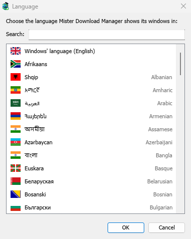
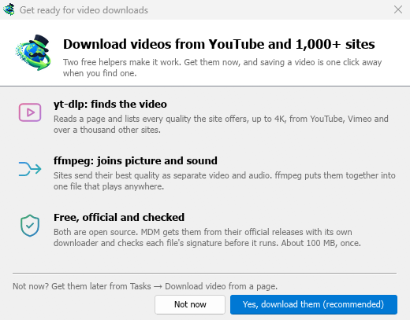
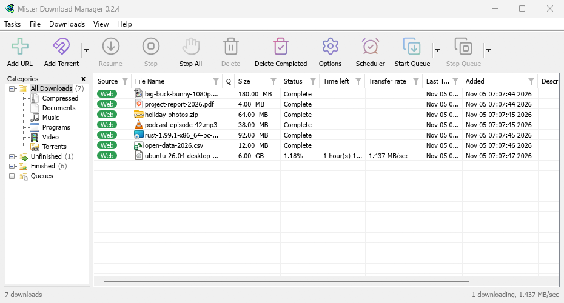
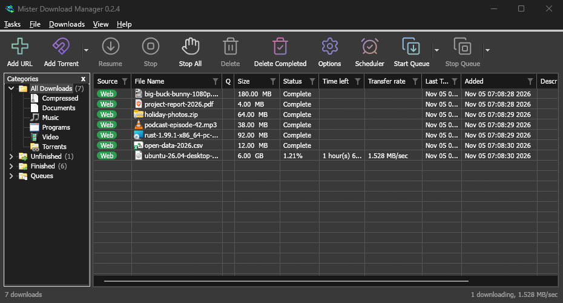

# Getting started

[← Back to docs index](README.md)

MDM runs on 64-bit Windows 10 and Windows 11. Builds for macOS and Linux are new: see
[On a Mac or Linux](#on-a-mac-or-linux).

## Choose a download

Every version is on the [Releases](https://github.com/anefzaoui/misterdownloadmanager/releases) page. For Windows there are three files:

| File | What it is |
|---|---|
| `MisterDownloadManager-<version>-setup.exe` | The installer. Pick this one unless you have a reason not to. It can set up browser integration and open `.torrent` files and magnet links with MDM. |
| `MisterDownloadManager-<version>-portable.zip` | A portable copy. The download list and settings stay in a `data` folder next to the program, and nothing is written to the registry. Browser integration needs the installer. See [Portable mode](portable.md). |
| `MisterDownloadManager-<version>-x64.zip` | The same programs without an installer. It keeps its data in `%APPDATA%\misterdownloadmanager`, like an installed copy. |

### On a Mac or Linux

The files marked `-experimental` are fresh builds for macOS (Apple Silicon and Intel) and Linux.
We haven't tried them ourselves yet, so you'd be among the first: please
[tell us how it went](https://github.com/anefzaoui/misterdownloadmanager/issues/new/choose), good or bad.

| File | What it is |
|---|---|
| `...-macos-arm64-experimental.dmg` | For a Mac with Apple Silicon (M1 or later: **Apple menu → About This Mac** shows a *Chip*). Open it and drag Mister Download Manager to Applications. macOS asks before its first start, because the app isn't notarized by Apple: right-click it and choose **Open** (on macOS 15 and later: **System Settings → Privacy & Security → Open Anyway**). |
| `...-macos-x86_64-experimental.dmg` | The same, for a Mac with an Intel processor (About This Mac shows a *Processor*). |
| `...-linux-x86_64-experimental.AppImage` | Runs on most distributions: make it executable (`chmod +x`) and run it. |
| `...-linux-x86_64-experimental.deb` | For Ubuntu, Debian, Mint and Pop!_OS: `sudo apt install ./<file>.deb`. |
| `...-linux-x86_64-experimental.rpm` | For Fedora, openSUSE and RHEL: `sudo dnf install ./<file>.rpm`. |
| `...-linux-x86_64-experimental.tar.gz` | The plain programs, for any distribution. |

Browser integration is set up by MDM itself at each start on Linux and macOS (the browsers installed then are found); add the extension as in [Browser integration](browser-integration.md). Firefox installed as a Snap (Ubuntu's) reaches MDM once you allow it; other Snap and Flatpak browsers can't (see [Flatpak and Snap browsers](browser-help.md#linux-sandbox)).

In a Wayland session (GNOME, KDE Plasma and others), MDM's windows run through XWayland when it is there: Wayland doesn't let a program place its own windows, so MDM's menus and drop-down lists would open in the middle of the screen. To run on Wayland itself anyway, start it with `MDM_WAYLAND=1 misterdownloadmanager`.

## Install with the setup

1. Run `MisterDownloadManager-<version>-setup.exe`.
2. Choose the language. Windows' display language is already selected. The setup offers every language MDM has, and MDM starts in the one you pick.
3. Choose whether to install for you only or for everyone on the computer. For you only needs no administrator rights and goes to `%LOCALAPPDATA%\Programs\Mister Download Manager`. For everyone goes to `Program Files`.
4. Pick what the setup should do:
   - **Set up browser integration (Chrome, Edge, Brave, Firefox)**
   - **Open .torrent files and magnet links with Mister Download Manager**
   - **Start Mister Download Manager when Windows starts**
   - **Create a desktop shortcut** (off unless you tick it)
5. Click **Install**, then **Finish** to start MDM.

If MDM is already running, the setup asks it to save and close first. To update, use **Help → Check for updates → Update now**, or run the setup of the new version; your list and settings stay.

Browser integration needs one more step in each browser: adding the extension. In Firefox, click **Add to Firefox** on [its page on addons.mozilla.org](https://addons.mozilla.org/firefox/addon/mister-download-manager/); in Chrome, Edge, Brave, Opera and Vivaldi, **Add to Chrome** on [its page in the Chrome Web Store](https://chromewebstore.google.com/detail/mister-download-manager/ejoleppdfgjdndddcjoehopknmlglojp). [Browser integration](browser-integration.md) shows how.

### Uninstall

Uninstall MDM from Windows **Settings → Apps**. The uninstaller asks whether to delete your download list and settings too. Your downloaded files are never touched.

## Use a zip copy

1. Unzip the file to a folder you can write to (not straight into `Program Files`).
2. Run `misterdownloadmanager.exe`.

The zips hold the same programs as the setup: the app, `misterdownloadmanager-cli.exe` (downloads from the command line; see [Command line and automation](command-line.md)) and the `extension` folder.

## First start and the language

- **Installed with the setup:** MDM starts in the language you chose in the setup.
- **Otherwise:** MDM shows the list of languages, each with its flag and its own name. Pick yours.

You can change it at any time in **View → Language**. More in [Languages](languages.md).

## The video helpers

Next, MDM offers its two free video helpers: **yt-dlp**, which finds the video on a page, and
**ffmpeg**, which joins its picture and sound. Click **Yes, download them (recommended)** and they
download in the background, about 100 MB, once. **Not now** leaves them for later: the video
window offers them when you first need them. More in [Videos](video.md).

## The main window

From top to bottom:

- **Menu bar.**
  - **Tasks** — add downloads, torrents, batch downloads and videos; Link grabber; show the drop target; import and export the list; exit.
  - **File** — the selected download: **Stop Download**, **Remove**, **Download Now**, **Redownload**.
  - **Downloads** — **Pause All**, **Stop All**, **Delete All Completed**, **Find**, the **Scheduler**, queues, the **Speed Limiter** and **Options**.
  - **View** — show or hide the categories, sort the list (**Arrange files**), **Dark Mode support**, **Always dark**, **Theme**, **Draw with** (OpenGL, or Direct3D on Windows, Vulkan on Linux, Metal on macOS) and **Language**.
  - **Help** — help pages and tutorials (on the website, in your language when it has it), **Keyboard shortcuts**, **Report a problem**, **Check for updates** and **About**.
- **Toolbar.** **Add URL**, **Add Torrent**, **Resume**, **Stop**, **Stop All**, **Delete**, **Delete Completed**, **Options**, **Scheduler**, **Start Queue**, **Stop Queue**. The small arrow next to **Add Torrent**, **Start Queue** and **Stop Queue** opens more choices.
- **Categories** (left). Choose what the list shows: **All Downloads**, **Unfinished**, **Finished** and **Queues**, each with its categories. Drag the gap between the pane and the list to make it wider.
- **Download list** (right). One row per download. See [The download list](download-list.md).

## Dark mode

MDM follows your system: when Windows (or your desktop's light/dark preference on Linux and macOS) is set to dark mode, so is MDM. To keep MDM light whatever the system does, turn off **View → Dark Mode support**. To keep it dark whatever the system does, for example on a desktop that reports no preference, turn on **View → Always dark**.

## Themes

**View → Theme** changes MDM's look at once, keeping its layout:

- **Classic**: MDM's own look, the default.
- **Native**: your system's colours. Windows' accent colour (Settings → Personalization →
  Colors) and, when it is on, its contrast theme; the desktop's accent colour and its higher
  contrast setting on Linux (GNOME 47 and later, KDE Plasma); the accent colour on macOS. It
  follows them when you change them.
- **High contrast**: black and white, a bright accent, every edge drawn, text at 7:1 or more.
- **Metro**: Windows 8's flat look: square corners, flat buttons and boxes, a coloured title bar
  with the title centred (on Windows, where MDM draws it), and one-colour icons (Microsoft's
  Fluent UI System Icons).
- **Adwaita**: GNOME's look: round corners, flat grey buttons, a rounded focus ring, GNOME's
  check boxes, a header bar with the title in bold and round buttons (on Windows, where MDM
  draws it), and GNOME's Adwaita icons, in colour for files and categories, one colour in the
  toolbar.
- **Breeze**: KDE Plasma's look: rounded corners, buttons and boxes that take the accent's edge
  under the pointer or when focused, KDE's check boxes and focus frame, KDE's title bar with the
  title centred and round buttons (on Windows, where MDM draws it), and KDE's Breeze icons.

Each has a light and a dark side: **Dark Mode support** and **Always dark** choose between
them as before. Theme files you put in the themes folder (**View → Theme → Open themes folder**)
are listed there too. A theme in a folder of its own (`<name>/theme.toml`) can bring its icons in
`icons/16` and `icons/24`, each named for what it shows (`tb-add-url.svg`, `cat-music.png`…):
SVG or PNG files keep their colours, and `-symbolic.svg` ones, as GNOME and KDE name them, take
the theme's text colour.

## The tray icon

Closing the main window doesn't quit MDM. It hides in the notification area, and downloads, queues and schedules carry on.

On Linux this needs a tray, which most desktops have (KDE, GNOME with its AppIndicator extension, waybar's tray). On a desktop without one (some tiling window managers), closing the window quits MDM, since there would be nowhere to bring it back from.

- Click the tray icon to bring the window back.
- Right-click it for **Add new download**, **Add batch download**, **Downloads in progress**, **Speed Limiter**, **Scheduler**, the main download queue, **Options** and **Exit**.
- **Downloads in progress** lists the running downloads. Choose one to see its progress window.

Minimize hides the main window there too, while **Minimize to the notification area** is on in **Options → General**. It is on by default.

A download's progress window can go there as well, with its Minimize or with its **Hide to the notification area** button: a short dash with an arrow down to the corner.

On Windows that button is in the window's title bar, left of Minimize, and in the title bar's menu (Alt+Space). On Linux and macOS it's at the end of the tab row.

To bring the window back, choose it in **Downloads in progress**, or double-click the download in the list.

To quit, choose **Tasks → Exit** or **Exit** in the tray menu.

## Where MDM keeps its data

The download list and settings are in `%APPDATA%\misterdownloadmanager` (`downloads.json`). A portable copy keeps them in its `data` folder instead. Downloaded files go to your **Downloads** folder, sorted into a folder per category; you can change that in **Options → Save to**.

## Next steps

- [Download your first file →](guide-first-download.md)
- [Send browser downloads to MDM →](browser-integration.md)
- [Learn the download list →](download-list.md)
