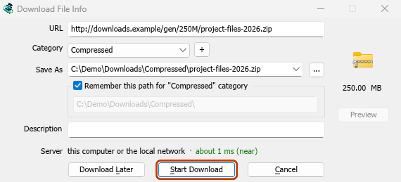
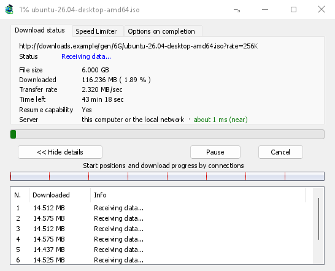
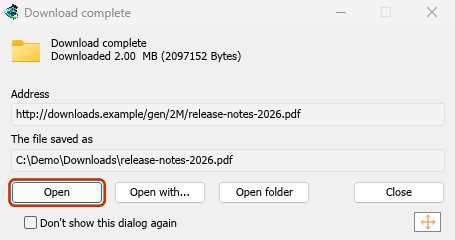
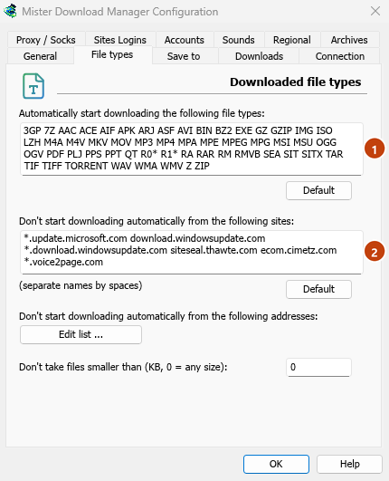

# Tutorial: catch downloads from your browser

[← Back to docs index](README.md)

Set up the extension once, and every download link you click in Firefox, Chrome, Edge, Brave, Opera, Vivaldi or Helium goes to MDM.

## Before you start

On Windows, MDM must be installed with the setup, with **Set up browser integration (Chrome, Edge, Brave, Firefox)** ticked. It is ticked by default. If you're not sure, run the setup again. A portable copy can't do this. On Linux and macOS, start MDM once: it sets browser integration up itself.

MDM's **Add Mister Download Manager to your browser** window, which opens at each start until a browser's extension has reached MDM, does the steps below for you: **Add the extension** opens the store's page in that browser.

Once it is set up, a download link goes like this:

<!-- steps -->

1. 
   *Click a download link in the browser: Download File Info opens in MDM.*
2. 
   *Start Download: the progress window shows it coming in.*
3. 
   *Download complete: Open the file, or Open folder.*

## In Firefox

1. Open the add-on's page on addons.mozilla.org, [Mister Download Manager](https://addons.mozilla.org/firefox/addon/mister-download-manager/), and click **Add to Firefox**. Zen and LibreWolf use the same page.
2. Firefox asks to confirm: click **Add**. Firefox keeps the add-on up to date.
3. Go to a web page and click a download link, for example a ZIP or an EXE: MDM opens **Download File Info**. Click **Start Download**.

## In Chrome, Edge, Brave, Opera or Vivaldi

1. Open the extension's page in the Chrome Web Store, [Mister Download Manager](https://chromewebstore.google.com/detail/mister-download-manager/ejoleppdfgjdndddcjoehopknmlglojp), and click **Add to Chrome**. In Edge the button is **Get**, and Edge first asks to **Allow extensions from other stores**: click **Allow**.
2. The browser asks to confirm: click **Add extension**. It keeps the extension up to date.
3. Go to a web page and click a download link, for example a ZIP or an EXE: MDM opens **Download File Info**. Click **Start Download**.

Helium installs it from the same page, as long as Helium may download extensions: see [Helium](browser-integration.md#helium).

## Without the store

When a browser can't use its store (a computer managed by an organization, or a build of your own), add the extension by hand:

1. Open your browser's extensions page: type `chrome://extensions`, `edge://extensions` or `brave://extensions` in the address bar.
2. Turn on **Developer mode**.
3. Click **Load unpacked**.
4. Choose the `extension\chromium` folder inside MDM's folder. If you installed MDM for yourself, that is `%LOCALAPPDATA%\Programs\Mister Download Manager\extension\chromium`; you can paste that path into the folder box.
5. **Mister Download Manager** appears. Make sure it is turned on.
6. Go to a web page and click a download link, for example a ZIP or an EXE.
7. MDM opens **Download File Info** instead of the browser downloading the file. Click **Start Download**.

You don't need to start MDM first: if it isn't running, it starts by itself.

## Choose what MDM takes

- **Which file types:** **Options → File types → Automatically start downloading the following file types**. Add or remove types, separated by spaces.
- **Sites to leave alone:** **Options → File types → Don't start downloading automatically from the following sites**. Add the site's name, for example `downloads.example.com` or `*.example.com`.
- **One browser only:** **Options → General → Capture downloads from the following browsers**. Untick the ones MDM should leave alone.

*1 the file types MDM takes, 2 the sites it leaves to the browser.*

Everything MDM doesn't take stays with the browser.

## Download a link the browser would open

Links to a PDF or a video file, which the browser would open itself, go to MDM too when their type is listed. To leave one to the browser, hold **Alt** while clicking it (Firefox opens it; Chrome and Edge download it themselves). Any other link: right-click it and choose **Download with Mister Download Manager**, which takes any type.

## Next steps

- [Browser integration in detail (Firefox, private windows, what is sent) →](browser-integration.md)
- [If the browser doesn't hand downloads over →](troubleshooting.md#the-browser-doesnt-send-downloads-to-mdm)
- [Download overnight →](guide-download-overnight.md)
