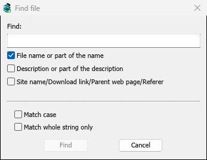

# Tutorial: find a download in a long list

[← Back to docs index](README.md)

After a few months the list can hold hundreds of downloads. Here are four ways to get to the one you want.

## Find by name

1. Press **Ctrl+F** (or **Downloads → Find**). **Find file** opens.
2. Type part of the file's name.
3. Click **Find**. The first match is selected.
4. Press **F3** to jump to the next match. The search wraps round to the top.

## Find by description or address

In **Find file**, tick what to search:

- **File name or part of the name** — on by default.
- **Description or part of the description** — your notes.
- **Site name/Download link/Parent web page/Referer** — the address, the site's name and the page the download came from. Tick this to find everything from one site.

**Match case** tells capitals apart. **Match whole string only** finds only an exact, complete match.

## Filter the list

Each column title has a faint funnel. Click it to keep only some rows:

- On **Status**, tick only **Error** to see the downloads that failed.
- On **Source**, tick only **Torrent**.
- On **Q**, tick **In a queue** or **Not in a queue**.
- On **File Name**, **Description** and the other columns, type a word.

A filtered column's funnel turns blue. Right-click a column title and choose **Clear all filters** to see everything again.

## Narrow it down with categories and sorting

- Click **Unfinished** or **Finished** in the categories, or a category such as **Video**, to see only those downloads.
- Click a column title to sort: **Added** for the newest, **Size** for the biggest, **File Name** for A to Z. Click again to reverse.
- With the list selected, type the first letters of a name to jump straight to it.

## Next steps

- [The download list in detail →](download-list.md)
- [Keyboard shortcuts →](keyboard-shortcuts.md)
- [Back to the docs index →](README.md)
