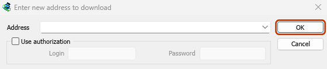
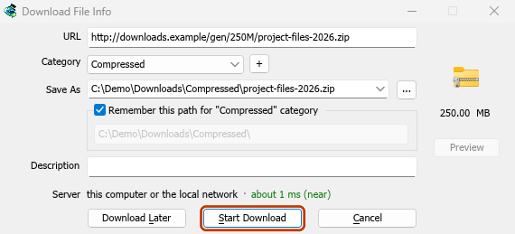
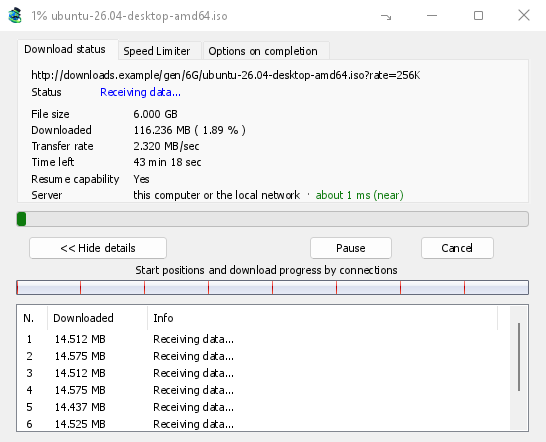
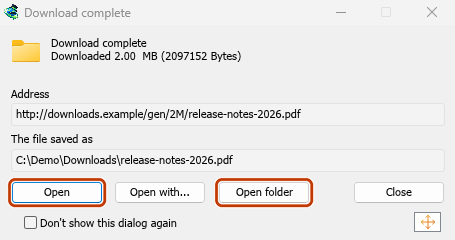

# Tutorial: download a file

[← Back to docs index](README.md)

From a copied link to an opened file in a minute or two.

## Steps

1. In your browser, right-click the link to the file and choose **Copy link**.
2. In MDM, click **Add URL** on the toolbar (or press **Ctrl+N**). The address is already filled in.
3. Click **OK**.
4. **Download File Info** shows the file's name, its size and where it will be saved. The folder depends on the file's type: a ZIP goes to `Downloads\Compressed`, a video to `Downloads\Video`, and so on. Change the folder or the category if you like.
5. Click **Start Download**.
6. The progress window shows the download: its speed, the time left, and what each connection is doing.
7. When it finishes, **Download complete** appears. Click **Open** to open the file, or **Open folder** to see it in Explorer.

<!-- steps -->

1. 
   *Add URL: the copied address is already there. Click OK.*
2. 
   *Check the folder, then Start Download.*
3. 
   *The progress window shows it coming in.*
4. 
   *Done: Open the file, or Open folder.*

The download stays in the list under **Finished**. To get rid of the entry later, select it and press **Delete**; tick **Also delete the file from disk** only if you want the file gone too.

## If something goes differently

- **The address isn't filled in:** the clipboard didn't hold a web address. Paste it into **Address** yourself.
- **The video window opens instead:** the address is a video's page. See [Download a video from a page](guide-video-from-page.md).
- **MDM asks to create a folder:** the folder doesn't exist yet. Click **Yes**.
- **The download stops with an error:** see [Resume a broken download](guide-resume-broken-download.md).

## Next steps

- [Catch downloads from your browser →](guide-catch-browser-downloads.md)
- [All the ways to add a download →](adding-downloads.md)
- [The progress window in detail →](connections-and-speed.md)
