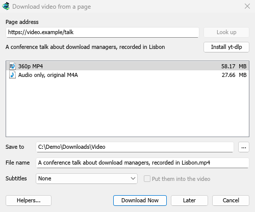
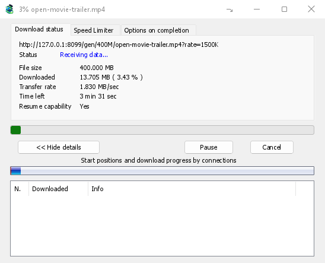

# Tutorial: download a video from a page

[← Back to docs index](README.md)

Save a video from YouTube, Vimeo, TikTok and many other sites, in the quality you choose.

## Steps

1. Open the video in your browser and copy the page's address from the address bar.
2. In MDM, click **Add URL** (or press **Ctrl+N**) and click **OK**. MDM sees that the address is a video's page and opens **Download video from a page**. (You can also open it with **Tasks → Download video from a page...**, paste the address and click **Look up**.)
3. The first time, MDM needs its video helper. Click **Install yt-dlp** (about 23 MB). MDM downloads it from its official release and checks it before use.
4. Wait while MDM looks the page up. The list of qualities appears, best first, with **Audio only** at the end: the sound as the site has it, then, with ffmpeg (next step), as an MP3 at its best variable bitrate or at 320, 256, 192 or 128 kbps.
5. For the best qualities and MP3, MDM needs **ffmpeg**, which joins the picture and the sound, and makes the MP3. On Windows MDM offers to install it (about 80 MB): click **Install ffmpeg** if you want them. On Linux and macOS MDM uses the system's ffmpeg. Without it, you get the qualities that come with their sound.
6. Pick a quality.
7. Check **Save to** and **File name**. The name comes from the video's title; change it if you like.
8. Want subtitles? Pick a language in **Subtitles**. They're saved beside the video, or inside it if you tick **Put them into the video** (see [Subtitles](video.md#subtitles)).
9. Click **Download Now**, or **Later** to add it to the list without starting.

The video appears in the list and downloads like any other file.

<!-- steps -->

1. 
   *MDM lists the qualities: pick one.*
2. 
   *It downloads like any other file.*

## Good to know

- A link to one video inside a playlist or a mix downloads just that video, not the whole list.
- Videos protected with DRM (most paid streaming services) can't be downloaded.
- Downloading may be against some sites' terms; that is up to you to check.

If the video won't download, see [Video downloads](video.md#if-a-video-wont-download).

## Next steps

- [Video downloads in detail →](video.md)
- [Find a download in a long list →](guide-find-in-long-list.md)
- [Back to the docs index →](README.md)
