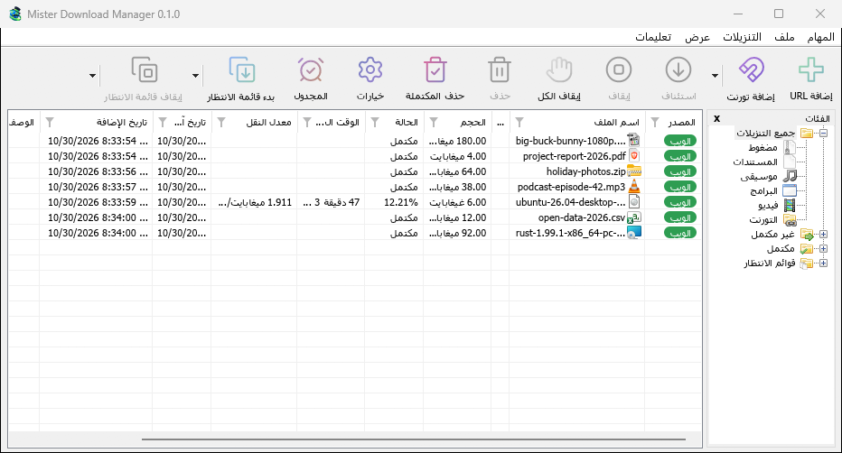

# Languages

[← Back to docs index](README.md)

MDM's interface comes in 86 languages: every display language Windows 11 offers, from Afrikaans to Vietnamese, including both Chinese scripts, Spanish for Spain and Mexico, French for France and Canada, Portuguese for Portugal and Brazil, and Serbian in Cyrillic and Latin.

## Choosing the language

- **With the setup:** the setup asks for its language first, with Windows' display language selected. MDM starts in the language you choose there.
- **Without the setup** (a zip copy): on the first start, MDM shows every language with its flag and its own name. Pick yours.


## Changing it later

Open **View → Language...**. The same window as on the first start opens: every language by its flag, its own name and its English name. Type in **Search** to narrow the list, then double-click a language or select it and click **OK**. The window switches at once; there is nothing to restart.

**Windows' language**, at the top, follows Windows' display language. When Windows uses a language MDM doesn't have, MDM shows English.

## Right-to-left languages

In Arabic, Hebrew, Persian, Urdu and Uyghur the whole window is mirrored: the menus, toolbar and categories run from right to left, as Windows does for these languages. File names, addresses and folder paths keep their own direction inside translated sentences, so they stay readable.



## Numbers and dates

Numbers and the dates in the list (**Last Try Date**, **Added**) follow the region set in Windows (**Settings → Time & language → Language & region → Regional format**), so digits, separators and the date order look the way you are used to. In English, MDM writes them as IDM does (`Oct 30 21:44:12 2026`).

A translation longer than the English ends in **...** where it doesn't fit; point at it to read it whole.

## Missing or odd translations

A text that hasn't been translated yet shows in English. Most translations were written by machine and are waiting for a native speaker to check them, so some wording may sound wrong.

## Help translate

Native speakers are very welcome to check and improve a language.

Each language has its own catalog in the repository: `i18n/<code>.tsv`, for example `i18n/de.tsv` for German or `i18n/pt-br.tsv` for Portuguese (Brazil). The codes are listed in `i18n/languages.tsv`. Each catalog is a text file with one row per text, in three columns separated by tabs:

```
context	source	translation
```

- **source** is the English text; leave it as it is. Change only **translation**.
- A row with a `#, machine` line above it was translated by machine. When you have checked it (and corrected it if needed), delete that `#, machine` line.
- Lines starting with `#.` are notes for translators: where the text appears and what it means.
- Keep `{name}` slots, such as `{n}` or `{file}`, exactly as they are. You can move them within the sentence.
- `&` marks the keyboard letter of a menu item or button. Keep one `&` before a letter of your translation.
- `tools/i18n/glossary.tsv` explains the key terms (download, queue, category, connection, resume…). Translate each one the same way everywhere, the way Windows says it in your language.

To send your changes:

- Open a pull request on [GitHub](https://github.com/anefzaoui/misterdownloadmanager) with the edited catalog, or
- [open an issue](https://github.com/anefzaoui/misterdownloadmanager/issues) describing what should change, if you'd rather not edit the file.

## Next steps

- [Options →](options.md)
- [Getting started →](getting-started.md)
- [Report a problem with a translation →](troubleshooting.md#reporting-a-problem)
