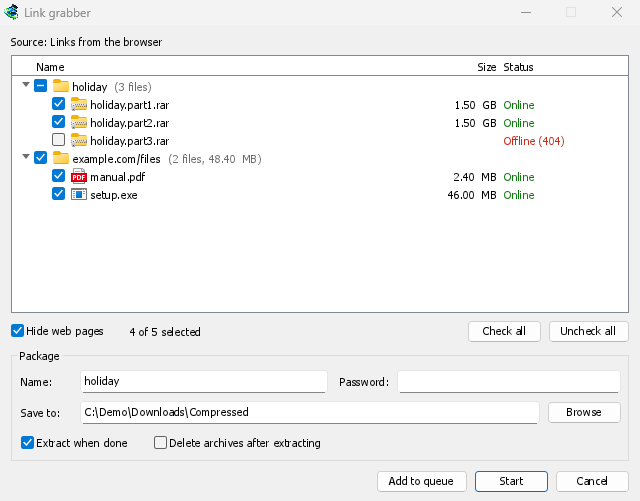

# Link grabber and archives

[← Back to docs index](README.md)

**Link grabber** gathers many links at once, sorts them into packages, and lets you tick the ones to download. MDM can then extract the archives it downloaded (zip, 7z, rar and more), by itself or when you ask.

## Where links come from

- **The browser.** Right-click a page for **Download all links with Mister Download Manager**, or select part of it for **Download selected links with Mister Download Manager**. The page's referrer and cookies go with each link.
- **Tasks → Import → From text file** and **From IDM export file**. An `.ef2` file brings each download's referrer and cookies.
- Several links, or a `.txt` or `.ef2` list, dropped on the download list.
- **The clipboard.** **Tasks → Add batch download from clipboard** (**Ctrl+B**, also in the tray icon's menu) reads the copied text when you choose it and lists every download link in it: `http`, `https`, `ftp` and magnet links, in a list, a forum post, Markdown or HTML, each once.
- **Pasting.** Choose **Tasks → Link grabber...** and press **Ctrl+V**: every download link in the copied text is added.

A magnet link shows as **Magnet link** and isn't looked up: once you click **Start** or **Add to queue**, MDM finds the torrent's files and adds it with all of them, in the package's folder (or the **Torrents** folder when the package has none).

Links that come while the window is open join the ones already there. A link that is already in the window isn't added twice. A link that is already in your download list goes under **Already in the list**, unticked.

## Packages

Each package is a row you can open and close (click its arrow, double-click it, or press **Right** and **Left**). Ticking a package ticks all its links; its box is half-filled when only some are ticked.

- **The volumes of one archive** (`movie.part1.rar`, `movie.part2.rar`…, or `backup.7z.001`, `backup.7z.002`…) form one package named after the archive, as long as they come from the same site.
- **The other links of one page** form a package named after the page.
- **Everything else** goes into **Various files**.

## Looking links up

As links arrive, MDM asks each server about its file, as IDM's **Download all links** does. A few links are checked at a time, and only a few from any one site. Each link then shows its real name and size, and a status:

- **Online**: the server has the file.
- **Offline (404)**: it doesn't. The link is unticked.
- **Needs a login**: the server wants a user name and password, or the page's cookies.
- **Busy, try later**: the server asked to wait.

Turn the look-ups off in **Options → Archives → Look links up when they arrive**. Some file hosts count a look-up as a download.

**Hide web pages** (on by default) leaves out links to pages (`.html`, `.php` and the like): they are neither shown nor downloaded.

## The package box

The box under the list edits the package you selected:

- **Name**: the package's name, kept with its downloads.
- **Save to**: the folder its files go to. When a package holds several kinds of files, the box says **Each file's category folder**: each file goes to its category's folder (**Options → Save to**), as Import always did.
- **Password**: the archives' password, if they have one. It is kept in memory only, never written to disk.
- **Extract when done**: ticked by itself when the package holds an archive.
- **Delete archives after extracting**: once extracted, the archives go to the Recycle Bin (the Trash on macOS and Linux).

## Adding the links

- **Start** adds the ticked links to the **Main download queue** and starts the queue. It downloads as many files at once as the queue allows.
- **Add to queue** adds them to the **Main download queue** without starting them, as IDM's import does.
- **Cancel** closes the window and adds nothing.

## Extracting archives

MDM itself extracts zip archives (AES-encrypted and Deflate64 ones too), tar, tar.gz and tar.xz archives, and single `.gz` and `.xz` files.

**7z and RAR archives need 7-Zip**, a free program ([7-zip.org](https://www.7-zip.org/)). MDM runs it when it is installed, for split and encrypted archives too. RAR's own extraction code can't be part of a free program like MDM, and 7-Zip extracts 7z best.

**Options → Archives** says whether 7-Zip was found. Without it, a 7z or RAR archive isn't extracted, and the **7-Zip needed** window says so, with a **Get 7-Zip** button.

An archive is extracted:

- when its package says **Extract when done**,
- when **Options → Archives → Extract archives when their download completes** is on (off by default), for any other download,
- when you right-click a finished archive and choose **Extract**.

A split archive is extracted once, when its last volume is downloaded. The files go next to the archive:

- into a folder named after the archive when it holds several things at its top (or always, or never: **Options → Archives**),
- a file that is already there is kept, and the new one is numbered: `report (1).txt`.

Extracted files are marked as coming from the internet, as the archive is, so Windows still warns before running a program from it.

MDM extracts safely. A name that would lead outside the folder is left out, and so is a link to somewhere else on the disk. An archive that would write far more than its size, or more than the disk has room for, stops before it fills it. When something goes wrong, nothing but the archive is left behind.

The download's log (hover over it in the list) says what happened: **Extracted 12 files to …**, or why not, for example **Couldn't extract movie.7z.001: volume 3 of it is missing**. An encrypted archive without its password opens the **Archive password** window. Type the password and click **Extract**, or **Cancel** to leave the archive as it is.

## Next steps

- [Adding downloads →](adding-downloads.md)
- [Options → Archives →](options.md#archives)
- [Browser integration →](browser-integration.md)
