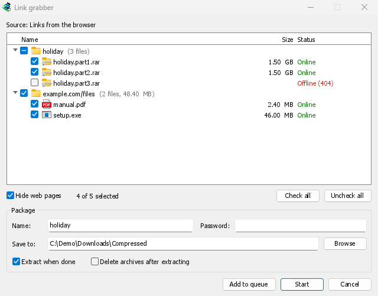

# Link grabber and archives

[← Back to docs index](README.md)

**Link grabber** gathers many links at once, sorts them into packages, and lets you tick the ones to download. MDM can then extract the archives it downloaded (zip, 7z, rar and more), by itself or when you ask.

## Where links come from

- **The browser.** Right-click a page for **Download all links with Mister Download Manager**, or select part of it for **Download selected links with Mister Download Manager**. The page's referrer and cookies go with each link. Both also send the pictures located on the page (or in the selection), hidden at first (see **Hide images located on this web page** below).
- **A page's images.** The browser add-on's toolbar button, **This page → Find images**, sends the pictures of a page at the largest size it lists, those you kept by size and type ([Images on this page](browser-integration.md#images-on-this-page)).
- **Tasks → Import → From text file** and **From IDM export file**. An `.ef2` file brings each download's referrer and cookies, and its file name when the list gives one (a `filename:` line; only the name, never a folder).
- Several links, or a `.txt` or `.ef2` list, dropped on the download list.
- **The clipboard.** **Tasks → Add batch download from clipboard** (**Ctrl+B**, also in the tray icon's menu) reads the copied text when you choose it and lists every download link in it: `http`, `https`, `ftp` and magnet links, in a list, a forum post, Markdown or HTML, each once. A `thunder://`, `flashget://` or `qqdl://` link is listed as the address wrapped in it, so the same file linked wrapped and plain is one row; this holds for pasted text and imported lists too.
- **Pasting.** Choose **Tasks → Link grabber...** and press **Ctrl+V**: every download link in the copied text is added.
- **A web page's address.** Paste or copy the address of a page (`https://example.com/downloads`) and MDM reads the page and lists the links on it, as the browser's **Download all links** does, in a package named after the page. The page itself is left unticked. This works for addresses that came on their own (pasted, copied, typed, in a list), not for the links found on a page, so MDM never wanders off through a site. MDM reads only what the page itself holds: links a page's scripts add after it loads come only through the browser.
- **A folder.** Paste or copy the address of an `ftp://` folder (`ftp://ftp.example.org/pub/`) or of the page a web server makes of a folder ("Index of /pub/"), and MDM lists every file in it and in its subfolders, each folder's files in a package of their own. See [Folders](#folders).
- **A Hugging Face model or dataset, a GitHub release.** Paste the address of a model or dataset on Hugging Face, of a folder in one, or of a release on GitHub, in **Add URL** or here, and MDM lists every file in it, with its size and folder. See [Models, datasets and releases](#models-datasets-and-releases).
- **A Google Drive folder.** Paste a shared folder's link (`https://drive.google.com/drive/folders/…`) in **Add URL** or here, or right-click it in the browser and choose **Download with Mister Download Manager**, and MDM lists every file in it and in its subfolders. See [Google Drive folders](#google-drive-folders).
- **Click'n'Load** buttons on link sites, once you turn it on. See [Click'n'Load](#clicknload).

A magnet link shows as **Magnet link** and isn't looked up: once you click **Start** or **Add to queue**, MDM finds the torrent's files and adds it with all of them, in the package's folder (or the **Torrents** folder when the package has none).

Links that come while the window is open join the ones already there. A link that is already in the window isn't added twice. A link that is already in your download list goes under **Already in the list**, unticked.

## Packages

Each package is a row you can open and close (click its arrow, double-click it, or press **Right** and **Left**). Ticking a package ticks all its links; its box is half-filled when only some are ticked.

- **The volumes of one archive** (`movie.part1.rar`, `movie.part2.rar`…, or `backup.7z.001`, `backup.7z.002`…) form one package named after the archive, as long as they come from the same site.
- **The other links of one page** form a package named after the page.
- **Everything else** goes into **Various files**.
- **Links a site packed** (Click'n'Load) keep the site's packages and names, with their archive password when the site gave one.
- **A folder's files** form a package for each folder, named after it, whose **Save to** keeps the folder's tree (see [Folders](#folders)).
- **A model's, a dataset's or a release's files** form one package, whose **Save to** keeps their folders (see [Models, datasets and releases](#models-datasets-and-releases)).

## Folders

Give Link grabber a folder's address, the way you give it a page's: paste it with **Ctrl+V**, copy it for **Tasks → Add batch download from clipboard**, put it in a list for **Tasks → Import**, or drop it on the download list.

- **An FTP folder**: an `ftp://`, `ftpes://` or `ftps://` address that ends in `/` (`ftp://ftp.example.org/pub/`). MDM logs in as it does for a download from that address (its user name and password, else your Sites Logins, else as anonymous) and asks the server for the folder's list. Each file comes with the size the server lists, so it isn't looked up again.
- **A web server's folder listing**: the page Apache, nginx, IIS and other servers make of a folder without its own page, titled **Index of /pub/** (or **Directory listing for /pub/**). MDM recognizes it, so it reads the folder instead of listing the page's links.

Link grabber then lists every file in the folder and in its subfolders. Each folder's files are a package named after the folder, and its **Save to** is that folder under your download folder (**Options → Save to**), so the tree is kept: `ftp://ftp.example.org/pub/iso/disc.iso` goes to `Downloads\pub\iso\disc.iso`. Tick what you want; **Hide web pages** and the package boxes work as for any links.

**Options → Archives and Link grabber → Folders: 3 levels deep, types: ...** sets how far MDM goes and what it keeps:

- **Levels deep**: how many levels of subfolders are read, 3 by default, at most 10. 0 lists the folder's own files only.
- **Types**: only the files of these types, written as on the **File types** page (`ISO ZIP R0*`). Empty (the default) keeps every type.

MDM stays inside the folder you gave. It never goes up to the folder above (`../`), never onto another site, never through a link the listing makes to somewhere else, and an FTP folder's links to other folders (symbolic links) aren't followed. A name that isn't a plain file or folder name (one with `/` or `\` in it, `..`) is left out. One folder lists at most 10,000 files, and MDM reads at most 500 folders for it; past that, the window's **Source** line says the folder was listed only in part (**pub: only its first 10000 files**).

Folders are read only with **Look links up when they arrive** on (the default), as web pages are. An FTP address without its final `/` is taken for a file.

## Models, datasets and releases

Paste one of these addresses in **Add URL** (**Ctrl+N**), or in Link grabber with **Ctrl+V** (copied, imported or dropped works too):

- **A Hugging Face model or dataset**: `https://huggingface.co/<owner>/<name>` or `https://huggingface.co/datasets/<owner>/<name>`, the whole repository.
- **A folder of one**, at a branch, a tag or a commit: the address of the folder's page, `https://huggingface.co/<owner>/<name>/tree/<revision>/<folder>`.
- **A GitHub release**: `https://github.com/<owner>/<repo>/releases/tag/<tag>`, or `…/releases/latest` for the newest one. A tag without a release lists its source code.

MDM asks the site's public API for the list of files and opens Link grabber with all of them in one package: each file with its size and the folder it is in, **unticked**, so you tick only what you need (the package's box ticks them all). Its **Save to** is the address's path under your download folder (**Options → Save to**), and each file keeps its folder inside it: `onnx/model.onnx` of `huggingface.co/org/tiny` goes to `Downloads\org\tiny\onnx\model.onnx`, a dataset's files under `Downloads\datasets\…`, a release's under `Downloads\<owner>\<repo>\<tag>`. A folder of a repository keeps its place in it (`org\tiny\onnx\…`), so files you take later from another folder land beside it. **Start** or **Add to queue** adds them as one group, with one summary when the last is done.

- **Checked against the site's digest.** Hugging Face publishes a SHA-256 for each large file, GitHub for each release file. MDM checks the finished file against it, as **Verify checksum** does; a file that doesn't match stays unfinished and says so (**the file's SHA-256 checksum doesn't match**), and **Redownload** fetches it again. Small files kept in the repository itself, and a release's source code, have no digest of their own to check.
- **One version.** A repository's files are asked at the commit its branch or tag pointed to when it was listed, so a branch that moves on while they download never mixes two versions.
- **Straight from the sites.** Files come from Hugging Face's and GitHub's own servers, never through a mirror, through MDM's own connections, speed limits and proxy, like any download.
- **Gated models.** A repository whose files need its terms accepted downloads with your Hugging Face access token: accept the terms on its page, make a token in your Hugging Face settings, and add it in **Options → Sites Logins** with the site `huggingface.co`, any user name and the token as the password. It is kept with your other passwords, in the system's keychain, and sent only to `huggingface.co`, never on to the servers it sends the files from. The Source line says when a gated repository has no token yet.
- **Limits.** Both sites let only so many requests through from a computer without an account (GitHub 60 an hour). When the limit is reached, the address's row says **Try again later**, and its tip says for how long.

What a site's list says is checked before it is used: a file whose path would lead out of its folder (`..`, an absolute path, a drive letter, a device name such as `CON`) is left out, and the Source line counts them. At most 10,000 files are listed for one address. As folders are, they are read only with **Look links up when they arrive** on (the default).

## Google Drive folders

Paste a shared folder's link, the one Drive's **Share → Copy link** gives (`https://drive.google.com/drive/folders/…?usp=sharing`), in **Add URL** (**Ctrl+N**) or in Link grabber with **Ctrl+V**. MDM reads the folder's page, the one your browser opens, and its subfolders' pages, one after the other, and opens Link grabber with all their files in one package, **ticked**, each with its name and size and the subfolder it is in. Its **Save to** is a folder of the Drive folder's name under your download folder (**Options → Save to**), and each file keeps its subfolders inside it: `Day 2/hills.jpg` of a folder named `Holiday photos` goes to `Downloads\Holiday photos\Day 2\hills.jpg`. **Start** or **Add to queue** adds them as one group, with one summary when the last is done.

- **Each file as a single Drive file.** Every file downloads the way a Drive file's own link does ([Google Drive links](adding-downloads.md#google-drive-links)): from Google's own servers, through MDM's connections, speed limits and proxy, past the **can't scan this file for viruses** page as **Download anyway** does. When Drive refuses one (too many downloads lately, a sign-in needed, no access), that file says so in its row, and the others go on.
- **Google Docs, Sheets and Slides** come as Word (`.docx`), Excel (`.xlsx`) and PowerPoint (`.pptx`) files, Drawings as `.png`; their size shows once they are looked up. **Forms, shortcuts and Sites** aren't files: they are left out, and the Source line says how many.
- **Folders shared with your account only.** Sign in to Google in your browser, right-click the folder's link there and choose **Download with Mister Download Manager**: the browser add-on passes your Google sign-in with it, and MDM uses it for the folder's pages and its files, on Google Drive only. Pasted without one, the folder's row says **Needs a sign-in**.
- **50 items a folder.** Drive's page lists a folder's first 50 items, so a folder (or a subfolder) with more shows only 50 of them. The Source line says so when a folder shows 50; Drive's own **Download** on the folder gets all of it, as a zip, which the browser add-on hands to MDM.
- **Names.** Drive lets a name hold characters a disk doesn't take (`a/b`, `x:y`) or be a Windows device's name (`CON`); MDM makes them plain names (`a_b`, `x_y`, `_CON`), as for any download. A name that is only dots (`..`) is left out, and the Source line counts it. A file's address is made from its Drive ID, never taken from the page.

## Click'n'Load

Many link sites have a **Click'n'Load** button that sends their links straight to a download manager on your computer, as JDownloader's documentation for web sites describes. Turn it on in **Options → Archives and Link grabber → Accept Click'n'Load from web pages** (off by default). MDM then listens on port 9666 of this computer only, and the links a page sends open in Link grabber, with the page's package name and archive password.

Any web page can send links there, not only the link site you are on, so MDM is careful with them:

- **The first time a site sends links, MDM asks**: **Allow** (that site's links go to Link grabber from now on), **Block** (they never do), or **Not now** (these links are dropped, and the site is asked again next time). The site is the one your browser names, never what the page claims. When the browser names none (a page that hides where it is, or one inside a sandboxed frame), the window says **An unknown site**: it is asked about every time, and its answer is never kept. Turning Click'n'Load off forgets the answers.
- **Links a page sent aren't looked up**: Link grabber shows them as **Not looked up**, and no request leaves for them, with or without your Sites Logins or debrid accounts, until you add them to the queue. Nothing is downloaded before that.
- **Links to this computer or your network are left out**: a link to `localhost`, to a private or link-local address (`192.168.…`, `10.…`, `172.16.…`, `169.254.…`, their IPv6 kin), or to a name without a dot or under `.local`, `.lan` or `.internal` never reaches Link grabber. A link site's files aren't there, and such an address could be your router or another device. MDM judges the address as written: a public-looking name that points into your network isn't recognized, so look at a package before you add it.
- **Limits**: at most 10 posts a minute from one site, 500 links and 256 KB a post; more is refused, and one site's posts don't use up another's. At most 20 posts wait for an answer. A site brings MDM's window to the front at most once a minute; its links still arrive in Link grabber in between.
- The page's own address isn't sent as the links' referrer: a page could name any.
- **MDM doesn't say it is JDownloader.** Some sites first ask whether JDownloader is running (a script named `jdcheck.js`) and show their button only then. MDM doesn't answer that question, so such a site may say no program was found; a site that simply sends its form works.
- Only one program can listen on port 9666. If JDownloader is running, MDM says so: close it, then turn the option off and on again.
- A button that sends a DLC container instead of links isn't taken: reading one needs a key MDM can't use. The site's plain links, or its Click'n'Load button, are the way.
- Some sites hide the key in a script MDM doesn't run (only the plain form the documentation shows is read): then their button reports a failure, and the site's plain links are the way.

## Looking links up

As links arrive, MDM asks each server about its file, as IDM's **Download all links** does. A few links are checked at a time, and only a few from any one site. Each link then shows its real name and size, and a status:

- **Online**: the server has the file.
- **Offline (404)**: it doesn't. The link is unticked.
- **Needs a login**: the server wants a user name and password, or the page's cookies.
- **Busy, try later**: the server asked to wait.

Turn the look-ups off in **Options → Archives → Look links up when they arrive**. Some file hosts count a look-up as a download. With the look-ups off, MDM asks nothing of the network until you start, so a web page's address isn't read for its links either.

**Hide web pages** (on by default) leaves out links to pages (`.html`, `.php` and the like, and any link whose look-up found a web page): they are neither shown nor downloaded.

**Hide images located on this web page** leaves out the pictures the browser found shown on the page (its images, at the largest size the page lists for each), so the list holds the page's links. It is ticked again each time a page's links come with such pictures, and not remembered: untick it to see the pictures and tick the ones you want; while it is ticked they are neither shown nor downloaded. A link to a picture (a thumbnail linking to its full size) is a link like any other and always shows, even when the same picture is also shown on the page.

## The package box

The box under the list edits the package you selected:

- **Name**: the package's name, kept with its downloads.
- **Save to**: the folder its files go to. When a package holds several kinds of files, the box says **Each file's category folder**: each file goes to its category's folder (**Options → Save to**), as Import always did.
- **Password**: the archives' password, if they have one. It is kept in memory only and is never saved by itself: to keep one for other packages, add it to your [archive passwords](#archive-passwords).
- **Extract when done**: ticked by itself when the package holds an archive.
- **Delete archives after extracting**: once extracted, the archives go to the Recycle Bin (the Trash on macOS and Linux).

## Adding the links

- **Start** adds the ticked links to the **Main download queue** and starts the queue. It downloads as many files at once as the queue allows.
- **Add to queue** adds them to the **Main download queue** without starting them, as IDM's import does.
- **Cancel** closes the window and adds nothing.

## Extracting archives

MDM itself extracts zip archives (AES-encrypted and Deflate64 ones too), tar, tar.gz and tar.xz archives, and single `.gz` and `.xz` files.

**7z and RAR archives need 7-Zip**, a free program ([7-zip.org](https://www.7-zip.org/)). MDM runs it when it is installed, for split and encrypted archives too. RAR's own extraction code can't be part of a free program like MDM, and 7-Zip extracts 7z best.

**Options → Archives** says whether 7-Zip was found. Without it, a 7z or RAR archive isn't extracted, and the **7-Zip needed** window says so, with a **Get 7-Zip** button. On Linux, install your distribution's `7zip` (or `p7zip`) package: MDM finds `7zz`, `7z` or `7za` on its own.

Another archiver built on 7-Zip does as well, so there is no need for a second copy. On Windows MDM finds the 7-Zip that **PeaZip** brings with it (`PeaZip\res\bin\7z\7z.exe` in Program Files) and **NanaZip**'s command line (`NanaZipC.exe`) by itself, after 7-Zip's own folders. For any other, such as a portable copy or one installed for your user only, press **Use another program...** in **Options → Archives** and choose its 7-Zip command line program: `7z.exe`, `7za.exe` or `7zz`, not the archiver's own window. MDM runs it once to see that it answers as 7-Zip, then uses it for 7z and RAR archives, with the same arguments as always. **Find 7-Zip automatically** goes back to the one MDM finds, which is also used if the chosen program is removed.

### In place, with HatchZip

[HatchZip](https://hatchzip.dev) is another free extractor (MIT or Apache-2.0), optional. MDM uses its command line program, `hatchzip`, when it is on the PATH (its installers and packages put it there; the desktop app alone isn't enough):

- **Options → Archives → Extract in place with HatchZip** (off by default): HatchZip removes the archive while its files come out, so a 180 GB download that unpacks to 200 GB needs a little over 200 GB, not 380 GB. It reads zip, 7z, RAR and tar archives, split ones too; single `.gz` and `.xz` files are still extracted by MDM. A solid RAR archive can't be extracted in place (HatchZip says so before it changes anything): MDM then extracts it as usual, with 7-Zip, and keeps the archive. HatchZip's own release builds read RAR; a build from crates.io doesn't.
- Before it changes anything, HatchZip checks that the files fit and proves the password. A missing or wrong password, or too little room, changes nothing: the log says so, and the **Archive password** window asks as usual. The password goes to HatchZip through its environment, never on its command line.
- The files go where **What an archive holds goes** says, as with any other extraction. On the way they are in a folder named `<archive>.hatchzip-out` beside the archive.
- If it stops partway (MDM closed, the download deleted, the disk filled by something else), the files extracted so far stay in that folder and the rest is still in the archive. **Extract** continues where it stopped, even with the option off: only HatchZip can finish such an archive. MDM continues only a run it started itself (it keeps a note of it in its own data): a HatchZip progress file (`<archive>.hatchzip`) that comes with a download or a torrent starts nothing, and that archive is extracted as usual.
- Nothing HatchZip extracted is ever deleted, those files are no longer in the archive. Entries MDM leaves out (links, names leading outside the folder) stay in that folder, and so do the files a failed move couldn't put in place (a file held open by another program); the log says where. So after an extraction in place, a link an archive held that MDM considers unsafe is still in your download folder, inside `<archive>.hatchzip-out`: it is never followed or moved, but it isn't removed either, as it is by every other extraction. Look at what is left in that folder before you open it.
- **Then move the archives to the Recycle Bin** has nothing to move afterwards: the archive is already gone.
- 7z and RAR archives still need 7-Zip when the option is off.

An archive is extracted:

- when its package says **Extract when done**,
- when **Options → Archives → Extract archives when their download completes** is on (off by default), for any other download,
- when you right-click a finished archive and choose **Extract**.

A split archive is extracted once, when its last volume is downloaded. The files go next to the archive:

- into a folder named after the archive when it holds several things at its top (or always, or never: **Options → Archives**),
- a file that is already there is kept, and the new one is numbered: `report (1).txt`.

Extracted files are marked as coming from the internet, as the archive is, so Windows still warns before running a program from it.

MDM extracts safely. A name that would lead outside the folder is left out, and so is a link to somewhere else on the disk. An archive that would write far more than its size, or more than the disk has room for, stops before it fills it. When something goes wrong, nothing but the archive is left behind.

The download's log (hover over it in the list) says what happened: **Extracted 12 files to …**, or why not, for example **Couldn't extract movie.7z.001: volume 3 of it is missing**. Every archive is tried without a password first. One that turns out to be encrypted is tried with its package's password, then with each of your saved passwords (**Options → Archives → Archive passwords...**), in their order, so an archive that needs no password never meets them. Only when none fits does the **Archive password** window open. Type the password and click **Extract**, or **Cancel** to leave the archive as it is. Tick **Remember it for other archives** (it starts unticked) to add it to the saved passwords. 7-Zip is given each password on its input, never on its command line, where other programs on the computer could read it.

### Archive passwords

**Options → Archives → Archive passwords...** keeps the passwords you use again and again (a site's own, say), one per line. The download's log says **Trying the saved archive passwords...** while MDM tries them. The one that opens an archive moves to the top of the list, so the passwords you need most are tried first. A package's password (one you typed in Link grabber, or one that came with the links) is tried first and never added to the list by itself; when it is one of your saved passwords already, it moves to the top like any other. A password typed in the **Archive password** window is added only with **Remember it for other archives** ticked, and only once it fits. The list is kept in the system's keychain, as the other passwords are (see [Where the sign-in is kept](debrid.md#where-the-sign-in-is-kept)).

Each try starts the extraction again: with a long list and a large archive whose file names aren't encrypted, it can take a moment before the right one is found.

## Testing archives

A finished archive can still be broken: a server sent wrong bytes, or a proxy on the way mangled part of the file. It shows only when someone opens it, often much later. So MDM tests ZIP, 7z and RAR archives, split ones too once every volume is in, when their download completes: **Options → Archives → Test archives when their download completes** is on by default, up to 4 GB. A test reads the whole archive, so a larger one is tested only when you ask: right-click a finished archive and choose **Test archive**, whatever its size.

- The test is 7-Zip's (`7z t`, with the 7-Zip that **Options → Archives** names): every file in the archive is read back and checked, and nothing is written. Without 7-Zip, MDM tests ZIP archives itself; 7z and RAR archives aren't tested.
- The download counts as done once its test is over. The list says **Checking 45%** meanwhile, its queue waits for it, and its **Download complete** window, its sound and its extraction come after the test.
- An archive protected by a password isn't tested, as its files can't be read without it: the log says **Couldn't test photos.zip: it needs a password**. Nor are tar, gz and xz files.
- A damaged archive says **Damaged** in the list, its log names the damaged files, and the **Damaged archive** window offers **Redownload**: it downloads the archive (every volume of a split one) again from the start. It isn't extracted by itself; **Extract** still tries it.
- A ZIP in one file is repaired instead, when MDM can tell where its damaged files are in it: their bytes alone are downloaded again, from the same server, and the archive is tested once more. The log says **Downloading the damaged parts again (1.20 MB)**, then **Tested again: the archive has no errors now**. The bytes come only from the same version of the file: MDM asks for them as it resumes any download (with the file's ETag or date, `If-Range`), and checks the bytes just before each part against the ones on disk. A file that changed on the server stops the download with **the file changed on the server** instead of mixing two versions: **Redownload** downloads the new one. An archive still damaged after that is offered for **Redownload**.
- 7z and RAR archives keep their files in blocks whose place in the file 7-Zip's test doesn't give, and a split archive's volumes are separate downloads: those are tested, and offered for **Redownload** when damaged, never repaired in part.
- A split archive (`photos.zip.001`, `photos.z01`, `notes.7z.001`, `movie.part1.rar`, `movie.r00`) is tested once, from its first volume, when every volume is downloaded, whichever of them finishes last. Its volumes often finish one after another (a queue that downloads one at a time, a host that makes you wait between files), and the ones in so far read as an archive cut short, so they aren't tested on their own. **Test archive** on a split archive not complete yet says so: **Not tested yet: photos.zip.001 isn't complete (volume 3 isn't there yet)**.
- Closing MDM stops a test; the archive is tested again at the next start.

## Next steps

- [Adding downloads →](adding-downloads.md)
- [Options → Archives →](options.md#archives)
- [Browser integration →](browser-integration.md)
