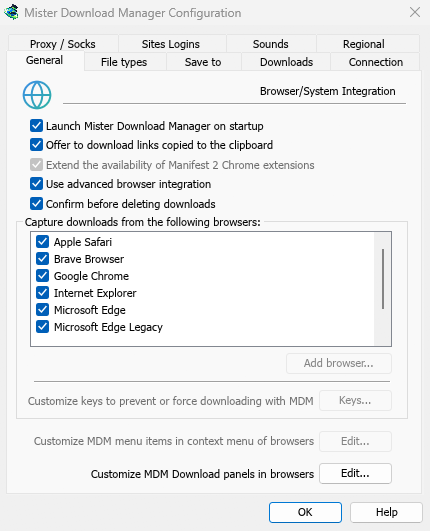
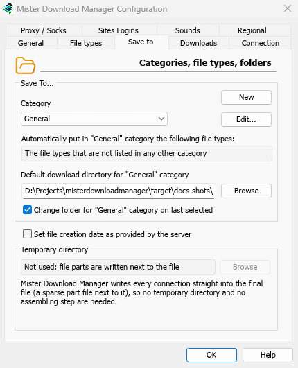
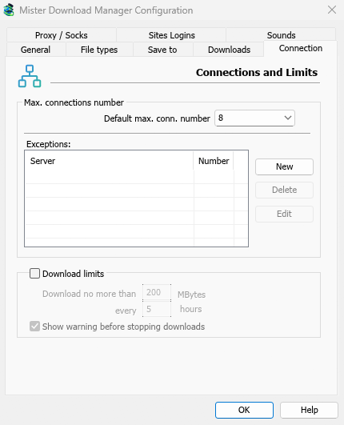

# Options

[← Back to docs index](README.md)

Open **Downloads → Options**, or click **Options** on the toolbar. The window has eight pages on two rows of tabs. **OK** saves your changes; closing the window or pressing **Esc** throws them away.

Some buttons are greyed. They belong to features that aren't built yet.

## General

- **Launch Mister Download Manager on startup** — start MDM when you sign in to Windows. Off by default. Greyed in a [portable copy](portable.md), which writes nothing to the registry.
- **Offer to download links copied to the clipboard** — when you copy a link whose file type is on the **File types** page, **Download File Info** opens with it, ready to start (or the download starts at once, with **Show start download dialog** off). On by default.
- **Use advanced browser integration** — let the browser extension hand downloads to MDM. Turn it off to keep every download in the browser.
- **Confirm before deleting downloads** — ask before taking downloads off the list. On by default; **Don't show this dialog again** in that question turns it off, and ticking it here turns it back on.
- **Capture downloads from the following browsers** — untick a browser to leave its downloads alone.
- **Customize MDM Download panels in browsers → Edit...** — the download button over videos on web pages: turn it off, or list the sites it never shows on (separate them by spaces; `*.example.com` covers its subdomains). See [Browser integration](browser-integration.md#the-download-button-over-videos).

See [Browser integration](browser-integration.md).

## File types

- **Automatically start downloading the following file types** — the file types the browser hands over (and the clipboard picks up). Separate them by spaces; `*` matches any characters, as in `R0*`. **Default** puts the original list back.
- **Don't start downloading automatically from the following sites** — sites whose downloads stay in the browser, separated by spaces. `*.example.com` covers every part of a site. **Default** puts the original list back.

## Save to

- **Category** — choose a category to see and change its settings below.
- **New** — make your own category. **Edit...** changes the selected one: its folder, and for your own categories its name and file types.
- **Automatically put in "…" category the following file types** — the file types that go to this category.
- **Default download directory for "…" category** — the category's folder. Type a path or click **Browse**.
- **Change folder for "…" category on last selected** — when you pick another folder in **Download File Info**, it becomes the category's folder from then on. On by default. (It sets the first state of **Remember this path** in that window.)
- **Set file creation date as provided by the server** — give finished files the date the server reports, not the date you downloaded them.

MDM doesn't use a temporary folder: every connection writes straight into the final file's place, so there is nothing to put together at the end.

## Downloads

- **Show start download dialog** — show **Download File Info** for each new download. With it off, downloads start at once, or only join the queue if you tick **Do not start downloading, only add files to the queue**.
- **Show download complete dialog** — show **Download complete** when a file finishes.
- **Start downloading immediately while displaying "Download File Info" dialog** — on by default, so the download is already under way while you choose a folder.
- **Show queue selection panel on pressing "Download Later" button** — ask which queue; off puts it in the **Main download queue**.
- **Show queue selection panel on closing batch download dialogs** — the same for batch downloads.
- **Ignore file modification time changes when resuming a download** — for servers that report a new date for the same file each time. Without it, such a server makes every resume start over.
- **If a duplicate download link is added** — ask, add it with a numbered name, overwrite the old one, or open the finished one / resume the unfinished one.
- **User-Agent for manually added downloads** — how MDM names itself to servers for downloads you add yourself. Downloads from the browser use the browser's own User-Agent.

## Connection

- **Default max. conn. number** — how many connections each download may use: 1, 2, 4, 8 (the default), 16, 24 or 32.
- **Exceptions** — a different number for some servers. **New** adds one (the server's name and the number of connections); **Edit** and **Delete** change or remove the selected one. Rows marked **(auto)** are limits MDM learned by itself from servers that refused more connections. They can't be edited and fade away by themselves.
- **Download limits** — download no more than a set amount every few hours. The same setting is in the Scheduler; see [Queues and the Scheduler](queues-and-scheduler.md#download-limits).

More in [Connections and speed](connections-and-speed.md).

## Proxy / Socks

- **No proxy/socks** — connect directly. This is the default.
- **Use system settings** — use the proxy set in Windows.
- **Use automatic configuration script** — the proxy auto-config (PAC) script your network gives: type its address (`http://…/proxy.pac`, or a file). MDM fetches it and asks it which proxy each download goes through (`PROXY`, `SOCKS` or `DIRECT`), as browsers do. Until it has been fetched, or if it can't be, MDM uses the system's settings.
- **Manual proxy/socks configuration** — type the proxy's address, **Port**, and a **UserName** and **Password** if it needs them, then tick the protocols it is for (**http**, **https**). For a SOCKS proxy, write the address as `socks5://host`.
- **Get System** — fill in the manual fields from Windows' proxy settings.
- **Use proxy/socks from a browser's request…** — on by default. With **No proxy/socks**, it makes MDM use Windows' proxy settings, as browsers do.
- **Use FTP in PASV mode** — on by default: for FTP downloads MDM opens the data connections itself (passive mode), which works through routers and firewalls. Turn it off only for a server that needs active mode (the server connects back to you). FTP never goes through the proxy above, so its **ftp** box stays greyed. See [FTP and FTPS](adding-downloads.md#ftp-and-ftps).

## Sites Logins

User names and passwords for sites that ask for them. **New** adds a row: the site (with a path if the login is only for part of it), the user name and the password. **Edit** and **Remove** change or delete the selected row. MDM uses the login for every download from that site. A login typed in **Add URL** (**Use authorization**) takes priority for that one download.

## Sounds

Play a sound for **Download complete**, **Download failed**, **Queue processing started** and **Queue processing stopped/finished**. Tick an event, select it, click **Browse...** to choose a `.wav` file, and **Play** to hear it.

## Regional

How dates and times are written in the list of downloads and the Scheduler.

- **As the system's region writes them** (the default) — Windows' region settings (Settings → Time & language → Region); on macOS and Linux, your language's usual way. In English the list keeps IDM's own date text.
- **My own way** — choose the **date order** (day, month, year; month, day, year; or year, month, day), a **12- or 24-hour clock**, and the **first day of the week** in the Scheduler's calendar. **Example** shows the result.

## Elsewhere

A few settings live outside this window:

- **Downloads → Speed Limiter → Settings...** — speed limits. See [Connections and speed](connections-and-speed.md#speed-limiter).
- **Tasks → Torrent settings...** — sharing and file associations. See [Torrents](torrents.md#torrent-settings).
- **View → Dark Mode support** and **View → Language**.
- **Help → Check for updates...** — **Check for updates at every start** is in that window.

## Next steps

- [Connections and speed →](connections-and-speed.md)
- [Browser integration →](browser-integration.md)
- [Languages →](languages.md)
