# Options

[← Back to docs index](README.md)

Open **Downloads → Options**, or click **Options** on the toolbar. The window has twelve pages on two rows of tabs. **OK** saves your changes; closing the window or pressing **Esc** throws them away.

Some buttons are greyed. They belong to features that aren't built yet.

## General

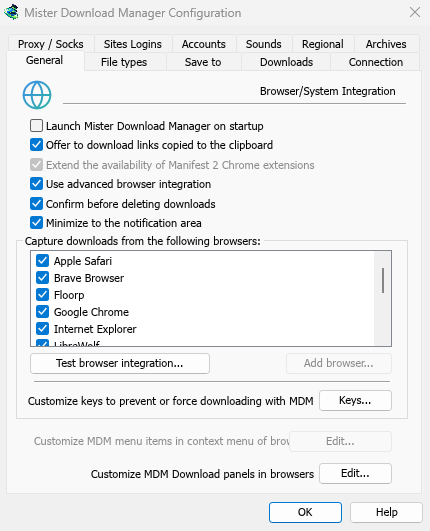
*General: how MDM starts, and what it takes from the clipboard and the browsers.*

- **Launch Mister Download Manager on startup** — start MDM when you sign in to Windows. It starts in the notification area, its window hidden, with its downloads, queues and Scheduler running; click its icon (or start MDM again) to show the window. On Linux and macOS it starts with your session the same way; where no notification area shows MDM's icon (some Linux desktops), it starts minimized, and the option's tooltip says so. MDM waits for the notification area up to 30 seconds after making its icon, its window hidden, as a desktop's can come up after MDM at sign-in. Off by default. Greyed in a [portable copy](portable.md), which writes nothing to the registry.
- **Offer to download links copied to the clipboard** — when you copy a link whose file type is on the **File types** page, **Download File Info** opens with it, ready to start (or the download starts at once, with **Show start download dialog** off). It keeps to archives, programs, music, videos, PDF and any type you added yourself, so copying the address of a picture, a font or a 3D model to use somewhere else never starts a download. On by default.
- **Use advanced browser integration** — let the browser extension hand downloads to MDM. Turn it off to keep every download in the browser.
- **Confirm before deleting downloads** — ask before taking downloads off the list. On by default; **Don't show this dialog again** in that question turns it off, and ticking it here turns it back on.
- **Keep running when closing the window** — closing the main window hides it in the notification area instead of quitting, and downloads, queues and schedules go on. On by default; unticked, closing quits MDM (so a [portable copy](portable.md)'s folder can then be deleted). If there is no icon for MDM at all — not even behind the ^ hidden icons — the window minimizes to the taskbar instead, so downloads continue and the window stays reachable; an icon behind ^ can be clicked to bring it back, or start MDM again. Greyed where no tray shows MDM's icon (some Linux desktops): closing quits there.
- **Minimize to the notification area** — Minimize hides the main window, and a download's progress window, in the notification area; downloads go on. On by default. Where the tray has no icon, the main window minimizes to the taskbar instead. The close setting above is separate; when it is on, closing hides there too (or minimizes to the taskbar if there is no icon at all). Greyed where no tray shows MDM's icon (some Linux desktops); in a Wayland session the main window stays minimized in the dock, since Wayland can't hide a window.
- **Capture downloads from the following browsers** — untick a browser to leave its downloads alone.
- **Customize MDM Download panels in browsers → Edit...** — the download button over videos on web pages: turn it off, or list the sites it never shows on (separate them by spaces; `*.example.com` covers its subdomains). See [Browser integration](browser-integration.md#the-download-button-over-videos).

See [Browser integration](browser-integration.md).

## File types

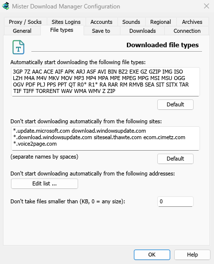
*File types: what the browser hands over, and the sites left alone.*

- **Automatically start downloading the following file types** — the file types the browser hands over (and the clipboard picks up). Separate them by spaces; `*` matches any characters, as in `R0*`. **Default** puts the original list back. The list starts with the usual archives, programs and installers (Windows, macOS and Linux ones: DMG, PKG, DEB, RPM, APPIMAGE, MSIX), music and videos, PDF and Office files, AI models and datasets (GGUF, SAFETENSORS, CKPT, PT, ONNX, PARQUET), 3D and CAD files (GLB, FBX, OBJ, STL, BLEND, STEP), design and camera RAW files, ebooks, disk images and split archives. Pages, scripts, plain text and web images are left out on purpose, so saving a picture or a page stays with the browser; add any type you need, or put a single `*` in the box to take every file that has an extension. A list you never changed gains the types a new version adds; one you edited stays as it is.
- **Don't start downloading automatically from the following sites** — sites whose downloads stay in the browser, separated by spaces. `*.example.com` covers every part of a site. **Default** puts the original list back.

## Save to

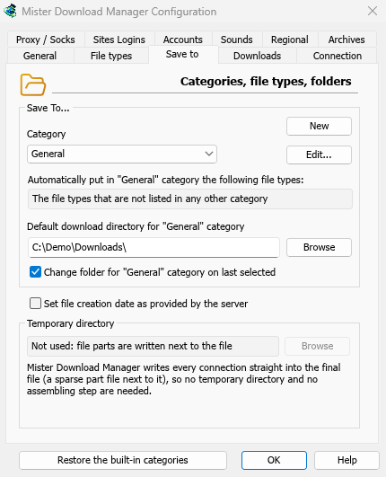
*Save to: each category's file types and folder.*

- **Category** — choose a category to see and change its settings below.
- **New** — make your own category. **Edit...** changes the selected one: its name, file types and folder. The built-in categories (Compressed, Documents, Music, Programs, Video) can be renamed, given other file types and deleted like your own; a renamed one keeps its folder. General and Torrents change only their folder.
- **Restore the built-in categories** — brings the built-in categories back as they came, after you renamed, retyped or deleted them.
- **Automatically put in "…" category the following file types** — the file types that go to this category.
- **Default download directory for "…" category** — the category's folder. Type a path or click **Browse**.
- **Change folder for "…" category on last selected** — when you pick another folder in **Download File Info**, it becomes the category's folder from then on. On by default. (It sets the first state of **Remember this path** in that window.)
- **Set file creation date as provided by the server** — give finished files the date the server reports, not the date you downloaded them.
- **Mark downloaded files as coming from the internet** — on by default. Every file MDM downloads (from the browser, a link you add, a video, a gallery, a torrent, and the files extracted from an archive) carries the mark a browser's downloads carry. On Windows that is the Mark of the Web: SmartScreen checks a program before it first runs, and Office opens a document in Protected View. On a Mac it is the quarantine attribute Gatekeeper checks; on Linux, where the file came from, which file managers show. Unticked, no download is marked. On Windows, MDM also follows the Group Policy **Do not preserve zone information in file attachments**, as browsers do: when it is on (for the computer or for you), no download is marked, whatever this box says.

MDM doesn't use a temporary folder: every connection writes straight into the final file's place, so there is nothing to put together at the end.

## Downloads

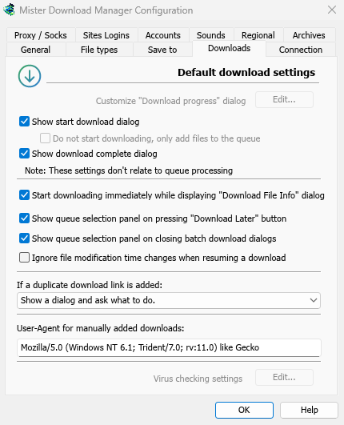
*Downloads: which windows show, and what a duplicate link does.*

- **Show start download dialog** — show **Download File Info** for each new download. With it off, downloads start at once, or only join the queue if you tick **Do not start downloading, only add files to the queue**.
- **Show download complete dialog** — show **Download complete** when a file finishes.
- **Start downloading immediately while displaying "Download File Info" dialog** — on by default, so the download is already under way while you choose a folder.
- **Show queue selection panel on pressing "Download Later" button** — ask which queue; off puts it in the **Main download queue**.
- **Show queue selection panel on closing batch download dialogs** — the same for batch downloads.
- **Ignore file modification time changes when resuming a download** — for servers that report a new date for the same file each time. Without it, such a server makes every resume start over.
- **If a duplicate download link is added** — ask, add it with a numbered name, overwrite the old one, or open the finished one / resume the unfinished one.
- **User-Agent for manually added downloads** — how MDM names itself to servers for downloads you add yourself. With **Automatic** ticked (the default), MDM introduces itself as your default browser: the User-Agent that browser sends, at the version you have installed (Chrome, Edge, Brave, Opera, Vivaldi, Firefox or Safari). The box shows it, and pointing at it names the browser. When MDM doesn't recognise your default browser, it sends a current Chrome's. Untick **Automatic** to type your own; tick it again to go back. Downloads from the browser use that browser's own User-Agent. If a site turns a browser's User-Agent away, MDM asks once more with its own.

## Connection

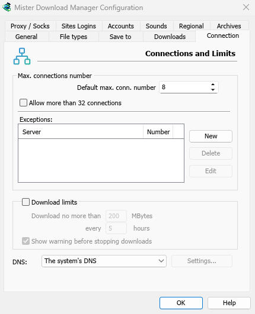
*Connection: how many connections, through which network adapter.*

- **Default max. conn. number** — how many connections each download may use, from 1 to 32 (8 by default). Type the number or use the arrows.
- **Allow more than 32 connections** — raises the most to 128, for the number above and for the exceptions. Most servers allow far fewer from one address; MDM notices and asks those for fewer. Turned off again, any higher number comes back to 32.
- **Exceptions** — a different number for some servers. **New** adds one (the server's name and the number of connections); **Edit** and **Delete** change or remove the selected one. Rows marked **(auto)** are limits MDM learned by itself from servers that refused more connections. They can't be edited and fade away by themselves.
- **Download limits** — download no more than a set amount every few hours. The same setting is in the Scheduler; see [Queues and the Scheduler](queues-and-scheduler.md#download-limits).
- **DNS** — which DNS turns the servers' names into addresses for MDM's downloads, its own downloads (helpers, updates) and FTP. **The system's DNS** is the default (on Windows 11 it can already be encrypted, in Windows' own network settings). Or pick **Cloudflare**, **Google**, **Quad9**, **AdGuard** or **NextDNS**, or **Another DNS...** to type your own; **Settings...** chooses how it's asked:
  - **DNS over HTTPS** (the default) or **DNS over TLS**: encrypted, so nobody on the way sees or changes the names you look up.
  - **Plain DNS**: not encrypted. MDM asks it over TCP, never UDP, so it never needs a firewall exception.
  - For your own DNS: the servers' IP addresses, the name their certificate shows (TLS), or the `https://` address (HTTPS, with its IP addresses if you know them). NextDNS takes your configuration ID.
  - **If it can't be reached, use the system's DNS**: off by default, so a DNS that doesn't answer stops the download with a message naming it rather than quietly showing your lookups to the system's DNS. A name the DNS says doesn't exist never falls back (that would undo a filtering DNS).
  - **Test** asks it for github.com and shows how long it took.

  The names in your hosts file, and local names (single words, `.local`, `.lan`, `.home.arpa`, `.internal`, `localhost`), stay with the system's DNS. Video pages (yt-dlp) and image galleries (gallery-dl) use the DNS you chose only while a [network adapter](#proxy--socks) is chosen; otherwise, like torrent trackers, they use the system's. With a proxy, the proxy looks up the names of the sites it reaches for you.

More in [Connections and speed](connections-and-speed.md).

## Proxy / Socks

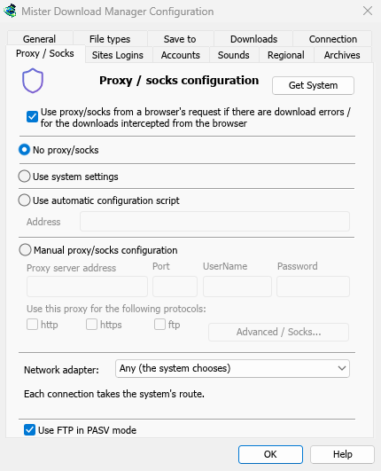
*Proxy / Socks: no proxy, the system's, or your own.*

- **No proxy/socks** — connect directly. This is the default.
- **Use system settings** — use the system's proxy: Windows' or macOS' settings, or on Linux the `https_proxy`, `http_proxy` and `all_proxy` variables of your session.
- **Use automatic configuration script** — the proxy auto-config (PAC) script your network gives: type its address (`http://…/proxy.pac`, or a file). MDM fetches it and asks it which proxy each download goes through (`PROXY`, `SOCKS` or `DIRECT`), as browsers do. Until it has been fetched, or if it can't be, MDM uses the system's settings.
- **Manual proxy/socks configuration** — type the proxy's address, **Port**, and a **UserName** and **Password** if it needs them, then tick the protocols it is for (**http**, **https**). For a SOCKS proxy, write the address as `socks5://host`.
- **Get System** — fill in the manual fields from Windows' proxy settings (on Windows).
- **Use proxy/socks from a browser's request…** — on by default. A download MDM takes from the browser goes through the proxy the browser used for it. That's the one a VPN or proxy extension set, the browser's own manual proxy, or its proxy auto-config script. Without it, the download would leave from your own address, and content limited to the VPN's country, or to its address, would fail. The browser extension reads that proxy and hands it to MDM with each download, once you switch on **Send downloads through this browser's proxy or VPN extension** in the extension's toolbar popup (Firefox asks you once; Chrome, Edge, Brave, Opera and Vivaldi ask nothing more: see [A VPN or proxy extension](browser-integration.md#a-vpn-or-proxy-extension)).
  - A proxy that asks for a login the VPN extension gives itself can't be shared: no other program has that login. The download then stops and says so, rather than going without the proxy. Use the VPN's own app, or choose its adapter under **Network adapter**.
  - In Firefox, MDM sees the proxy the browser's own request for the file took, including the ones a VPN extension picks for each request. In Chrome and the other Chromium browsers, it sees the browser's proxy settings: the server for the download's scheme (honouring their bypass list) or their proxy auto-config script.
  - When the browser used no proxy, and **No proxy/socks** is chosen, MDM uses Windows' proxy settings, as browsers do.
- **Network adapter** — **Any (the system chooses)** is the default. Pick an adapter, usually your VPN's, and every connection MDM opens goes out through it, or not at all. That covers downloads, FTP, torrents, video pages and image galleries, the DNS you chose, MDM's own downloads and the update check. It works as a kill switch: when the adapter disconnects, or the VPN is switched off, nothing goes out through your normal connection. Running downloads stop with "… is not connected" and start again when the adapter is back. The line under the list shows the adapter's address, or that it isn't connected.
  - How it holds: Windows binds the adapter's own address. Windows then sends those packets only through that adapter (its strong host model). Linux binds the device itself (Linux 5.7 or newer), and macOS binds the interface. An address of a kind the adapter doesn't have (IPv6 on an IPv4-only VPN) is refused, not sent around it.
  - The system's DNS asks the names in its own way, and Windows may ask over every adapter. To keep the names inside the adapter too, choose a DNS under [Connection](#connection) → **DNS**: MDM then asks it through the adapter.
  - Video pages and image galleries: yt-dlp, gallery-dl and the ffmpeg yt-dlp starts can't be held to an adapter themselves, so while one is chosen MDM gives them a proxy of its own on this computer (`127.0.0.1`, with a password only they get). MDM opens their connections through the adapter, as it opens its own, and looks the names up with the DNS you chose. When the adapter disconnects, their connections close and the downloads stop with the others. Video formats that can't go through a proxy (RTMP, RTSP, MMS, FTP) are refused rather than sent around it.
  - Not held to the adapter yet, so they don't start while one is chosen: `ftps://` (implicit TLS; `ftp://` with TLS is fine).
  - Connections to this computer itself (`localhost`) aren't bound. A proxy on this computer carries the downloads, and where it sends them is up to it.
  - On macOS a VPN that reconnects may get a new interface (`utun5` instead of `utun4`): pick it again.
- **Use FTP in PASV mode** — on by default: for FTP downloads MDM opens the data connections itself (passive mode), which works through routers and firewalls. Turn it off only for a server that needs active mode (the server connects back to you). FTP never goes through the proxy above, so its **ftp** box stays greyed. See [FTP and FTPS](adding-downloads.md#ftp-and-ftps).

## Sites Logins

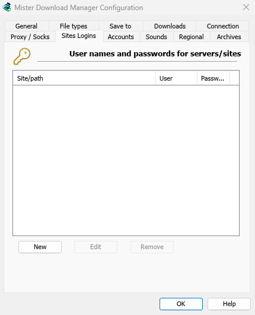
*Sites Logins: a user name and password per site.*

User names and passwords for sites that ask for them. **New** adds a row: the site (with a path if the login is only for part of it), the user name and the password. **Edit** and **Remove** change or delete the selected row. MDM uses the login for every download from that site. A login typed in **Add URL** (**Use authorization**) takes priority for that one download.

The passwords (these, the proxy's and the debrid accounts') are kept in the system's keychain: Windows Credential Manager, the keyring on Linux (Secret Service: GNOME Keyring, KeePassXC and others) or the macOS keychain; MDM's settings keep only a reference. A locked keyring is never unlocked for MDM: without one, they stay in MDM's settings, sealed for your Windows account on Windows. **Options → Accounts** says where they are. A [portable copy](portable.md) keeps them in its own folder.

**Cookies for video sites** — for videos that play only when you're signed in (YouTube's "Sign in to confirm you're not a bot"):

- **Off** (the default) — yt-dlp gets cookies only from the browser's extension, when you use the button over a video.
- **From browser** — yt-dlp reads the chosen browser's cookies on this computer (Firefox, Chrome, Edge, Brave, Opera, Vivaldi, Chromium, Whale; Safari on macOS) for every video it looks up or downloads, pasted addresses included. When the extension passed the page's own cookies, those are used instead. **Profile (optional)**: a profile's name or folder (**...** chooses one); empty, the one used last. Chrome, Edge and Brave lock their cookies on Windows: Firefox works. See [Sites that want you signed in](video.md#sites-that-want-you-signed-in).

## Accounts

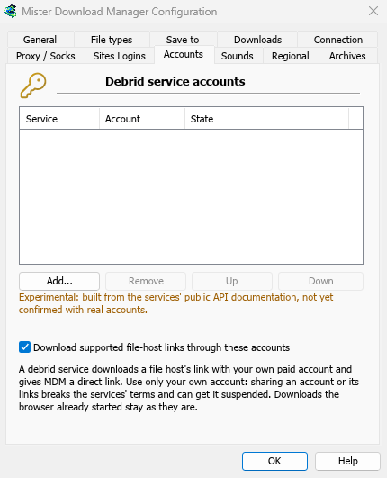
*Accounts: your debrid accounts.*

Your debrid service accounts (Real-Debrid, AllDebrid, Premiumize, TorBox, Mega-Debrid; experimental): **Add...** signs in by code in the browser, with your user name and password, or with your API token or key; a link from a host the service supports is then downloaded through it. The list's order is the order accounts are asked. See [Debrid service accounts](debrid.md).

## Sounds

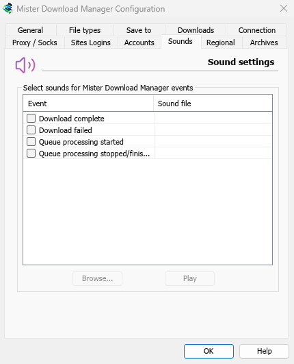
*Sounds: a sound for each event.*

Play a sound for **Download complete**, **Download failed**, **Queue processing started** and **Queue processing stopped/finished**. Tick an event, select it, click **Browse...** to choose a `.wav` file, and **Play** to hear it.

## Regional

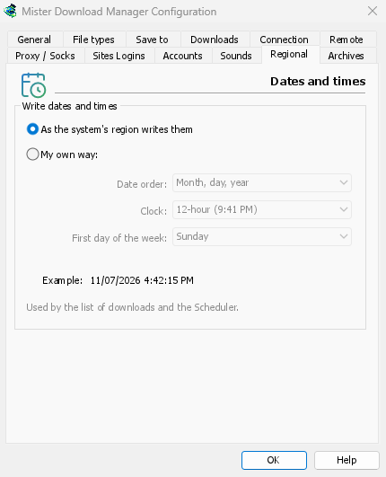
*Regional: dates and times as the system writes them, or your own way.*

How dates and times are written in the list of downloads and the Scheduler.

- **As the system's region writes them** (the default) — Windows' region settings (Settings → Time & language → Region); on macOS and Linux, your language's usual way. In English the list keeps IDM's own date text.
- **My own way** — choose the **date order** (day, month, year; month, day, year; or year, month, day), a **12- or 24-hour clock**, and the **first day of the week** in the Scheduler's calendar. **Example** shows the result.

## Archives

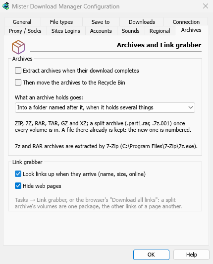
*Archives: extract when downloaded, and where the files go.*

Archives (zip, 7z, rar, tar, gz, xz), and [Link grabber](link-grabber.md).

- **Extract archives when their download completes** (off by default) — every archive downloaded, as soon as it (or a split archive's last volume) is in. A Link grabber package has its own **Extract when done**.
- **Then move the archives to the Recycle Bin** (off by default; the Trash on macOS and Linux) — after a successful extraction only. This is also the default of a new package's **Delete archives after extracting**.
- **What an archive holds goes** — into a folder named after it when it holds several things (the default), always into such a folder, or straight into the archive's folder.
- Whether **7-Zip** was found: 7z and RAR archives need it.
- **Look links up when they arrive (name, size, online)** — Link grabber asks each server about its file (on by default).
- **Hide web pages** — Link grabber's default for the same box (on).

## Remote

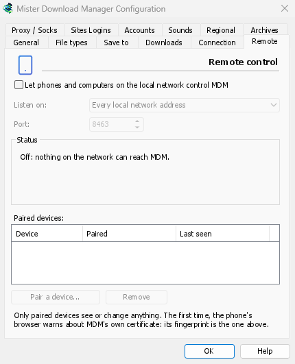

Control MDM from your phone or another computer on the local network: see
[Control MDM from your phone](remote-control.md).

- **Let phones and computers on the local network control MDM** (off by default).
- **Listen on** — every local network address (the default), this computer only, or one address.
- **Port** — 8463 by default.
- **Status** — what it is doing, the address to open on the phone, and the certificate's
  fingerprint.
- **Paired devices** — **Pair a device...** shows a QR code and a code; **Remove** unpairs the
  device selected, at once.

## Elsewhere

A few settings live outside this window:

- **Downloads → Speed Limiter → Settings...** — speed limits. See [Connections and speed](connections-and-speed.md#speed-limiter).
- **Tasks → Torrent settings...** — sharing and file associations. See [Torrents](torrents.md#torrent-settings).
- **View → Dark Mode support**, **Always dark**, **Theme**, **Draw with**, **Interface size** and **Language**. See [Getting started](getting-started.md#themes) and [Troubleshooting](troubleshooting.md).
- **Help → Check for updates...** — **Check for updates at every start** is in that window.

## Next steps

- [Connections and speed →](connections-and-speed.md)
- [Browser integration →](browser-integration.md)
- [Languages →](languages.md)
