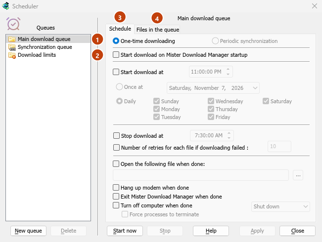

# Queues and the Scheduler

[← Back to docs index](README.md)

A **queue** is a list of downloads that run in order, a few at a time. The **Scheduler** starts and stops queues by the clock, and decides what happens when a queue is done.

## Queues

MDM comes with two queues:

- **Main download queue** — where **Download Later**, batch downloads and imported lists go. A download leaves it when it is finished.
- **Synchronization queue** — finished downloads stay in it instead of leaving. It is the only queue that takes finished downloads.

You can add your own queues in the Scheduler, or with **Create new queue** in a download's right-click menu.

### Put downloads in a queue

- In **Download File Info**, click **Download Later** and pick the queue.
- Or select downloads in the list, right-click and choose **Add to queue**, then the queue. A download that is already in a queue shows **Move to queue** instead.
- To take a download out of its queue, right-click it and choose **Delete from queue**. The download stays in the list.

The **Q** column shows which downloads are in a queue. Under **Queues** in the categories pane, select a queue to see only its downloads.

### Start and stop a queue

- **Start Queue** and **Stop Queue** on the toolbar start and stop the **Main download queue**. The arrow next to each button lists every queue.
- **Downloads → Start queue** and **Downloads → Stop queue** list them too.
- Or right-click a queue under **Queues** and choose **Start now** or **Stop**.

A running queue starts its downloads in list order, a few at a time (four by default). When one fails, it moves to the end of the queue and is tried again 30 seconds later. The queue stops when nothing is left to download.

## The Scheduler window

Open it with **Scheduler** on the toolbar or **Downloads → Scheduler**. Right-clicking a queue and choosing **Schedule** or **Edit queue** opens it on that queue.


*1 the queues, 2 Download limits, 3 the queue's schedule, 4 its files.*

The queues are on the left, with **Download limits** below them. The right side shows the selected queue on two tabs, **Schedule** and **Files in the queue**.

- **New queue** asks for a name and adds a queue. **Delete** removes one of your own queues; the two built-in queues can't be deleted. A deleted queue's downloads stay in the list.
- **Start now** and **Stop** run or halt the selected queue straight away.
- **Apply** saves your changes. **Close** closes the window.

## Schedule: starting and stopping on time

- **Start download on Mister Download Manager startup** — start the queue whenever MDM starts.
- **Start download at** — a time, then either:
  - **Once at** a date, or
  - **Daily**, on the days you tick.
- **Stop download at** — a time to stop the queue if it is still running.
- **Number of retries for each file if downloading failed** — how often a failed download is tried again before the queue gives up on it. Without it, MDM keeps trying.

To set a time, click a part of it (hours, minutes, seconds) and use the arrows, the mouse wheel, **Up** / **Down** or the number keys. **Left** and **Right** move between the parts.

MDM has to be running for a schedule to fire. It can sit in the tray: closing the main window doesn't quit it.

## Wake the computer to run a queue

Tick **Wake the computer to run this queue**, under the start time, and a computer that is asleep at the start time is woken for it. It needs **Start download at**.

- MDM wakes the computer a minute before the start time, so the network is back when the queue starts.
- While the queue runs, the computer doesn't go to sleep. When the queue is done, the computer's own sleep settings apply again: a computer nobody is using goes back to sleep by itself. **Turn off computer when done → Sleep** sends it back to sleep at once.
- The line under the option says when the computer will next be woken, or why it can't be.
- MDM has to be running (it can sit in the notification area). The computer has to be asleep, not shut down.
- The wake follows the schedule: change the start time or the days, untick the option or delete the queue, and the wake moves or goes away. MDM sets it again each time it starts. Nothing stays behind in the system when MDM quits or is uninstalled.

### Windows

Windows wakes a computer only if its power plan allows wake timers. If it doesn't, the Scheduler says so, and **Change** opens the setting: **Power Options → Change plan settings → Change advanced power settings → Sleep → Allow wake timers**. Choose **Enable**: **Important Wake Timers Only** lets only Windows' own important timers wake the computer. On laptops the setting is often off on battery, so the computer is woken only while plugged in.

### Linux

On Linux only an administrator may set the computer's wake alarm, so the option is greyed until an administrator allows it. To let the users in a `wakealarm` group set it, an administrator runs, once:

```sh
sudo groupadd --system wakealarm
sudo usermod -aG wakealarm "$USER"
echo 'z /sys/class/rtc/rtc0/wakealarm 0664 root wakealarm -' | sudo tee /etc/tmpfiles.d/wakealarm.conf
sudo systemd-tmpfiles --create /etc/tmpfiles.d/wakealarm.conf
```

then signs out and in again. The setting stays after a restart. The computer has one wake alarm: if another program has set it, MDM leaves it alone and says so.

A user's systemd timer can't wake the computer, and `rtcwake` needs root, so without this setting MDM can't wake the computer. MDM never asks for an administrator's password.

### macOS

On macOS only an administrator can schedule a wake, so the option is greyed. MDM doesn't ask for an administrator's password. An administrator can have the Mac wake every day a minute before the queue starts, for example at 10:59 PM for a queue that starts at 11:00 PM:

```sh
sudo pmset repeat wakeorpoweron MTWRFSU 22:59:00
```

`sudo pmset repeat cancel` removes it.

## Schedule: when the queue is done

- **Open the following file when done** — for example a sound, a script or a program. **...** picks the file.
- **Hang up modem when done** — ends a dial-up connection, if you use one.
- **Exit Mister Download Manager when done**.
- **Turn off computer when done** — choose **Shut down**, **Sleep** or **Hibernate**.
  - MDM first shows a 30-second countdown. **Cancel** stops it; **Turn off now** goes ahead at once.
  - **Force processes to terminate** closes programs that would otherwise hold Windows up.

## Files in the queue

- **Download [N] files at the same time** — how many of the queue's downloads run together. The rest wait their turn.
- The list shows the queue's downloads in the order they will run. The arrow buttons under it move the selected download down or up; the cross takes it out of the queue.

## Download limits

For an internet plan with a data cap, select **Download limits** on the left:

1. Tick **Download limits**.
2. Fill in **Download no more than [N] MBytes every [H] hours**. It starts at 200 MBytes every 5 hours.
3. Click **Apply**.

When the limit is reached, MDM stops downloading. New downloads show **Waiting: the download limit is reached (Scheduler)**. Everything resumes on its own when the period is over. **Show warning before stopping downloads** tells you when this happens and when downloads will go on.

The same setting is in **Options → Connection**.

## Next steps

- [Tutorial: download overnight →](guide-download-overnight.md)
- [Keep some speed for everything else →](guide-keep-speed-for-everything-else.md)
- [The download list →](download-list.md)
