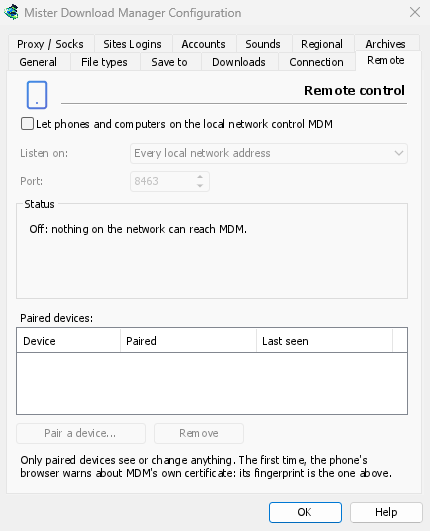
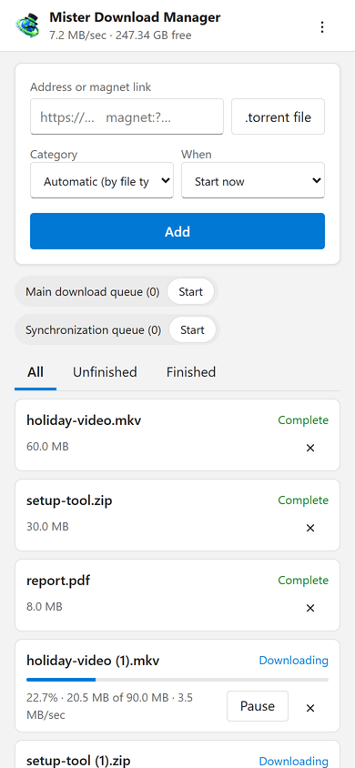

# Control MDM from your phone

Add a download from your phone, or from another computer at home, and watch it run on the
computer where MDM is: paste a link or a magnet link, send a `.torrent` file, see the list with
its progress, and pause, start or remove downloads. Your phone opens a small page that MDM
itself serves; nothing is installed on the phone, and no outside service is involved.

The remote control is **off until you turn it on**, it answers **only phones and computers you
paired** with a code MDM shows, and it listens **only on your local network** (your Wi-Fi or your
cable), never on an address the internet can reach.

## Turn it on

1. **Options → Remote**.
2. Tick **Let phones and computers on the local network control MDM**.
3. Click **OK**.

The page then says **On** and shows the address to open, such as `https://192.168.1.20:8463/`.

The first time, Windows may ask whether to let MDM communicate on networks: allow it on private
networks, or the phone can't reach MDM.

## Pair your phone

1. On the computer: **Options → Remote → Pair a device...** It shows a QR code, the address and an
   8-digit code.
2. On the phone, on the same Wi-Fi: scan the QR code with the camera (or type the address).
3. The browser warns that the connection's certificate isn't trusted. That is expected: MDM made
   its own certificate, on your computer, and no public authority knows it. To be sure the page is
   your MDM's, open the warning's details: the certificate's **SHA-256 fingerprint** is the one
   **Options → Remote** shows. Then continue to the page (**Advanced → Proceed** in Chrome,
   **Show details → visit this website** in Safari).
4. The code is filled in when you scanned the QR code; otherwise type it. Give the phone a name,
   and tap **Pair**. The window on the computer says so, and closes with **Done**.

A code works once, for ten minutes, and not after five wrong tries: click **New code** for
another. To keep the page one tap away, add it to the phone's home screen (the browser's menu:
**Add to Home screen**).

## What the page does

- **Add**: a download's address or a magnet link, or a `.torrent` file from the phone. Pick a
  **Category** (or let the file's type pick it), and **When**: **Start now**, or wait in a queue.
  A torrent is added with all its files, once MDM has read them (a magnet link can take a moment).
- **The list**: every download with its progress, speed and size, with **All**, **Unfinished**
  and **Finished**. **Pause** and **Start** each one; **×** removes it from the list, and with
  **Delete the file too**, deletes its file from the computer.
- **The queues**: start and stop each one.
- The bar at the top shows the total speed and the free space where your downloads go.

Downloads added from the phone are like the ones you add on the computer: they go into the
category's folder, follow the queues, the Scheduler and the speed limits, and go through the
network adapter you chose in **Options → Proxy / Socks** (and stop when it disconnects). The
page shows the language your phone uses when MDM has it, and follows its light or dark mode.

## Your paired devices

**Options → Remote** lists the paired devices, when each was paired and when it was last seen.
Select one and click **Remove**: it is refused from its next request on, at once (no need for
**OK**). On the phone, the page's **⋮ → Forget this device** does the same from that side.

Lost your phone? Remove it in Options. To stop everyone at once, untick the box: nothing listens
any more.

## Where it listens

- **Listen on**: **Every local network address** (the default) listens on each private address of
  the computer (`192.168.x.x`, `10.x.x.x`, `172.16–31.x.x`, and IPv6's `fd…`), one by one, and
  follows them when you join another network. **This computer only** listens on `127.0.0.1`. Or
  pick one address of one adapter.
- **Port**: `8463` unless another program uses it; then pick another (1024 to 65535).

Don't make MDM reachable from the internet (a router's port forwarding): the remote control is
made for your home network. To reach it while away, use a VPN to your home network instead
(WireGuard, Tailscale): with Tailscale, choose its address in **Listen on**.

## Security

What keeps the remote control safe, in short:

- **Off by default**, and nothing listens while it is off.
- **Paired devices only**: every request but pairing needs the token the device got when it
  paired. A pairing code works once, for ten minutes, with five tries, and tries are slowed down.
  The settings keep a fingerprint of each token, not the token.
- **Your local network only**: MDM listens on the computer's private addresses, one by one, never
  on every address at once.
- **Encrypted**: HTTPS, with a certificate made on your computer and kept; its fingerprint is in
  Options, to compare with the one the phone's browser shows.
- **Web pages can't use it**: requests must name MDM's own address, come from its own page, and
  carry the token; MDM's page can't be shown inside another site.
- **Only downloads**: a paired device lists, adds, pauses, starts and removes downloads, and
  starts and stops queues. It can't change settings, open windows on the computer, or see
  folders (the list it gets has no paths).

Found a problem? Please report it privately, as [SECURITY.md](../SECURITY.md) says.
