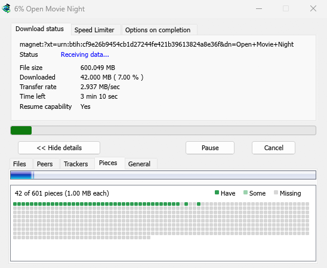

# Torrents

[← Back to docs index](README.md)

MDM downloads BitTorrent files from magnet links and `.torrent` files. Torrents appear in the same list as other downloads, marked **Torrent** in the **Source** column, and can be queued and scheduled like them.

## Add a torrent

1. Click **Add Torrent** on the toolbar to choose a `.torrent` file. Or click the arrow next to it and choose **Open torrent file...** or **Add magnet link...** (also under **Tasks**).
2. **Add torrent** opens. Paste a magnet link into **Torrent**, or click **...** to choose a `.torrent` file, then click **Look up**.
3. MDM reads the torrent and shows its files as a folder tree. A `.torrent` file is read at once. A magnet link first has to get the file list from other peers, which can take a minute or two.
4. Untick the folders or files you don't want. **Select all** and **Select none** help with big torrents. **Selected** shows how many files and how much data you picked.
5. Check **Save to**. **Files go to** shows the exact folder. Torrents have their own category, so by default this is `Downloads\Torrents`.
6. Click **Download Now**, or **Later** to add it to the list without starting.

You can also paste a magnet link into **Add URL**, or drop a magnet link or a `.torrent` file on the drop target (**Tasks → Show drop target**). If a torrent is already in the list, MDM says so instead of adding it twice.

## While it downloads

Double-click the torrent in the list to open its progress window. Besides the usual status, a torrent's window has five tabs:

- **Files** — each file, its size and how much of it is done. Files you unticked show **Skipped**.
- **Peers** — the computers you are downloading from, with how much you received from and sent to each.
- **Trackers** — the torrent's trackers. With none, peers come from the DHT and other peers.
- **Pieces** — a map of the torrent's pieces: there, partly there, or missing.
- **General** — the info hash, pieces, peers, how much was sent, the share ratio and the folder.

## Torrent settings

Choose **Tasks → Torrent settings...** (or the arrow next to **Add Torrent**):

- **Keep sharing torrents after they finish** — off by default: a finished torrent stops, like any download. Turn it on to keep uploading to other peers after your download is complete.
- **Open magnet links and .torrent files with Mister Download Manager** — Windows then opens magnet links in your browser and `.torrent` files in Explorer with MDM. This is for your Windows account only; a program you chose in Windows' **Open with** stays first. The setup can turn it on for you.

MDM starts its torrent engine the first time you add a torrent. If you never use torrents, it never listens for peers.

## Next steps

- [Queues and the Scheduler →](queues-and-scheduler.md)
- [Video downloads →](video.md)
- [The download list →](download-list.md)
