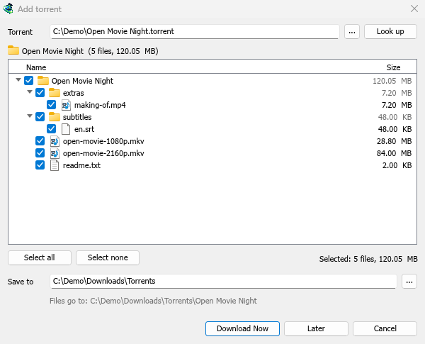
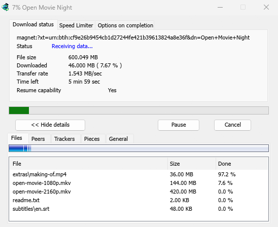
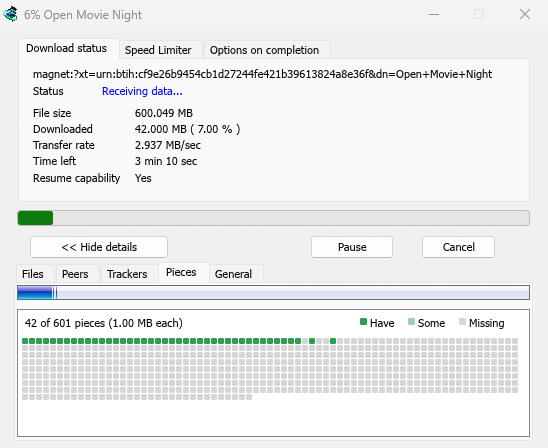

# Torrents

[← Back to docs index](README.md)

MDM downloads BitTorrent files from magnet links and `.torrent` files. Torrents appear in the same list as other downloads, marked **Torrent** in the **Source** column, and can be queued and scheduled like them.

## Add a torrent

1. Click **Add Torrent** on the toolbar to choose a `.torrent` file. Or click the arrow next to it and choose **Open torrent file...** or **Add magnet link...** (also under **Tasks**).
2. **Add torrent** opens. Paste a magnet link into **Torrent**, or click **...** to choose a `.torrent` file, then click **Look up**.
3. MDM reads the torrent and shows its files as a folder tree. A `.torrent` file is read at once. A magnet link first has to get the file list from other peers, which can take a minute or two.
4. Untick the folders or files you don't want. **Select all** and **Select none** help with big torrents. **Selected** shows how many files and how much data you picked.
5. Check **Save to**. **Files go to** shows the exact folder. Torrents have their own category, so by default this is `Downloads\Torrents`.
6. Click **Download Now**, or **Later** to add it to the list without starting.

You can also paste a magnet link into **Add URL**, or drop a magnet link or a `.torrent` file on the drop target (**Tasks → Show drop target**). If a torrent is already in the list, MDM says so instead of adding it twice.

A `.torrent` file's web address works too: paste it into **Add URL** or **Torrent**, or let the browser hand the download over. MDM fetches the file, with the browser's cookies when the browser sent it, and **Add torrent** shows what it holds. The browser hands `.torrent` downloads over because `TORRENT` is in **Options → File types**. It's there by default; a list you had before this version keeps what it had, so add `TORRENT` to it yourself. **Download with Mister Download Manager** on a link always hands it over. A command line with `/n` (silent) saves the `.torrent` file itself, like any file. MDM fetches at most 10 MB: anything bigger isn't a `.torrent` file.

If some of the torrent's files are already in the folder, MDM asks before using them. **Yes** keeps them for the torrent: MDM checks them, keeps what matches the torrent and downloads the rest, which is how you continue a download started elsewhere or share files you already have. **No** (the default) goes back, so you can choose another folder and nothing of yours is overwritten.

MDM refuses a torrent with file names your system can't write safely, says which name, and writes nothing. What others can see, the network switches in **Torrent settings**, blocklists and proxies: [Torrents and your security](torrent-security.md).

## While it downloads

Double-click the torrent in the list to open its progress window. Besides the usual status, a torrent's window has five tabs:

- **Files** — each file, its size and how much of it is done. Files you unticked show **Skipped**. Tick or untick a file's box to change what is downloaded, even while the torrent runs. At least one file stays ticked. If you untick everything still missing, the torrent finishes. If a finished torrent that isn't running gets a file back, it waits as stopped until you resume it, so nothing downloads unseen.
- **Peers** — the computers you are downloading from, with how much you received from and sent to each.
- **Trackers** — the torrent's trackers. With none, peers come from the DHT and other peers.
- **Pieces** — a map of the torrent's pieces: there, partly there, or missing.
- **General** — the info hash, pieces, peers, how much was sent, the share ratio, how long it has been shared and the folder. What was sent and the time shared add up over all of the torrent's runs: they don't start again at 0 after a pause or a restart of MDM.

The tabs stay once the torrent has finished, for as long as it is shared.

The **Speed Limiter** tab of a torrent's window has, besides its download limit, **Limit uploading** to a speed of your choice. That limit is kept with the torrent: it applies again whenever the torrent runs or shares. A torrent can't be held under 16 KBytes/sec either way.

## Torrent commands

Right-click a torrent in the list and open **Torrent**:

- **Recheck files** — reads every piece of the torrent's files and checks it, for example after you moved files in or a disk had errors. A running torrent goes on afterwards and fetches what is missing. A stopped one stays stopped. Its event log says how much was found: a finished torrent with a damaged piece becomes stopped, and resuming it fetches the piece again.
- **Reannounce** — asks the torrent's trackers for peers again now, instead of waiting for their next round. It works while the torrent runs or is shared.
- **Add trackers...** — adds trackers, one address a line (`http`, `https` or `udp`). They are kept with the torrent, after the ones it has, and the **Trackers** tab shows them. A tracker on your computer or your local network is refused: MDM never contacts those ([why](torrent-security.md)).
- **Copy magnet link** — copies a magnet link for the torrent, with its trackers.

Each command's outcome goes into the torrent's event log; hover its **Status** cell in the list to read it.

## Torrent settings

Choose **Tasks → Torrent settings...** (or the arrow next to **Add Torrent**):

- **Keep sharing torrents after they finish** — off by default: a finished torrent stops, like any download. Turn it on to keep uploading to other peers after your download is complete.
  - **Stop sharing at a share ratio of** — a finished torrent stops being shared once it has sent that many times what it has (2.00: twice). Off by default.
  - **Stop sharing after sharing for … minutes** — or once it has been shared that long, over all its runs. Off by default.

  A torrent stopped by one of these says so in its event log, and isn't shared again when MDM starts. Raise or turn off the limit to share it again.
- **Limit uploading for all torrents to** — off by default. Caps what all your torrents together send to other peers, while they download and while they share. A torrent's own upload limit, in its progress window, applies on top of it.
- **Open magnet links and .torrent files with Mister Download Manager** — Windows then opens magnet links in your browser and `.torrent` files in Explorer with MDM. This is for your Windows account only; a program you chose in Windows' **Open with** stays first. The setup can turn it on for you.

MDM starts its torrent engine the first time you add a torrent. If you never use torrents, it never listens for peers.

## Next steps

- [Queues and the Scheduler →](queues-and-scheduler.md)
- [Video downloads →](video.md)
- [The download list →](download-list.md)
