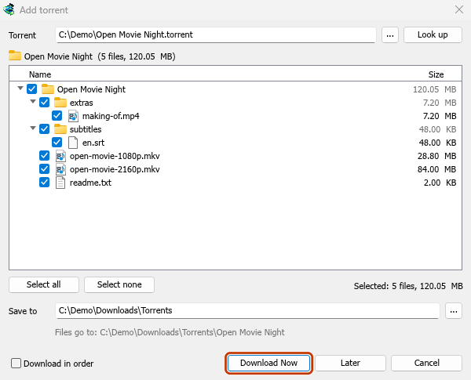
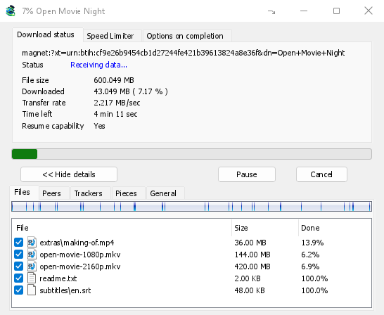
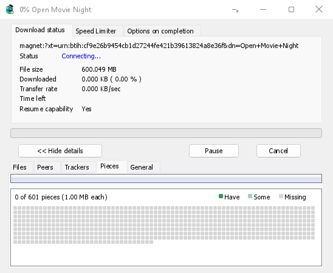
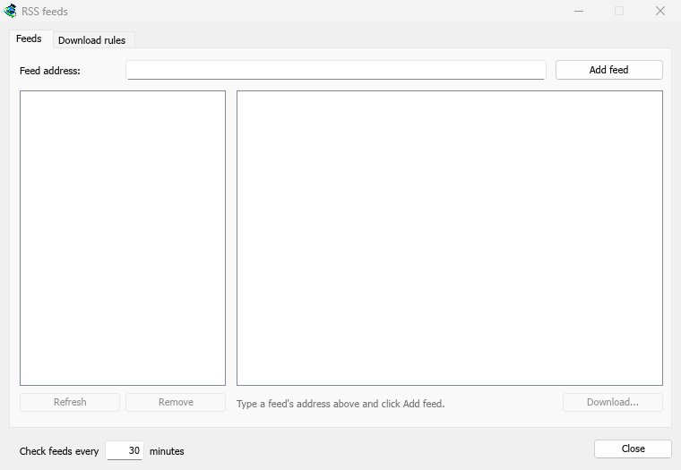
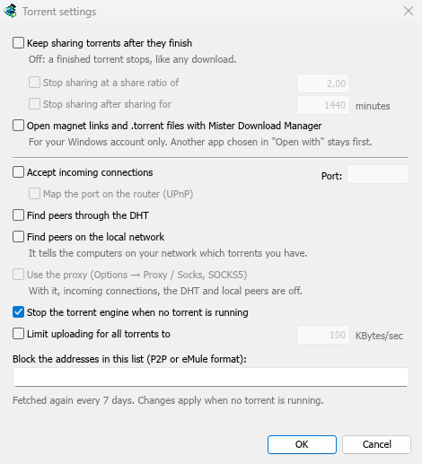

# Torrents

[← Back to docs index](README.md)

MDM downloads BitTorrent files from magnet links and `.torrent` files. Torrents appear in the same list as other downloads, marked **Torrent** in the **Source** column, and can be queued and scheduled like them.

## Add a torrent

1. Click **Add Torrent** on the toolbar to choose a `.torrent` file. Or click the arrow next to it and choose **Open torrent file...** or **Add magnet link...** (also under **Tasks**).
2. **Add torrent** opens. Paste a magnet link into **Torrent**, or click **...** to choose a `.torrent` file, then click **Look up**.
3. MDM reads the torrent and shows its files as a folder tree. A `.torrent` file is read at once. A magnet link first has to get the file list from other peers, usually within seconds. While it waits, **Add torrent** shows how many peers it found, from the trackers, the DHT or your local network, and how many answered. After 30 seconds without an answer, it says what may be in the way: a link with no trackers while the DHT is off, or a firewall, a VPN or a network that blocks BitTorrent.
4. Untick the folders or files you don't want. **Select all** and **Select none** help with big torrents. **Selected** shows how many files and how much data you picked.
5. Check **Save to**. **Files go to** shows the exact folder. Torrents have their own category, so by default this is `Downloads\Torrents`.
6. To watch a video while it downloads, tick **Download in order** (see [Download in order](#download-in-order)).
7. Click **Download Now**, or **Later** to add it to the list without starting.

<!-- steps -->

1. 
   *Untick what you don't want, then Download Now.*
2. 
   *Its progress window: each file and how much of it is here.*
3. 
   *Pieces: the torrent's map, filling in.*

You can also paste a magnet link into **Add URL**, or drop a magnet link or a `.torrent` file on the drop target (**Tasks → Show drop target**). If a torrent is already in the list, MDM says so instead of adding it twice.

A `.torrent` file's web address works too: paste it into **Add URL** or **Torrent**, or let the browser hand the download over. MDM fetches the file, with the browser's cookies when the browser sent it, and **Add torrent** shows what it holds. The browser hands `.torrent` downloads over because `TORRENT` is in **Options → File types**. It's there by default; a list you had before this version keeps what it had, so add `TORRENT` to it yourself. **Download with Mister Download Manager** on a link always hands it over. A command line with `/n` (silent) saves the `.torrent` file itself, like any file. MDM fetches at most 10 MB: anything bigger isn't a `.torrent` file.

If some of the torrent's files are already in the folder, MDM asks before using them. **Yes** keeps them for the torrent: MDM checks them, keeps what matches the torrent and downloads the rest, which is how you continue a download started elsewhere or share files you already have. **No** (the default) goes back, so you can choose another folder and nothing of yours is overwritten.

MDM refuses a torrent with file names your system can't write safely, says which name, and writes nothing. What others can see, the network switches in **Torrent settings**, blocklists and proxies: [Torrents and your security](torrent-security.md).

## While it downloads

Double-click the torrent in the list to open its progress window. Besides the usual status, a torrent's window has five tabs:

- **Files** — each file, its size and how much of it is done. Files you unticked show **Skipped**. Tick or untick a file's box to change what is downloaded, even while the torrent runs. At least one file stays ticked. If you untick everything still missing, the torrent finishes. If a finished torrent that isn't running gets a file back, it waits as stopped until you resume it, so nothing downloads unseen.
- **Peers** — the computers you are downloading from, with how much you received from and sent to each.
- **Trackers** — the torrent's trackers. With none, peers come from the DHT and other peers.
- **Pieces** — a map of the torrent's pieces: there, partly there, or missing.
- **General** — the info hash, pieces, peers, how much was sent, the share ratio, how long it has been shared and the folder. What was sent and the time shared add up over all of the torrent's runs: they don't start again at 0 after a pause or a restart of MDM.

The tabs stay once the torrent has finished, for as long as it is shared.

The **Speed Limiter** tab of a torrent's window has, besides its download limit, **Limit uploading** to a speed of your choice. That limit is kept with the torrent: it applies again whenever the torrent runs or shares. A torrent can't be held under 16 KBytes/sec either way.

## Torrent commands

Right-click a torrent in the list and open **Torrent**:

- **Recheck files** — reads every piece of the torrent's files and checks it, for example after you moved files in or a disk had errors. A running torrent goes on afterwards and fetches what is missing. A stopped one stays stopped. Its event log says how much was found: a finished torrent with a damaged piece becomes stopped, and resuming it fetches the piece again.
- **Reannounce** — asks the torrent's trackers for peers again now, instead of waiting for their next round. It works while the torrent runs or is shared.
- **Add trackers...** — adds trackers, one address a line (`http`, `https` or `udp`). They are kept with the torrent, after the ones it has, and the **Trackers** tab shows them. A tracker on your computer or your local network is refused: MDM never contacts those ([why](torrent-security.md)).
- **Download in order** — downloads the torrent's files from their start (see below). Click it again to go back to the rarest pieces first.
- **First and last pieces first** — with **Download in order**, each file's first and last pieces come before the rest. It's on by default.
- **Copy magnet link** — copies a magnet link for the torrent, with its trackers.

Each command's outcome goes into the torrent's event log; hover its **Status** cell in the list to read it.

## Download in order

By default MDM downloads the pieces that the fewest peers have first, as BitTorrent programs usually do. That way a piece only one peer has is fetched before that peer leaves, and MDM can pass it on to others sooner. On MDM's test swarms it finished just as fast as downloading in order, and it was the only order that finished when a scarce piece's only holder left.

**Download in order** gets a file's start first instead, so you can watch a video while it downloads: open it in your player once the first part is in. Tick it in **Add torrent**, or choose **Torrent → Download in order** in the list's right-click menu, any time, even while it runs. The next pieces asked for follow the new order.

- With **First and last pieces first** (on by default), each file's last pieces come early too. Most video files keep their index at the end, and a player reads it before anything plays.
- Several files are downloaded one after another, sorted by name.
- Slower peers take pieces a little further on, so the start isn't waiting for them.

A torrent in order isn't faster to finish, and it helps the swarm less: use it for what you want to watch now.

## RSS feeds

Many sites publish their new torrents as an RSS or Atom feed. MDM can watch feeds, list what they hold, and add the new torrents you want by itself. Choose **Tasks → RSS feeds...**, or click the arrow next to **Add Torrent**.

*RSS feeds, and the rules that pick what to download.*

**Feeds** tab:

- Type a feed's address into **Feed address** and click **Add feed**. MDM fetches it at once, then every 30 minutes; change that under **Check feeds every ... minutes**, 5 at the least.
- Pick a feed on the left to see its articles. An article with a torrent shows a torrent icon and its size when the feed gives it. Double-click one, or select it and click **Download...**, to open **Add torrent** with it, as for any magnet link or `.torrent` address.
- **Refresh** fetches the selected feed now. **Remove** stops watching it. A feed that can't be read is shown in red, and its line at the bottom says why.

**Download rules** tab: a rule adds the torrents of new articles whose titles it matches, without asking.

- **Must contain**: words the title must contain, all of them, in any order. `|` separates alternatives (`1080p|2160p`), and `*` and `?` are wildcards. Case doesn't matter.
- **Must not contain**: words that make the rule skip an article, written the same way.
- **Regular expressions**: the two boxes hold regular expressions instead.
- **Episodes**: which episodes to take, read from `S01E05` or `1x05` in the title. `1x2` is season 1 episode 2, `1x5-8` episodes 5 to 8, `2x1-` everything from season 2 episode 1 on, and `3` all of season 3, separated by `;`. Empty: any article. A rule takes each episode once: a second release of an episode it already added is skipped.
- **Save to**: the folder its torrents go to; empty, the Torrents category's folder. **Add them without starting them** adds them as **Download Later** would.
- **Feeds**: the feeds it watches; none ticked, all of them.

Rules only look at articles that are new since the feed was last fetched, and a feed's first fetch only lists what is there. So adding a feed or a rule never downloads a whole backlog. **Matches ... articles now** shows which of the articles the feeds hold now the rule matches, to check it; download those by hand. A torrent the list already has isn't added again, and neither is one whose files are already in the folder: MDM never writes into files it didn't make without asking. The bottom line of the tab says what the rules did last, and a torrent a rule added says so in its event log.

Feeds and rules are kept in `rss.json` in MDM's data folder. MDM reads at most 5 MB of a feed.

## Torrent settings

Choose **Tasks → Torrent settings...** (or the arrow next to **Add Torrent**):

*Tasks → Torrent settings...*

- **Keep sharing torrents after they finish** — off by default: a finished torrent stops, like any download. Turn it on to keep uploading to other peers after your download is complete.
  - **Stop sharing at a share ratio of** — a finished torrent stops being shared once it has sent that many times what it has (2.00: twice). Off by default.
  - **Stop sharing after sharing for … minutes** — or once it has been shared that long, over all its runs. Off by default.

  A torrent stopped by one of these says so in its event log, and isn't shared again when MDM starts. Raise or turn off the limit to share it again.
- **Limit uploading for all torrents to** — off by default. Caps what all your torrents together send to other peers, while they download and while they share. A torrent's own upload limit, in its progress window, applies on top of it.
- **Open magnet links and .torrent files with Mister Download Manager** — Windows then opens magnet links in your browser and `.torrent` files in Explorer with MDM. This is for your Windows account only; a program you chose in Windows' **Open with** stays first. The setup can turn it on for you. On Linux it makes MDM your desktop's default app for them; on macOS, their default app (Finder offers MDM in **Open With** for `.torrent` files either way, and a double-click opens them in MDM when no other app is their default).

The same window has the network switches (incoming connections, the port, UPnP, the DHT, a SOCKS5 proxy) and the blocklist: see [Torrents and your security](torrent-security.md).

MDM starts its torrent engine the first time you add a torrent. If you never use torrents, it never listens for peers.

To find peers without trackers, MDM joins the DHT through four public routers (`dht.libtorrent.org`, `dht.transmissionbt.com`, `router.bittorrent.com` and `router.utorrent.com`); any one that answers is enough. It keeps the DHT nodes it found for the next start, so later starts don't depend on those routers.

MDM's log (`logs\mdm.log` in [MDM's data folder](crash-reports.md#where-reports-are-kept)) says where it listens, for example `torrents: listening for peers on TCP port 51413 (every address, IPv4 and IPv6: [::]:51413)`. That is one socket for IPv4 and IPv6, so on Windows `netstat -ano -p tcp` (IPv4 only) doesn't list it; `netstat -ano` or `Get-NetTCPConnection -State Listen` does, under `[::]` or `::`.

On a Linux system without CA certificates (a minimal install without the `ca-certificates` package), torrents still work: peers, the DHT and `http://` trackers. An `https://` tracker can't be checked there, so MDM skips it; install that package to use those too.

With a debrid account, torrents and magnet links can go to the service instead of to peers, and MDM downloads the files from it over HTTP: see [Torrents through the service](debrid.md#torrents-through-the-service).

## Next steps

- [Queues and the Scheduler →](queues-and-scheduler.md)
- [Video downloads →](video.md)
- [The download list →](download-list.md)
