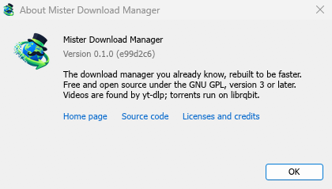

# Troubleshooting

[← Back to docs index](README.md)

## First, look at what happened

Every download keeps a log of its recent events: retries, redirects, the server's answers and errors.

- Hover over the download's **Status** in the list to see them.
- Or open its progress window (double-click an unfinished download). The connection table shows what each connection is doing, and **Retrying** with the reason when one fails.
- **File Properties** (**Alt+Enter**) shows **Last try** and its **Result**.

## A download says Error

1. Read the reason (hover over **Status**).
2. Select the download and click **Resume**. Many errors are a server or connection having a bad moment.
3. If the link has expired (common for links from sites you sign in to, or links with a time limit in them), get a new one: right-click → **Refresh download address**. See [Resume a broken download](guide-resume-broken-download.md).
4. If it says **the file changed on the server**, the file isn't the one MDM started with. Right-click → **Redownload** to start again from the beginning.

## A download starts over instead of resuming

- Look at **Resume capability** in the progress window. **No** means the server can't send a file in parts, so MDM can't continue it later.
- Some servers report a new date for the same file every time. Tick **Options → Downloads → Ignore file modification time changes when resuming a download**.

## Downloads are slow

- Check that the Speed Limiter is off: **Downloads → Speed Limiter → Turn off**. Also look at **Downloads → Speed Limiter → Settings... → Limit all downloads together to**, which applies even with the limiter off.
- Check the download's own **Speed Limiter** tab in its progress window.
- Check **Options → Connection**. A low **Default max. conn. number**, or an exception for the server, means fewer connections. Rows marked **(auto)** are servers that refused more connections; MDM can't do more there.
- Check **Download limits** in the Scheduler. When the limit is reached, downloads wait with **Waiting: the download limit is reached (Scheduler)**.

## The browser doesn't send downloads to MDM

1. Was MDM installed with the setup, with **Set up browser integration** ticked? A portable copy can't take browser downloads. Run the setup again to add it.
2. Is the extension loaded and turned on? Look for **Mister Download Manager Integration Module** on the browser's extensions page. In Firefox, a temporary add-on is gone after a restart. See [Browser integration](browser-integration.md).
3. Is **Options → General → Use advanced browser integration** on, and your browser ticked under **Capture downloads from the following browsers**?
4. Is the file's type in **Options → File types**? Only listed types are taken. The same goes for **Download with Mister Download Manager** on the right-click menu: if the link's address doesn't end in a listed type, nothing happens.
5. Is the site in **Don't start downloading automatically from the following sites**?

When none of this helps, the browser keeps the download, so nothing is lost.

## The Scheduler didn't start the queue

- MDM must be running at that time. Closing the window is fine (it stays in the tray); **Tasks → Exit** is not.
- Did you click **Apply** after setting the time?
- **Daily** starts only on the ticked days. **Once at** starts only on that date.
- A computer that is asleep doesn't run anything until it wakes.

## A video won't download

See [If a video won't download](video.md#if-a-video-wont-download).

## A magnet link takes a long time

A magnet link has to get the torrent's file list from other peers first. That can take a minute or two, and longer for torrents with few peers. If nobody answers in about three minutes, MDM gives up; try again later, or use the `.torrent` file if the site offers one.

## The setup or MDM won't start

- If Windows says **Windows protected your PC**, click **More info**, check that the file is `MisterDownloadManager-<version>-setup.exe` from the [Releases](https://github.com/anefzaoui/misterdownloadmanager/releases) page, then click **Run anyway**.
- MDM runs only once. Starting it again brings the running copy's window to the front. If nothing appears, look for MDM's icon in the notification area.

## Where your data is

- Installed or the plain zip: `%APPDATA%\misterdownloadmanager`. The list and settings are in `downloads.json`.
- Portable: the `data` folder next to `misterdownloadmanager.exe`.

To back up your list, quit MDM (**Tasks → Exit**) and copy `downloads.json`.

## Updates

**Help → Check for updates...** tells you whether a newer version is out, and what is new in it. **Check for updates once a week** in that window lets MDM look by itself. New versions are on the [Releases](https://github.com/anefzaoui/misterdownloadmanager/releases) page.

**Help → About Mister Download Manager** shows the version you have.

## Reporting a problem

Choose **Help → Report a problem**. It opens the bug report form on GitHub with your MDM version, your system and its version, how MDM was installed and its interface language already filled in. Describe what happened, what you expected and the steps that make it happen. For a download, include the address if you can share it, and the reason shown under **Status**.

You can also [open the form yourself](https://github.com/anefzaoui/misterdownloadmanager/issues/new?template=bug.yml); it asks for the same details.

## Next steps

- [Resume a broken download →](guide-resume-broken-download.md)
- [Browser integration →](browser-integration.md)
- [Back to the docs index →](README.md)
