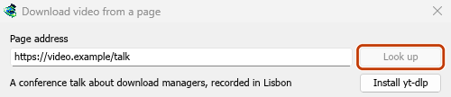
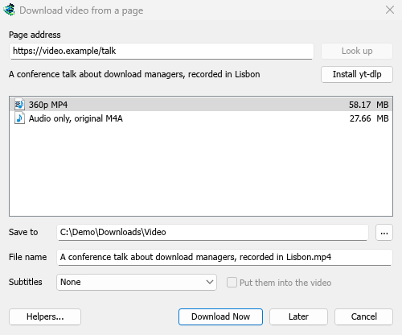
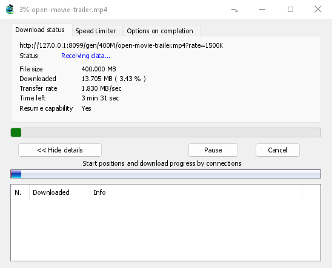
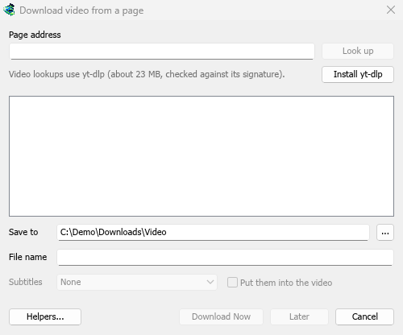
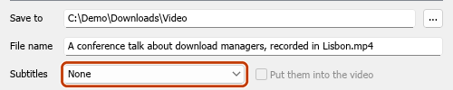
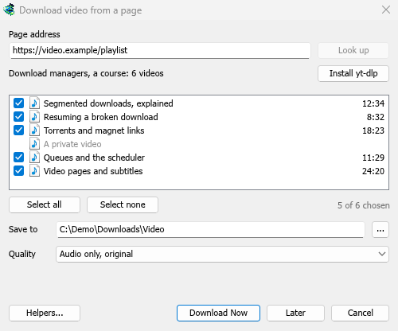
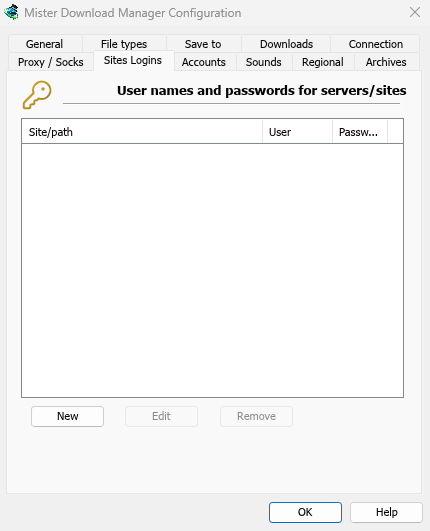

# Video downloads

[← Back to docs index](README.md)

MDM downloads videos from their web pages: YouTube, Vimeo, Dailymotion, Twitch, TikTok, X, Instagram, Facebook, Reddit, SoundCloud and well over a thousand other sites. **yt-dlp**, an open-source program whose community keeps it working as sites change, finds the video on the page; MDM's own downloader then brings it in, the way it downloads any file.

## Start a video download

- Give the video's page address to **Add URL** (**Ctrl+N**). MDM recognises video pages and opens the video window, already looking the page up.
- Or choose **Tasks → Download video from a page...**, paste the address into **Page address** and click **Look up**.

Any other page address that turns out to be a web page, not a file, is offered to the video window too.

<!-- steps -->

1. 
   *Paste the page's address and click Look up.*
2. 
   *Pick a quality, then Download Now.*
3. 
   *It downloads like any other file, in its own row and window.*

## yt-dlp and ffmpeg

MDM offers its two helpers on its first start, and again the first time they are needed. It
downloads them from their official releases with its own downloader, so a cut connection
resumes, and uses your proxy settings:

- **yt-dlp** (about 23 MB) looks the page up and finds where the video and its sound come from; MDM downloads them ([How a video comes down](#how-a-video-comes-down)). The first time, click **Install yt-dlp**. MDM checks the download against the signature yt-dlp's developers publish before it uses it.
- **ffmpeg** (about 80 MB) joins a video and its sound when a site keeps them apart, which most sites do for the higher qualities, and turns the sound into an MP3, Opus or FLAC file. Click **Install ffmpeg** when MDM offers it. MDM checks it against the checksums its release publishes.

Both are kept in a `tools` folder in MDM's data folder.

### Use your own copies

On Linux and macOS, MDM finds yt-dlp, ffmpeg and gallery-dl on your `PATH` and in the usual package-manager folders, including Homebrew's. A program you selected yourself takes priority, followed by MDM's own installed copy. The system copy is used when neither is present, and your package manager keeps it up to date: MDM never downloads over it on its own. If your distribution's yt-dlp is old, **Use MDM's own copy** in Helpers downloads MDM's, which keeps itself current and is used from then on.

Already have yt-dlp or ffmpeg for another program? Use those instead of a second copy: in **Download video from a page**, click **Helpers...**, then **Use another program...** beside yt-dlp or ffmpeg, and choose the program. MDM runs it once to check that it is that program, and uses it from then on, the command line too. MDM doesn't update a program you chose: keep it up to date yourself (yt-dlp: `yt-dlp -U`, or your package manager). **Use MDM's own copy** goes back to the one MDM downloads and checks.

*Helpers...: use your own yt-dlp or ffmpeg instead.*

### A JavaScript runtime for YouTube {#javascript-runtime}

YouTube hides most of a video's qualities behind small puzzles that yt-dlp solves with a JavaScript runtime: **Deno**, **Node.js** or **Bun**. Without one, the list is short, sometimes only the sound and a low quality, and MDM says so: *YouTube needs a JavaScript runtime to list its video qualities*. Other sites don't need one.

Install one of them, either works, then look the video up again. MDM finds Deno, Node.js (also one installed with nvm) and Bun by itself. If it still says so, the new program's folder isn't on the `PATH` MDM started with (Windows' installers add it for programs started after them): quit MDM (**Tasks → Exit**) and start it again.

- **Windows**: `winget install DenoLand.Deno`, or `winget install OpenJS.NodeJS.LTS`. The installers on [deno.com](https://deno.com) and [nodejs.org](https://nodejs.org) work too.
- **Ubuntu and Debian**: `sudo apt install nodejs`
- **Fedora**: `sudo dnf install nodejs`
- **Arch**: `sudo pacman -S nodejs`, or `sudo pacman -S deno`
- **macOS**: `brew install deno`, or `brew install node`
- **Any system**, Deno for your user alone: `curl -fsSL https://deno.land/install.sh | sh` (on Windows, in PowerShell: `irm https://deno.land/install.ps1 | iex`)

A distribution's yt-dlp can also be too old for YouTube: if the list stays short, click **Use MDM's own copy** beside yt-dlp in **Helpers...**.

## Choose the quality

1. Wait for the list. It shows each quality with its size, best first, then the sound alone:
   - A video's line says its resolution, its codec, its frame rate and whether it is HDR: `2160p · AV1 · 60 fps · HDR`. A resolution that comes in several (AV1, VP9 and H.264, HDR and SDR) has a line for each: AV1 makes the smallest file, H.264 plays on the most devices, and an HDR video looks washed out on a screen without HDR. `SDR` is said only beside an HDR line of the same resolution.
   - The size is that of exactly what downloads, the video and its sound. A size with `~` before it (`~532 MB`) is only an estimate: the site didn't say the size, so it comes from the stream's bitrate and length.
   - **Audio only, original**: the site's own file, not converted, once for each type the site has it in (WebM with Opus inside, M4A), the best first. The best sound there is, in the smallest file.
   - **Audio only MP3** at its best variable bitrate (VBR) and at 320, 256, 192 and 128 kbps, for players that only take MP3.
   - **Audio only OPUS**: an `.opus` file. When the site's sound is Opus already (YouTube's usually is), it's only moved into that file, not converted, so nothing is lost.
   - **Audio only FLAC**: a lossless `.flac` file, for a library or a program that wants FLAC. It can't add quality: the site's sound is already compressed with losses, and FLAC keeps it exactly as it came, in a file several times bigger. The window says so when you choose it.
2. Pick one. Without ffmpeg, only the qualities that come with their sound are listed, and no MP3, Opus or FLAC (ffmpeg makes them).
3. Check **Save to** (the Video category's folder by default) and **File name**, which comes from the video's title.
4. Choose **Subtitles** if you want them (see below). **Embed chapters** is ticked: see [Chapters](#chapters).
5. Click **Download Now**, or **Later** to add it to the list without starting.

The video then downloads like any other file, with its own row in the list and its progress window.

## How a video comes down

yt-dlp looks the page up and picks the quality's video and sound. MDM's own downloader then brings each of them in, one after the other, the way it downloads any file:

- **Over several connections**: as many as **Options → Connection** gives a file. The progress window's connections table shows each one, and the segment map shows the video and then its sound.
- **A stream sent in many small pieces** (HLS, DASH, as most sites other than YouTube send theirs) comes down that many pieces at once, each kept on disk as it arrives, then joined in order into one file, as yt-dlp joins them. Pieces encrypted with AES-128 are decrypted with the key the stream's playlist names. When their addresses expire, MDM asks yt-dlp for the stream's new list and carries on with the pieces still missing.
- **Under your speed limits**: the **Speed Limiter**'s, the video's own (its progress window's **Speed Limiter** tab), and the limit for all downloads together. A change applies at once.
- **Paused and resumed** like a file, also after quitting MDM: it carries on from the bytes already saved.
- **When an address stops working**: a video's addresses are signed and expire after a few hours (YouTube's after six). MDM asks yt-dlp for a fresh one for the same quality and carries on from where it stopped.

Then yt-dlp does what it does after a download: it joins the video and its sound with ffmpeg into one MP4, saves or embeds the subtitles, puts the chapters into the file, and converts the sound for an MP3, Opus or FLAC choice.

YouTube serves each connection's long requests slowly, so MDM asks for the video in pieces of 10 MB at most, as yt-dlp does, and several at once.

Some videos yt-dlp still downloads by itself, over its own connection, and the progress window says so:

- a live stream still being recorded;
- a stream sent over RTMP, RTSP, MMS or FTP;
- the rare streams in pieces of other kinds (Adobe's HDS, Microsoft's Smooth Streaming), and one whose key the site hands yt-dlp directly.

For those, a new speed limit starts the download again with it, from where it was ([Speed limits](#speed-limits)).

## Subtitles

When the video has subtitles, the **Subtitles** list offers them: the uploader's own languages first (and **All the uploader's** when there are several), then the site's automatic captions, marked *automatic*. Of those, only the ones in the language spoken and their translations into English and your interface language are listed; sites like YouTube offer a machine translation into every language they know.

*Choose the subtitles; tick Put them into the video to keep them inside the file.*

- Saved beside the video, they get its name and the language: `My video.fr.srt`. Players such as VLC and MPV pick them up on their own. With ffmpeg they're always SRT; without it, the site's own format (often WebVTT, `.vtt`).
- **Put them into the video** puts them inside the file instead, as tracks you switch on in the player. It needs ffmpeg, and an MP4 or MKV video.
- A sound-only choice (**Audio only**, MP3, Opus, FLAC) has no subtitles.

MDM offers the same choice again for the next video when it has that language.

A site may refuse subtitles when it's asked too often: YouTube does, most of all for its translated captions. The video is saved all the same. MDM asks for the subtitles once more after 20 seconds, and if they still don't come, the **Download complete** window and the download's log say which ones are missing and why. Try them again later. When subtitles meant to go inside the video only come on that second try, they're saved beside it instead.

## Chapters

Many videos are split into chapters on their page: YouTube's list under the player, with a title and a start time for each part. With **Embed chapters** ticked, under **Subtitles**, they go into the video file, so players such as VLC, MPV, MPC-HC and Windows' Media Player list them and skip from one to the next.

- It's ticked to begin with, and stays as you leave it for the next video.
- It needs ffmpeg, which writes them. A video without chapters is saved as it is.
- They go into a video (MP4, MKV, WebM) and into the sound as the site has it (**Audio only, original**), not into an MP3, Opus or FLAC file.
- The command line (`video-get`) puts them in too, whenever ffmpeg is there.

## Playlists and channels

Paste the address of a playlist (`youtube.com/playlist?list=…`) or a channel's videos (`youtube.com/@name/videos`) and click **Look up**. Instead of one video's qualities, the window lists the list's videos, each with its length.

*A playlist: every video ticked, one quality for all.*

- A playlist is listed whole, as its videos come in: the line above the list says how far it is ("Listing the videos: 1,200 of 6,000"). **Stop listing** keeps the ones listed so far, and **List the rest** carries on from there. If the site stops answering part-way (YouTube may, when it's asked too often), the window says after how many videos and why, and **List the rest** tries again from there.
- A channel is listed 50 videos at a time, newest first. **Load more** lists the next 50.
- Every video starts ticked. Untick the ones you don't want, or use **Select all** and **Select none**. Private and deleted videos are greyed out and can't be ticked.
- **Quality** applies to every video: **Best quality**, **Up to** a height (each video at that height, or the nearest below it), **Audio only, original**, **Audio only MP3**, **Audio only OPUS** or **Audio only FLAC**. Without ffmpeg, only the qualities that come with their sound are offered, and no MP3, Opus or FLAC.
- The videos go into a folder named after the list, inside **Save to**, each under its own title.

**Download Now** adds each video as its own download and starts the main queue, which runs as many at once as you set in the [Scheduler](queues-and-scheduler.md) (**Download N files at the same time**). **Later** adds them without starting. Adding more than 500 at once asks first.

MDM lists at most 20,000 videos of one list.

A page address that points at one video inside a playlist or a mix (for example `watch?v=…&list=…`) downloads that one video, never the whole list.

## Speed limits

Videos keep to the [Speed Limiter](connections-and-speed.md#speed-limiter): the limit for one file, a video's own limit (the **Speed Limiter** tab of its progress window), and the limit for all downloads together, which they share with every other download. MDM's own downloader brings them in, so a change applies at once, as for a file.

A video yt-dlp downloads by itself ([How a video comes down](#how-a-video-comes-down)) takes a limit only as it starts: when you turn the limiter on or off, change its settings or the video's own limit, MDM stops it and starts it again with the new limit, and it goes on from where it was (the log says "Stopped: the speed limit changed; starting again with it"). Under the limit for all downloads, such videos share it evenly: when another starts, the ones running with more than their share start again with it; when one ends, the others keep theirs. A gallery's pictures that MDM brings in follow a change at once; what gallery-dl still fetches itself starts again with the new limit, skipping the files already saved. Other changes (torrents taking more or less of the limit for all downloads, **Only while I'm using the computer**) apply to the next one that starts.

## Through a VPN's adapter

With **Options → Proxy / Socks → [Network adapter](options.md#proxy--socks)** set, video downloads go through that adapter too, with the same kill switch as other downloads. MDM's own downloader opens its connections through the adapter as for any file; for yt-dlp's look-ups (and what it downloads itself, with the ffmpeg it starts) MDM hands it a proxy of its own on this computer, and opens every connection through the adapter, looking the names up with the DNS you chose in **Options → Connection** (without an adapter, yt-dlp uses the system's DNS). When the adapter disconnects, the video download stops, and it starts again when the adapter is back. Formats sent over RTMP, RTSP, MMS or FTP can't go through it and are refused.

## Sites that want you signed in

Some videos play only for a signed-in viewer: a member's or a private video, an age-restricted
one. And YouTube sometimes asks any viewer from a network it doubts (a VPN, a shared or
cloud address) to "Sign in to confirm you're not a bot". yt-dlp then needs your browser's
cookies, the small files that keep you signed in.

- **The Download video button over the video** passes that page's cookies, from the window and
  profile you're in (a private window, a Firefox container), for the look-up and the download,
  so you're signed in as you are in the browser. Nothing to set up. Each cookie goes with the
  domain the browser keeps it for, so a sign-in on YouTube Music (music.youtube.com) or
  YouTube's mobile site reaches www.youtube.com too.
- **A pasted address** (Add URL, Download video from a page, a playlist): choose your browser in
  **Options → Sites Logins → Cookies for video sites**. yt-dlp then reads that browser's cookies
  on this computer for every video it looks up or downloads. When the extension passed the
  page's own cookies, those are used instead: they are that page's and that session's.
- **A spare account, in a profile of its own**: you don't have to lend yt-dlp your main
  account. Make a second profile in your browser, sign in to the site there with a spare
  account, and put that profile in **Profile** (its name, or its folder with **...**). yt-dlp
  reads that profile's cookies only. yt-dlp's developers advise this too: a site may limit an
  account it sees used by a program.

*Cookies for video sites: off, or a browser and its profile.*

Sign in to the site in that browser first. MDM never logs or shows the cookies; the download's
log names only the browser they came from.

### Which browsers

**From browser** lists the browsers yt-dlp reads: Firefox, Chrome, Edge, Brave, Opera, Vivaldi,
Chromium and Whale, and Safari on macOS. **Profile** is optional: a profile's name (`Profile 1`)
or its folder; empty, the profile used last.

- **Firefox** works on every system. If you signed in only moments ago with Firefox open, close
  it once so it writes the sign-in to its files.
- **Chrome, Edge and Brave on Windows** lock their cookies to themselves (Chrome 127 and later,
  "app-bound encryption"), and yt-dlp can't read them while the browser is open either. The
  window says so; choose Firefox, or use the button over the video, which works with any
  browser.
- **On Linux**, Chrome-family browsers keep the key to their cookies in the system's keyring
  (GNOME Keyring, KWallet); yt-dlp asks it, so it must be unlocked.
- **Another browser built on Chromium** (Helium, Thorium, ungoogled-chromium...): choose
  **Chromium** and that browser's profile folder (its `Default` folder, or `Profile 1`...;
  under `~/.config` on Linux, `%LOCALAPPDATA%` on Windows). yt-dlp reads the folder, but a browser that keeps its
  key under its own name in the keyring, or locks its cookies as Chrome does, can't be read
  this way: use its extension's button.

## When a video server can't be reached

Some sites, YouTube among them, send each viewer to a nearby video server, sometimes one inside the internet provider's own network. If that server can't be reached from your connection, a browser quietly switches to another one, but yt-dlp on its own would give up. Before each video download MDM checks the servers in the video's links and, if one doesn't answer, switches to the next one the site lists. The download's log says when this happens.

## If a video won't download

- Hover over the download's **Status**, or open its progress window, to read yt-dlp's message.
- **No video this can download on that page** means yt-dlp found nothing on the page. Check that the address is the video's own page.
- **This video needs you to be signed in**, or the site wants you signed in: see [Sites that want you signed in](#sites-that-want-you-signed-in).
- Sites change often, and a newer yt-dlp usually fixes it. MDM doesn't update yt-dlp on its own yet. To get the newest one: quit MDM (**Tasks → Exit**), delete the `tools\yt-dlp` folder in MDM's data folder (`%APPDATA%\misterdownloadmanager`, or the `data` folder of a portable copy), start MDM, open the video window and click **Install yt-dlp**.
- Videos protected with DRM (most paid streaming services) can't be downloaded, and MDM doesn't try. The browser extension's [Media on this page](browser-integration.md#media-on-this-page) shows such a stream as **Protected** and doesn't send it.
- A page whose video the window can't find: play the video in your browser, then use the extension's [Media on this page](browser-integration.md#media-on-this-page) to send the stream the page loaded.
- Downloading may be against some sites' terms. Checking that is up to you.
- Still stuck? Use **Help → Report a problem** and include the page address.

## Next steps

- [Tutorial: download a video from a page →](guide-video-from-page.md)
- [Torrents →](torrents.md)
- [Troubleshooting →](troubleshooting.md)
