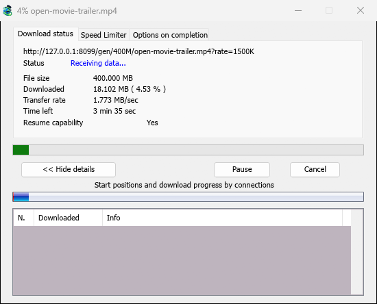

# Video downloads

[← Back to docs index](README.md)

MDM downloads videos from their web pages: YouTube, Vimeo, Dailymotion, Twitch, TikTok, X, Instagram, Facebook, Reddit, SoundCloud and well over a thousand other sites. It does this with **yt-dlp**, an open-source program whose community keeps it working as sites change.

## Start a video download

- Give the video's page address to **Add URL** (**Ctrl+N**). MDM recognises video pages and opens the video window, already looking the page up.
- Or choose **Tasks → Download video from a page...**, paste the address into **Page address** and click **Look up**.

Any other page address that turns out to be a web page, not a file, is offered to the video window too.

## yt-dlp and ffmpeg

MDM offers its two helpers on its first start, and again the first time they are needed. It
downloads them from their official releases with its own downloader, so a cut connection
resumes, and uses your proxy settings:

- **yt-dlp** (about 23 MB) looks the page up and downloads the video. The first time, click **Install yt-dlp**. MDM checks the download against the signature yt-dlp's developers publish before it uses it.
- **ffmpeg** (about 80 MB) joins a video and its sound when a site keeps them apart, which most sites do for the higher qualities. Click **Install ffmpeg** when MDM offers it. MDM checks it against the checksums its release publishes.

Both are kept in a `tools` folder in MDM's data folder.

## Choose the quality

1. Wait for the list. It shows each resolution with its size, best first, and **Audio only** at the end.
2. Pick one. Without ffmpeg, only the qualities that come with their sound are listed.
3. Check **Save to** (the Video category's folder by default) and **File name**, which comes from the video's title.
4. Click **Download Now**, or **Later** to add it to the list without starting.

The video then downloads like any other file, with its own row in the list and its progress window. yt-dlp brings it in over one stream of its own, so the window's connections table stays empty.

## Playlists and mixes

A page address that points at one video inside a playlist or a mix (for example `watch?v=…&list=…`) downloads that one video, never the whole list.

## When a video server can't be reached

Some sites, YouTube among them, send each viewer to a nearby video server, sometimes one inside the internet provider's own network. If that server can't be reached from your connection, a browser quietly switches to another one, but yt-dlp on its own would give up. Before each video download MDM checks the servers in the video's links and, if one doesn't answer, switches to the next one the site lists. The download's log says when this happens.

## If a video won't download

- Hover over the download's **Status**, or open its progress window, to read yt-dlp's message.
- **No video this can download on that page** means yt-dlp found nothing on the page. Check that the address is the video's own page.
- Sites change often, and a newer yt-dlp usually fixes it. MDM doesn't update yt-dlp on its own yet. To get the newest one: quit MDM (**Tasks → Exit**), delete the `tools\yt-dlp` folder in MDM's data folder (`%APPDATA%\misterdownloadmanager`, or the `data` folder of a portable copy), start MDM, open the video window and click **Install yt-dlp**.
- Videos protected with DRM (most paid streaming services) can't be downloaded, and MDM doesn't try.
- Downloading may be against some sites' terms. Checking that is up to you.
- Still stuck? Use **Help → Report a problem** and include the page address.

## Next steps

- [Tutorial: download a video from a page →](guide-video-from-page.md)
- [Torrents →](torrents.md)
- [Troubleshooting →](troubleshooting.md)
